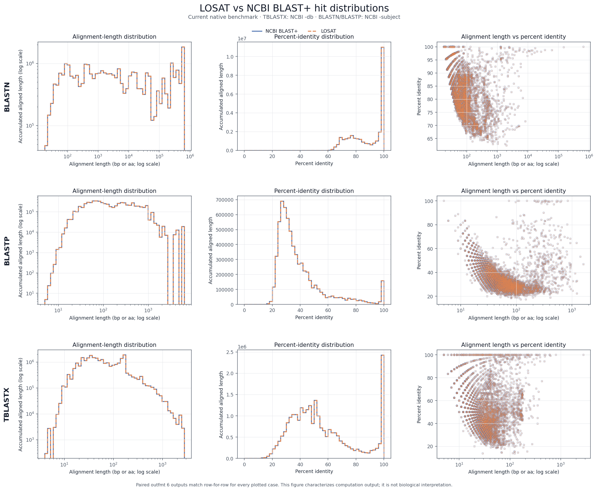
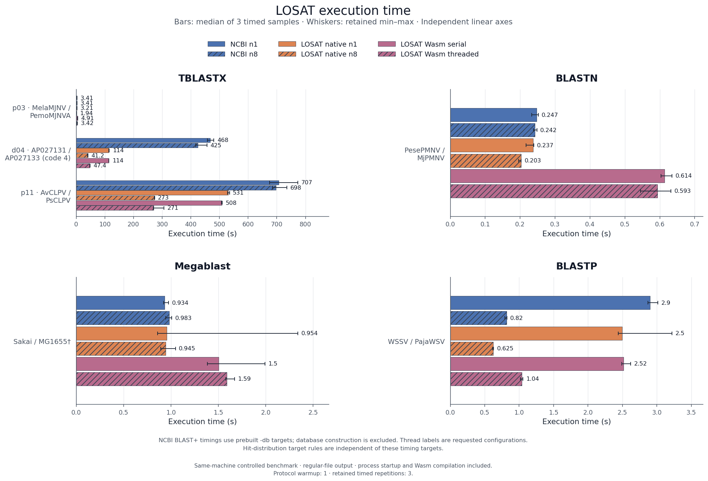

# LOSAT: LOcal Sequence Alignment Tool

[](LICENSE)
[](https://www.rust-lang.org)
[](https://anaconda.org/bioconda/losat)
[](https://anaconda.org/bioconda/losat)
[](#webassembly-wasm-integration)
[](https://anaconda.org/bioconda/losat)
[](https://anaconda.org/bioconda/losat)
[](https://anaconda.org/bioconda/losat)
[](https://anaconda.org/bioconda/losat)


**LOSAT** is a lightweight, pure-Rust reimplementation of the NCBI BLAST sequence alignment algorithm designed specifically for pairwise sequence-to-sequence comparisons (`-query` vs `-subject`).

On certified pairwise profiles and fixtures, LOSAT is checked against declared NCBI source, executable, or API oracle contracts for scores, E-values, coordinates, and output. Exact-byte parity applies where each contract requires it; documented local subject genetic-code exceptions apply to TBLASTX and TBLASTN. LOSAT runs without external C/C++ libraries, BLAST+ installations, or pre-formatted database indices. Built for high portability, LOSAT runs natively on modern operating systems and compiles directly to WebAssembly for client-side, zero-install genomic analyses in web browsers and sandboxed runtimes.

---

## Key Highlights

- **NCBI-Verified Certified Fixtures**: Matches the declared NCBI source, CLI, or API oracle contract on certified fixtures, including exact output bytes where required and the documented local subject genetic-code exceptions.
- **Pure Rust, Zero Dependencies**: Standalone single executable. Does not wrap, link, or shell out to external NCBI binaries or libraries.
- **Direct Pairwise Alignment**: Compares FASTA files directly via `-query` and `-subject` without running `makeblastdb`.
- **WebAssembly Ready**: Compiles to serial and threaded command-WASI (see [Platforms](#platforms)) and runs in the browser through the [Web GUI (preview)](#web-gui-preview). Browser/reactor APIs exist for integrations such as [gbdraw](https://github.com/satoshikawato/gbdraw).
- **Corrected TBLASTX Genetic Codes**: Fully respects `-db_gencode` for translated subject sequences in pairwise searches (resolving NCBI BLAST+'s default fallback to standard code; see [Scope & Differences](#scope--differences-from-ncbi-blast)).
- **High Performance**: Multithreaded execution via Rayon natively and shared-memory threading in WebAssembly (`wasm32-wasip1-threads`).

---

## Supported Programs & Tasks

| Program | Supported Tasks | Output Formats (`-outfmt`) | Description |
|:---|:---|:---|:---|
| **`blastn`** | `megablast` (default), `blastn`, `dc-megablast`, `blastn-short` | `0`, `5`, `6`, `7`, `8`, `9`, `12`, `13`, `14`, `15`, `16`, `17` (see [Output formats](#output-formats)) | Nucleotide vs. nucleotide alignment |
| **`blastx`** | `blastx`; native and Wasm entry points | `0`, `5`, `6`, `7`, `8`, `9`, `12`, `13`, `14`, `15`, `16` (see [Output formats](#output-formats)) | Nucleotide query vs. protein subject; [CLI scope and release status](docs/losatx_blastx_native_cli.md) |
| **`blastp`** | `blastp` (default), `blastp-fast` | `0`, `5`, `6`, `7`, `8`, `9`, `12`, `13`, `14`, `15`, `16` (see [Output formats](#output-formats)) | Protein vs. protein alignment |
| **`tblastx`** | `tblastx` | `0`, `5`, `6`, `7`, `8`, `9`, `12`, `13`, `14`, `15`, `16` (see [Output formats](#output-formats)) | Translated 6-frame nucleotide vs. nucleotide alignment |
| **`tblastn`** | `tblastn` (default) | `0`, `5`, `6`, `7`, `8`, `9`, `12`, `13`, `14`, `15`, `16` (see [Output formats](#output-formats)) | Protein query vs. translated nucleotide subject; [v0.2.0 fixture-scoped contract](docs/release/v0.2.0.md) |
| **`psiblast`** | the first round (`-num_iterations 1`, the default) | `0`, `6`, `7` | Position-Specific Iterated BLAST: the first round, blastp's search with psiblast's report (see [section 7](#7-psi-blast-psiblast-first-round)) |

> **Not supported**: `-task blastp-short` and `-task tblastn-fast` are rejected at the command line with an error message.
>
> **Note**: Tabular output (`-outfmt 6` and `7`) writes the 12 standard BLAST fields:  
> `qseqid sseqid pident length mismatch gapopen qstart qend sstart send evalue bitscore`.  
> BLASTP and BLASTX also accept a custom field list (for example `-outfmt "6 qseqid sseqid evalue"`); BLASTN, TBLASTN and TBLASTX write the standard fields only. `delim=` is rejected.

---

## Output formats

The `-outfmt` numbers that the five NCBI BLAST+ 2.17.0 programs (`blastn`, `blastp`, `blastx`, `tblastn`, `tblastx`) write; `19` and `21` belong to igblastn and magicblast. Every LOSAT program reads `-outfmt` as NCBI does and gives NCBI's error for a value that NCBI rejects. A format that NCBI writes and LOSAT does not write yet is rejected with "output format N is not supported by LOSAT's PROGRAM" before the inputs are read. The default is `0`.

| `-outfmt` | NCBI name | NCBI programs that write it | LOSAT |
|:---|:---|:---|:---|
| `0` | Pairwise | all five | all five programs |
| `1` | Query-anchored showing identities | all five | not yet |
| `2` | Query-anchored no identities | all five | not yet |
| `3` | Flat query-anchored showing identities | all five | not yet |
| `4` | Flat query-anchored no identities | all five | not yet |
| `5` | BLAST XML | all five | all five programs (with `-subject` and `-db`) |
| `6` | Tabular | all five | all five programs |
| `7` | Tabular with comment lines | all five | all five programs |
| `8` | Seqalign (Text ASN.1) | all five | all five programs |
| `9` | Seqalign (Binary ASN.1) | all five | all five programs |
| `10` | Comma-separated values | all five | not yet |
| `11` | BLAST archive (ASN.1) | all five | every program (with `-subject` and `-db`; `ARCHIVE_FORMAT` text and `bin`, as NCBI reads it; `xml` is refused for now) |
| `12` | Seqalign (JSON) | all five | all five programs |
| `13` | Multiple-file BLAST JSON | all five, with `-out FILE` only | all five programs (with `-subject` and `-db`) |
| `14` | Multiple-file BLAST XML2 | all five, with `-out FILE` only | all five programs (with `-subject` and `-db`) |
| `15` | Single-file BLAST JSON | all five | all five (with `-subject` and `-db`) |
| `16` | Single-file BLAST XML2 | all five | all five (with `-subject` and `-db`) |
| `17` | Sequence Alignment/Map (SAM) | `blastn` only | `blastn` (with `-subject` and `-db`; `SQ` and `SR` as in NCBI) |
| `18` | Organism Report | all five | not yet |
| `20` | Comma-separated values with header lines | all five | not yet |

Outfmt `17` (SAM, `blastn` only) is NCBI's document byte for byte except the `CL:` tag of its `@PG` line, which holds LOSAT's own command line (every argument followed by one space, as NCBI writes its own); a run without a command line (the library) has no `CL:` tag. NCBI writes the whole document when the search ends, and so does LOSAT, which holds the records as text until then. `-outfmt "17 SQ"` writes the target's letters in SEQ and `-outfmt "17 SR"` makes the subject the reference; other words are ignored, as in NCBI.

Outfmt `13` and `14` write the report of the n-th query to `<base>_<n>.json` / `<base>_<n>.xml` next to `-out FILE` and a master file at `FILE` that lists them, with NCBI's names: the base is `FILE` without its extension if that is `.json` (13) or `.xml` (14), and the master file always uses the `.xml` rule and drops the directory (`-out o.json` with `-outfmt 13` lists `o.json_1.json`); `blastx` holds the side files in memory, like the document of `-outfmt 5`, 15 and 16, in the rare run in which a later query batch could still be refused. Outfmt `13` to `16` with `-db` write the scientific name of a sequence's taxid (`sciname`) when `taxdb.bti` is found as NCBI finds it: in the current directory, in `BLASTDB` (the environment variable, `~/.ncbirc` or `NCBI_CONFIG__BLAST__BLASTDB`), not in the `-db` directory. The other output formats never read it.

---

## Installation

### Bioconda (Recommended)

LOSAT is available on [Bioconda](https://anaconda.org/bioconda/losat) for Linux and macOS:

```bash
# Using conda
conda install -c bioconda -c conda-forge losat

# Using mamba (recommended for fast dependency resolution)
mamba install -c bioconda losat

# Using pixi
pixi add losat
```

### Pre-built Binaries
Each release from v0.2.0 provides eight items on the [Releases](https://github.com/satoshikawato/LOSAT/releases) page (earlier releases list their own items on their release pages):

| Item | Target | Archive | Binary |
|:---|:---|:---|:---|
| Linux x86_64 | `x86_64-unknown-linux-gnu` | `.tar.gz` | `losat` |
| Linux aarch64 | `aarch64-unknown-linux-gnu` | `.tar.gz` | `losat` |
| macOS arm64 | `aarch64-apple-darwin` | `.tar.gz` | `losat` |
| macOS x86_64 | `x86_64-apple-darwin` | `.tar.gz` | `losat` |
| Windows x86_64 | `x86_64-pc-windows-msvc` | `.zip` | `losat.exe` |
| WASI serial | `wasm32-wasip1` | `.tar.gz` | `losat.wasm` |
| WASI threads | `wasm32-wasip1-threads` | `.tar.gz` | `losat.wasm` |
| Source crate | n/a | `.crate` | n/a |

LOSAT is not published on crates.io, Homebrew, PyPI, Docker Hub or npm. Bioconda (above) is the only package-manager channel.

### Build from Source
Requires the [Rust toolchain](https://rustup.rs/) (edition 2021, Rust 1.92+ recommended). There is no crates.io package, so `cargo` builds from source only:

```bash
git clone https://github.com/satoshikawato/LOSAT.git
cd LOSAT/LOSAT
cargo build --release
```
The compiled binary will be located at `target/release/losat`.

### Platforms

| Platform | Status in v0.2.0 |
|:---|:---|
| Linux x86_64, Linux aarch64, macOS arm64, macOS x86_64, Windows x86_64 (native) | **Certified** against NCBI BLAST+ 2.17.0 on the certification set |
| WASI serial (`wasm32-wasip1`) | **Certified** against NCBI BLAST+ 2.17.0 on the certification set |
| WASI threads (`wasm32-wasip1-threads`) | **Supported**: tested in CI, not certified |
| [Web GUI](#web-gui-preview) (browser) | **Preview**: no NCBI certification is claimed |

On macOS, an E value printed with full precision (`-outfmt 11`, `-outfmt 8`) can differ from other platforms by 1 in its last (15th) digit because of Apple's libm, as in NCBI BLAST+ built on macOS; see [PD-LOSAT-PLATFORM-LIBM](docs/product_decisions/PD-LOSAT-PLATFORM-LIBM.md).

---

## Quick Start

LOSAT adopts the standard NCBI single-dash command-line syntax:

### 1. Nucleotide Alignment (BLASTN / MegaBLAST)
```bash
# Fast pairwise nucleotide search with MegaBLAST
losat blastn \
  -query query.fna \
  -subject subject.fna \
  -task megablast \
  -outfmt 6
```

### 2. Protein Alignment (BLASTP)
```bash
# Protein alignment with custom E-value cutoff and multithreading
losat blastp \
  -query query.faa \
  -subject subject.faa \
  -evalue 1e-5 \
  -num_threads 4 \
  -outfmt 6
```

### 3. Translated Alignment (TBLASTX)
```bash
# 6-frame translated search using bacterial genetic code (Table 11)
losat tblastx \
  -query contigA.fna \
  -subject contigB.fna \
  -query_gencode 11 \
  -db_gencode 11 \
  -outfmt 6
```

---

### Translated Query vs. Protein Subject (BLASTX)

```bash
losat blastx -query transcripts.fna -subject proteins.faa \
  -query_gencode 1 -num_threads 1 -outfmt 6
```

The current branch implements native threaded BLASTX, command-WASI, and the
Web/reactor entry points. See the [CLI scope and custom fields](docs/losatx_blastx_native_cli.md).
The release record for v0.2.0 is [docs/release/v0.2.0.md](docs/release/v0.2.0.md).

### 4. Protein vs. Translated Nucleotide (TBLASTN)
```bash
losat tblastn \
  -query proteins.faa \
  -subject genome.fna \
  -task tblastn \
  -db_gencode 1 \
  -outfmt 6
```

The local TBLASTN path accepts all 27 NCBI `gc.prt` genetic-code IDs, including ID 32 under the documented product decision. Its certified output and target claims apply to the [declared fixtures and options](docs/release/v0.2.0.md). PSI-TBLASTN and composition modes 1/3 are unsupported (so is `-task tblastn-fast`); database searches (`-db`) are described in section 6.

### 5. Writing a BLAST Database (makedb)
```bash
losat makedb \
  -in proteins.faa \
  -dbtype prot \
  -out proteins_db \
  -title "my proteins"
```

`losat makedb` writes the sequence, header and index files of `makeblastdb -blastdb_version 4` (without `-parse_seqids`), and the alias file of a database in several volumes: the sequence and header files are the same bytes, and the index file differs only in its creation date. The JSON metadata file (`.pjs`, `.njs`) is not written. `-max_file_sz` splits the database into volumes as makeblastdb does. NCBI BLAST+ programs and LOSAT's BLASTP, BLASTN, TBLASTN, BLASTX and TBLASTX search such a database with `-db` (section 6); the makeblastdb options LOSAT does not implement (`-parse_seqids`, masks, taxonomy, `-blastdb_version 5`) are rejected by name.

### 6. Searching a BLAST Database (BLASTP, BLASTN, TBLASTN, BLASTX, TBLASTX)
```bash
losat blastp \
  -query proteins.faa \
  -db proteins_db \
  -outfmt 6 \
  -num_threads 8
```
```bash
losat makedb -in genomes.fna -dbtype nucl -out genomes_db
losat blastn \
  -query contigs.fna \
  -db genomes_db \
  -outfmt 6 \
  -num_threads 8
```
```bash
losat blastx \
  -query contigs.fna \
  -db proteins_db \
  -outfmt 6 \
  -num_threads 8
```

`blastp -db`, `blastn -db` (megablast, blastn, dc-megablast), `tblastn -db`, `blastx -db` and `tblastx -db` search a protein or nucleotide database written by `losat makedb` or by `makeblastdb` without `-parse_seqids` (format versions 4 and 5, several volumes, alias files), found as NCBI finds it (the current directory, `BLASTDB`, `.ncbirc`). The output is that of NCBI BLAST+ 2.17.0 `blastp -db`, `blastn -db`, `tblastn -db`, `blastx -db` or `tblastx -db` run with `-num_threads 1`, for outfmt 0, 6 and 7, and it is the same at every `-num_threads`. A database search differs from `-subject` on the same sequences as it does in NCBI BLAST+ (the statistics see the database and the `Database:` lines differ; the random bases that stand for ambiguous letters in a nucleotide database are the ones `-subject` draws, but a database stores a hyphen as `N` where `-subject` drops it). `-dbsize` is accepted with `-db` and `-subject`; `-searchsp`, databases with parsed Seq-ids (NCBI's distributed databases), id and taxonomy filters and several databases in one `-db` are rejected. See [PD-LOSAT-DATABASE-SEARCH](docs/product_decisions/PD-LOSAT-DATABASE-SEARCH.md) for what is rejected.

### 7. PSI-BLAST (psiblast), first round
```bash
losat psiblast \
  -query protein.faa \
  -db proteins_db \
  -outfmt 6
```

`losat psiblast` runs the first round of NCBI BLAST+ 2.17.0 `psiblast` (`-num_iterations 1`, the default), with `-subject` or `-db`: the search of each query with blastp's options, one query at a time, and psiblast's report (the `PSIBLAST` header and references, `Results from round 1`, `# Iteration: 1`). It takes blastp's options without `-task` and `-ungapped` (`-soft_masking` included), and `-inclusion_ethresh` and `-pseudocount`. More rounds, the PSSM files (`-out_pssm`, `-out_ascii_pssm`, `-save_*`, `-in_pssm`), `-in_msa`, `-phi_pattern`, `-gap_trigger` and `-sum_stats` are rejected for now, as are the output formats other than `0`, `6` and `7`.

---

## Common Command-Line Options

| Flag | Type | Default | Description |
|:---|:---|:---|:---|
| `-query <file>` | File path | *(Required)* | Input query sequence file (FASTA) |
| `-subject <file>` | File path | *(Required unless `-db`)* | Input subject sequence file (FASTA) |
| `-db <name>` | Database name | — | BLAST database to search in place of `-subject` (BLASTP, BLASTN, TBLASTN, BLASTX, TBLASTX, PSIBLAST; section 6) |
| `-task <string>` | String | Program default | Task: `megablast`, `blastn`, `dc-megablast` or `blastn-short` (for `blastn`); `blastp` or `blastp-fast` (for `blastp`); `blastx` (for `blastx`); `tblastn` (for `tblastn`). `blastp-short` and `tblastn-fast` are not supported |
| `-evalue <real>` | Float | `10.0` | Expectation value (E-value) threshold |
| `-outfmt <spec>` | Integer, or `6`/`7` with fields | `0` | Output format for every program: `0`=pairwise, `5`=BLAST XML, `6`=tabular, `7`=commented tabular, `8`=Seq-align (text ASN.1), `9`=Seq-align (binary ASN.1), `11`=BLAST archive (every program), `12`=Seq-align (JSON), `13`=BLAST JSON and `14`=BLAST XML2 as files next to `-out` (every program), `15`=BLAST JSON and `16`=BLAST XML2 (every program), `17`=SAM (BLASTN only); custom tabular fields in BLASTP and BLASTX only |
| `-num_threads <int>` | Integer | `1` | Number of threads to use |
| `-max_target_seqs <int>`| Integer | `500` | Maximum number of aligned target sequences to keep |
| `-max_hsps <int>` | Integer | Unlimited | Maximum number of HSPs per subject sequence |
| `-num_descriptions <int>` | Integer (0 or more) | `500` | Number of database sequences to show one-line descriptions for (outfmt 0; ignored with a warning for outfmt above 4). Without `-max_target_seqs`, either `-num_descriptions` or `-num_alignments` sets the hit list size to the larger of the two (outfmt 0), and `-num_alignments` sets it for the tabular formats; 0 for both, or `-num_alignments 0` with a tabular format, is NCBI's error `No hits are being saved`. Excludes `-max_target_seqs` |
| `-num_alignments <int>` | Integer (0 or more) | `250` | Number of database sequences to show alignments for (outfmt 0), or the number of subjects of the tabular formats. Excludes `-max_target_seqs` |
| `-qcov_hsp_perc <real>` | Float | `0` (no filter) | Percent query coverage per HSP: HSPs that cover less of the query (of the query frame in BLASTX/TBLASTX) are removed |
| `-dust <args>` | String | `20 64 1` | DUST low-complexity filter for BLASTN (`yes`, `no`, or `"level window linker"`) |
| `-seg <args>` | String | `no` (blastp)<br>`12 2.2 2.5` (blastx/tblastx/tblastn) | SEG low-complexity filter for BLASTX/BLASTP/TBLASTX/TBLASTN (`yes`, `no`, or `"window locut hicut"`) |
| `-soft_masking <bool>` | Boolean | `false` | Apply the filtering locations as soft masks: they keep words out of the lookup table, but the query keeps its letters (BLASTP, BLASTX, TBLASTN, TBLASTX) |
| `-query_gencode <int>` | Integer | `1` | Genetic code for query translation (BLASTX/TBLASTX) |
| `-db_gencode <int>` | Integer | `1` | Genetic code for subject translation (TBLASTX/TBLASTN) |

---

## Accuracy and Benchmarks

### Alignment Parity
LOSAT is continuously audited against NCBI BLAST+ 2.17.0 across the retained
comparison fixtures. This is a compute-program comparison, not biological
interpretation of the input sequences.



The current plot contains 45 exact output pairs and 1,565,630 normalized rows.
TBLASTX uses a prebuilt NCBI database (including matching `-db_gencode`), while
BLASTN and BLASTP use NCBI local-subject output. The LOSAT side uses its local
`-subject` interface.

### Execution Speed
Benchmarked on an Intel Core i9-14900HX comparing NCBI BLAST+ 2.17.0, native
LOSAT, and WebAssembly modes (single-threaded and requested 8-thread
configurations):



The figure reports the median of three retained wall-clock samples after one
warmup, with the full three-sample range. Every timed NCBI search uses a prebuilt
`-db`; database construction is excluded. Hit-distribution target selection is
independent of these timing targets. Process and Wasm startup are included.

*For complete reproducible datasets, scripts, and methodology, see the [Benchmark Documentation](benchmarks/v0.1.0/README.md).*

### Database searches
LOSAT `-db` was timed against NCBI BLAST+ 2.17.0 `-db` on small public databases
(RefSeq 16S, Swiss-Prot, the yeast proteome) on a workstation with two Intel Xeon
Gold 6338 CPUs, using 16 physical cores of one NUMA node with memory bound to that
node. Each tool and thread count had one untimed warmup and three timed rounds,
with the tool order alternating by round; the table gives median wall time in
seconds (LOSAT / NCBI = ratio). Both tools searched the `makeblastdb` default
(version 5) database, and every LOSAT output equals NCBI BLAST+ 2.17.0
`-db -num_threads 1` byte for byte at 1, 8 and 16 threads.

| Case (query x database) | 1 thread | 8 threads | 16 threads |
| --- | --- | --- | --- |
| megablast, 100 full-length 16S x RefSeq 16S | 65.9 / 111.2 = 0.59 | 13.1 / 17.2 = 0.76 | 6.6 / 10.6 = 0.62 |
| megablast, 100 amplicon-like 460 nt slices x 16S | 21.6 / 34.7 = 0.62 | 4.6 / 6.7 = 0.68 | 2.3 / 5.5 = 0.43 |
| blastn task, the same 100 slices x 16S | 54.7 / 128.9 = 0.42 | 10.8 / 18.7 = 0.57 | 5.5 / 10.8 = 0.51 |
| blastp, 1 protein x Swiss-Prot | 3.67 / 3.70 = 0.99 | 0.53 / 0.66 = 0.80 | 0.36 / 0.51 = 0.71 |
| blastp, 100 proteins x Swiss-Prot | 153.5 / 249.7 = 0.61 | 20.5 / 36.4 = 0.56 | 11.0 / 20.2 = 0.54 |
| blastp, yeast proteome all against all (a) | 279.1 / 885.7 = 0.32 | 38.6 / 114.3 = 0.34 | 22.9 / 61.4 = 0.37 |
| blastx, 10 transcripts x Swiss-Prot (b) | 28.3 / 30.2 = 0.94 | 3.90 / 4.12 = 0.95 | 2.24 / 2.27 = 0.99 |

(a) The small-tier run (build 0b7335ce) lost at 16 threads (97.9 s vs NCBI 61.4 s) because the 2.9 MB database made only 3 blocks of 1 MiB. The development variable `LOSAT_X_BPDBCUT` (#231, in the default set since #289) fixes it. The LOSAT numbers here are from a later paired run on the same workstation (2026-10-18, build 9560b7c1, medians of 3, 2 and 1 runs at 16, 8 and 1 threads) that had no NCBI arm; the ratios use NCBI's small-tier medians (a cross-run ratio).

(b) The small-tier run lost at 8 and 16 threads (7.1 vs 4.1 s, 4.9 vs 2.2 s). The development variable `LOSAT_X_BXSUBJFLOW` (#287, default ON) fixes it. The 8- and 16-thread numbers are from a later run with NCBI in the same rounds (2026-10-17, build 6d0c7b1e, medians of 3); the 1-thread value is the small-tier one, because the flow does not act at one thread.

Database construction (median of three, one thread): `makeblastdb` 0.69 s for
RefSeq 16S, 8.47 s for Swiss-Prot and 0.16 s for the yeast proteome; `losat makedb`
0.17 s, 2.02 s and 0.03 s. Data sources, build hashes, memory use, the machine
state and the row files are in the [Database benchmark documentation](benchmarks/db6-small/README.md).

---

## WebAssembly (Wasm) Integration

LOSAT can be built as a standalone WASI module or embedded into web browsers:

```bash
cd LOSAT

# Build single-threaded WASI command
cargo build --release --target wasm32-wasip1 --no-default-features

# Build multithreaded WASI command (requires shared-memory runtime)
cargo build --release --target wasm32-wasip1-threads --features wasm-threads
```

LOSAT powers the client-side comparative genomic alignment engine in [gbdraw](https://github.com/satoshikawato/gbdraw), enabling interactive circular and linear genome visualization without any backend server requirements.

---

## Web GUI (preview)

LOSAT also runs in the browser through the Web GUI (`web/app`), which follows the layout and terms of NCBI BLAST: a search form with a "Run LOSAT" button, then a Graphic Summary and Descriptions on one page. It is a **preview**: it claims no NCBI certification, and it rejects `-db` (database searches are native only). Its boundary is set by [PD-LOSAT-WEB-APP-BOUNDARY](docs/product_decisions/PD-LOSAT-WEB-APP-BOUNDARY.md); the build and test commands are in [web/AGENTS.md](web/AGENTS.md).

---

## Development variables (unsupported)

The `LOSAT_X_*` environment variables, `LOSAT_TIMING`, `LOSAT_X_STATS`, `LOSAT_X_REACH` and the `--features diagnostics` build are development variables. They are unsupported and may change or disappear without notice. The defaults (no variable set, a normal build) are the certified configuration; do not set these variables in production runs.

---

## Scope & Differences from NCBI BLAST+

- **Intended Use Case**: LOSAT is engineered for local pairwise sequence comparisons (`-query` vs `-subject`).
- **Database searches**: LOSAT searches `-subject` FASTA files and BLAST databases (`-db`, section 6) written by `makeblastdb` without `-parse_seqids` or by `losat makedb`; `-db` gives NCBI BLAST+ 2.17.0 `-db -num_threads 1` output at every thread count. NCBI's distributed databases (nr, nt, core_nt and other databases built with parsed Seq-ids), taxonomy and id filters, and several databases in one `-db` are not supported; use NCBI BLAST+ for those.
- **TBLASTX Subject Genetic Code**: In NCBI BLAST+, local `-subject` searches inadvertently default to genetic code 1 (Standard) regardless of command-line flags. LOSAT correctly translates the subject according to `-db_gencode`. See [PD-TBLASTX-LOCAL-SUBJECT-GENCODE](docs/product_decisions/PD-TBLASTX-LOCAL-SUBJECT-GENCODE.md).
- **Fail-Fast Configuration**: Unsupported flags and tasks fail fast with clear error messages rather than silently falling back to uncertified defaults.

---

## Documentation & Verification

- [TLOSAN v0.2.0 release readiness and scope](docs/release/v0.2.0.md)
- [v0.1.0 historical release scope](docs/archive/v0.1.0_scope.md)
- [Verification & Parity Specifications](docs/release/pure_rust_runtime_v0.1.0_certification.md)
- [CLI Migration Details](docs/cli_v2_migration.md)
- [Developer & Contributor Guidelines](AGENTS.md)

---

## References

1. Altschul, S. F., Gish, W., Miller, W., Myers, E. W., & Lipman, D. J. (1990). Basic local alignment search tool. *Journal of Molecular Biology*, 215(3), 403–410.
2. Camacho, C., Coulouris, G., Avagyan, V., Ma, N., Papadopoulos, J., Bealer, K., & Madden, T. L. (2009). BLAST+: architecture and applications. *BMC Bioinformatics*, 10, 421.
3. [NCBI C++ Toolkit Repository](https://github.com/ncbi/ncbi-cxx-toolkit-public)

---

## License

This project is licensed under the [MIT License](LICENSE).
