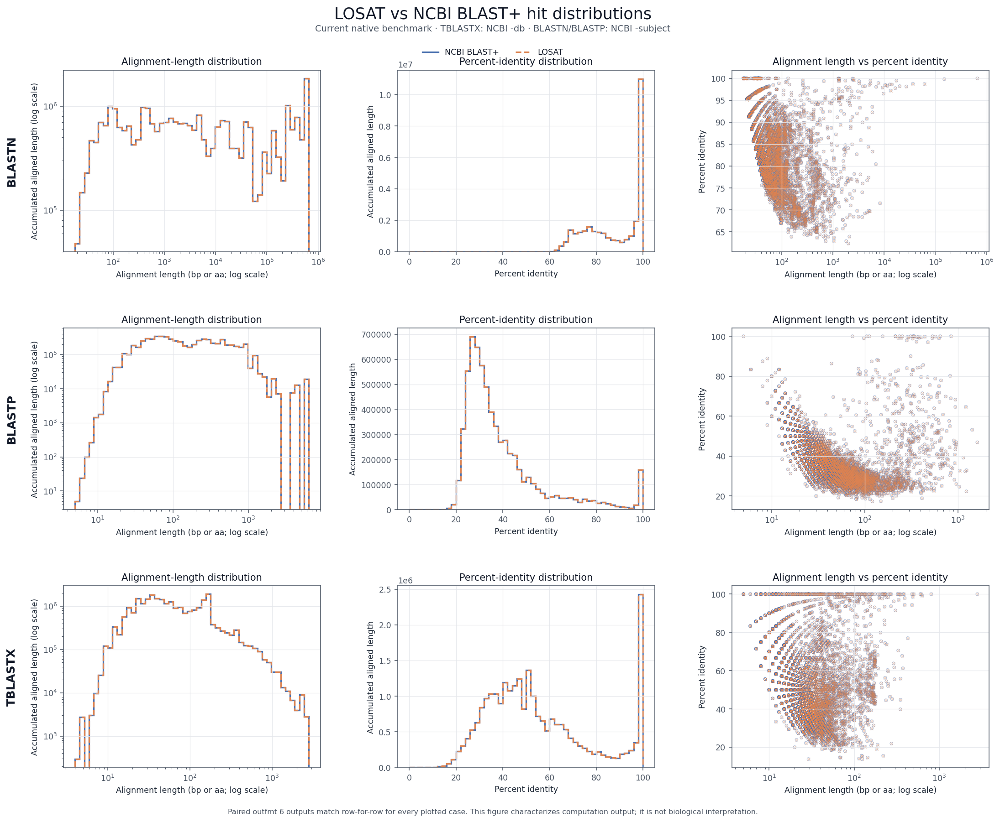
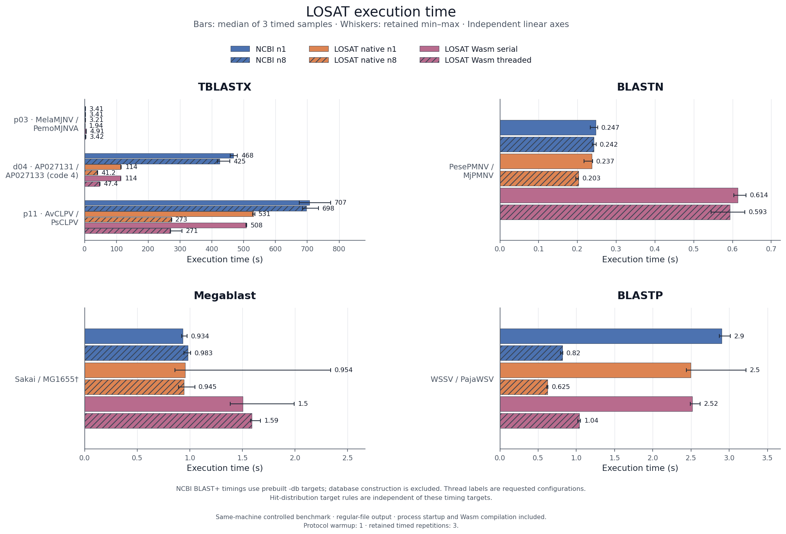

<p align="center">
  <picture>
    <source media="(prefers-color-scheme: dark)" srcset="docs/assets/losat-logo-white.svg">
    
  </picture>
</p>

# LOSAT: LOcal Sequence Alignment Tool

[](LICENSE)
[](https://www.rust-lang.org)
[](https://anaconda.org/bioconda/losat)
[](https://anaconda.org/bioconda/losat)
[](#webassembly-wasm-integration)
[](https://anaconda.org/bioconda/losat)
[](https://anaconda.org/bioconda/losat)
[](https://anaconda.org/bioconda/losat)


**LOSAT** is a lightweight, pure-Rust reimplementation of the NCBI BLAST sequence alignment algorithm. It compares query sequences with subject sequences from FASTA files (`-query` vs `-subject`) and searches BLAST databases (`-db`), including those written by NCBI's `makeblastdb` or by `losat makeblastdb`.

On the pairwise profiles and fixtures of its [release test set](docs/release/v0.2.0_certification_plan.md), LOSAT is checked against declared NCBI source, executable, or API oracle contracts for scores, E-values, coordinates, and output. Exact-byte parity applies where each contract requires it; documented local subject genetic-code exceptions apply to TBLASTX and TBLASTN. LOSAT runs without external C/C++ libraries or a BLAST+ installation, and a `-subject` search needs no pre-formatted database. Built for high portability, LOSAT runs natively on modern operating systems and compiles directly to WebAssembly for client-side, zero-install genomic analyses in web browsers and sandboxed runtimes.

---

## Key Highlights

- **NCBI Parity on Test Fixtures**: Matches the declared NCBI source, CLI, or API oracle contract on the release test fixtures, including exact output bytes where required and the documented local subject genetic-code exceptions.
- **Pure Rust, Zero Dependencies**: Standalone single executable. Does not wrap, link, or shell out to external NCBI binaries or libraries.
- **Direct Pairwise Alignment**: Compares FASTA files directly via `-query` and `-subject` without running `makeblastdb`.
- **WebAssembly Ready**: Compiles to serial and threaded command-WASI (see [Platforms](#platforms)) and runs in the browser through the [Web GUI (preview)](#web-gui-preview). Browser/reactor APIs exist for integrations such as [gbdraw](https://github.com/satoshikawato/gbdraw).
- **Corrected TBLASTX Genetic Codes**: Fully respects `-db_gencode` for translated subject sequences in pairwise searches (resolving NCBI BLAST+'s default fallback to standard code; see [Scope & Differences](#scope--differences-from-ncbi-blast)).
- **High Performance**: Multithreaded execution via Rayon natively and shared-memory threading in WebAssembly (`wasm32-wasip1-threads`).

---

## Supported Programs & Tasks

| Program | Supported Tasks | Output Formats (`-outfmt`) | Description |
|:---|:---|:---|:---|
| **`blastn`** | `megablast` (default), `blastn`, `dc-megablast`, `blastn-short` | `0`, `5`, `6`, `7`, `8`, `9`, `10`, `11`, `12`, `13`, `14`, `15`, `16`, `17`, `20` (see [Output formats](#output-formats)) | Nucleotide vs. nucleotide alignment |
| **`blastx`** | `blastx` (default), `blastx-fast`; native and Wasm entry points | `0`, `5`, `6`, `7`, `8`, `9`, `10`, `11`, `12`, `13`, `14`, `15`, `16`, `20` (see [Output formats](#output-formats)) | Nucleotide query vs. protein subject; [CLI scope and release status](docs/losatx_blastx_native_cli.md) |
| **`blastp`** | `blastp` (default), `blastp-fast`, `blastp-short` | `0`, `5`, `6`, `7`, `8`, `9`, `10`, `11`, `12`, `13`, `14`, `15`, `16`, `20` (see [Output formats](#output-formats)) | Protein vs. protein alignment |
| **`tblastx`** | `tblastx` | `0`, `5`, `6`, `7`, `8`, `9`, `10`, `11`, `12`, `13`, `14`, `15`, `16`, `20` (see [Output formats](#output-formats)) | Translated 6-frame nucleotide vs. nucleotide alignment |
| **`tblastn`** | `tblastn` (default), `tblastn-fast`; a PSSM query (`-in_pssm`, PSI-TBLASTN) | `0`, `5`, `6`, `7`, `8`, `9`, `10`, `11`, `12`, `13`, `14`, `15`, `16`, `20` (see [Output formats](#output-formats); `-in_pssm`: `0`, `6`, `7`, `10`) | Protein query vs. translated nucleotide subject; [v0.2.0 fixture-scoped contract](docs/release/v0.2.0.md) |
| **`psiblast`** | the rounds of FASTA queries (`-num_iterations N`, 0 until convergence); a PSSM query (`-in_pssm`, its rounds too) | `0`, `6`, `7`, `10`, `20` (`-in_pssm`: `0`, `6`, `7`) | Position-Specific Iterated BLAST: blastp's search in round 1, then the search of the PSSM made from each round's alignments, or the search of a PSSM (see [section 7](#7-psi-blast-psiblast)) |
| **`rpsblast`** | composition-based statistics 0, 1, 2 and 3 (the default 1), profile databases of one or several volumes | `0`, `6`, `7`, `10` | Reverse Position-Specific BLAST: protein queries against a database of profiles such as CDD (see [section 8](#8-reverse-psi-blast-rpsblast)) |

> **Note**: Tabular output (`-outfmt 6`, `7`, `10` and `20`) writes the 12 standard BLAST fields by default:  
> `qaccver saccver pident length mismatch gapopen qstart qend sstart send evalue bitscore`.  
> All five programs, `psiblast` and `rpsblast` also accept a custom field list (for example `-outfmt "6 qseqid sseqid evalue"`) and `delim=`.
>
> LOSAT refuses an NCBI option or value it does not implement with an error; see [Scope & Differences](#scope--differences-from-ncbi-blast) for the list.

---

## Output formats

The `-outfmt` numbers that the five NCBI BLAST+ 2.17.0 programs (`blastn`, `blastp`, `blastx`, `tblastn`, `tblastx`) write; `19` and `21` belong to igblastn and magicblast. Every LOSAT program reads `-outfmt` as NCBI does and gives NCBI's error for a value that NCBI rejects. A format that NCBI writes and LOSAT does not write is rejected with "output format N is not supported by LOSAT's PROGRAM" before the inputs are read. The default is `0`.

| `-outfmt` | NCBI name | NCBI programs that write it | LOSAT |
|:---|:---|:---|:---|
| `0` | Pairwise | all five | all five programs |
| `1` | Query-anchored showing identities | all five | not written |
| `2` | Query-anchored no identities | all five | not written |
| `3` | Flat query-anchored showing identities | all five | not written |
| `4` | Flat query-anchored no identities | all five | not written |
| `5` | BLAST XML | all five | all five programs (with `-subject` and `-db`) |
| `6` | Tabular | all five | all five programs |
| `7` | Tabular with comment lines | all five | all five programs |
| `8` | Seqalign (Text ASN.1) | all five | all five programs |
| `9` | Seqalign (Binary ASN.1) | all five | all five programs |
| `10` | Comma-separated values | all five | all five programs |
| `11` | BLAST archive (ASN.1 text, ASN.1 binary or XML) | all five | every program (with `-subject` and `-db`; `ARCHIVE_FORMAT` unset: ASN.1 text, `bin...`: ASN.1 binary, `xml`: XML (`Blast4-archive`), any case, as NCBI reads it) |
| `12` | Seqalign (JSON) | all five | all five programs |
| `13` | Multiple-file BLAST JSON | all five, with `-out FILE` only | all five programs (with `-subject` and `-db`) |
| `14` | Multiple-file BLAST XML2 | all five, with `-out FILE` only | all five programs (with `-subject` and `-db`) |
| `15` | Single-file BLAST JSON | all five | all five (with `-subject` and `-db`) |
| `16` | Single-file BLAST XML2 | all five | all five (with `-subject` and `-db`) |
| `17` | Sequence Alignment/Map (SAM) | `blastn` only | `blastn` (with `-subject` and `-db`; `SQ` and `SR` as in NCBI) |
| `18` | Organism Report | all five | not written |
| `20` | Comma-separated values with header lines | all five | all five programs |

Outfmt `17` (SAM, `blastn` only) is NCBI's document byte for byte except the `CL:` tag of its `@PG` line, which holds LOSAT's own command line (every argument followed by one space, as NCBI writes its own); a run without a command line (the library) has no `CL:` tag. NCBI writes the whole document when the search ends, and so does LOSAT, which holds the records as text until then. `-outfmt "17 SQ"` writes the target's letters in SEQ and `-outfmt "17 SR"` makes the subject the reference; other words are ignored, as in NCBI.

Outfmt `13` and `14` write the report of the n-th query to `<base>_<n>.json` / `<base>_<n>.xml` next to `-out FILE` and a master file at `FILE` that lists them, with NCBI's names: the base is `FILE` without its extension if that is `.json` (13) or `.xml` (14), and the master file always uses the `.xml` rule and drops the directory (`-out o.json` with `-outfmt 13` lists `o.json_1.json`); `blastx` holds the side files in memory, like the document of `-outfmt 5`, 15 and 16, in the rare run in which a later query batch could still be refused. Outfmt `13` to `16` with `-db` write the scientific name of a sequence's taxid (`sciname`) when `taxdb.bti` is found as NCBI finds it: in the current directory, in `BLASTDB` (the environment variable, `~/.ncbirc` or `NCBI_CONFIG__BLAST__BLASTDB`), not in the `-db` directory. The other output formats never read it.

---

## Installation

### Bioconda (Recommended)

LOSAT is available on [Bioconda](https://anaconda.org/bioconda/losat) for Linux and macOS:

```bash
# Using conda
conda install -c bioconda -c conda-forge losat

# Using mamba (recommended for fast dependency resolution)
mamba install -c bioconda losat

# Using pixi
pixi add losat
```

### Pre-built Binaries
Each release from v0.2.0 provides eight items on the [Releases](https://github.com/satoshikawato/LOSAT/releases) page (earlier releases list their own items on their release pages):

| Item | Target | Archive | Binary |
|:---|:---|:---|:---|
| Linux x86_64 | `x86_64-unknown-linux-gnu` | `.tar.gz` | `losat` |
| Linux aarch64 | `aarch64-unknown-linux-gnu` | `.tar.gz` | `losat` |
| macOS arm64 | `aarch64-apple-darwin` | `.tar.gz` | `losat` |
| macOS x86_64 | `x86_64-apple-darwin` | `.tar.gz` | `losat` |
| Windows x86_64 | `x86_64-pc-windows-msvc` | `.zip` | `losat.exe` |
| WASI serial | `wasm32-wasip1` | `.tar.gz` | `losat.wasm` |
| WASI threads | `wasm32-wasip1-threads` | `.tar.gz` | `losat.wasm` |
| Source crate | n/a | `.crate` | n/a |

LOSAT is not published on crates.io, Homebrew, PyPI, Docker Hub or npm. Bioconda (above) is the only package-manager channel.

### Build from Source
Requires the [Rust toolchain](https://rustup.rs/) (edition 2021, Rust 1.92+ recommended). There is no crates.io package, so `cargo` builds from source only:

```bash
git clone https://github.com/satoshikawato/LOSAT.git
cd LOSAT/LOSAT
cargo build --release
```
The compiled binary will be located at `target/release/losat`.

### Platforms

| Platform | Status in v0.2.0 |
|:---|:---|
| Linux x86_64, Linux aarch64, macOS arm64, macOS x86_64, Windows x86_64 (native) | **Supported**: matches NCBI BLAST+ 2.17.0 on the release test set |
| WASI serial (`wasm32-wasip1`) | **Supported**: matches NCBI BLAST+ 2.17.0 on the release test set |
| WASI threads (`wasm32-wasip1-threads`) | **Supported**: tested in CI, outside the release's NCBI parity claim |
| [Web GUI](#web-gui-preview) (browser) | **Preview**: outside the release's NCBI parity claim; each run is marked "Supported" or "Not yet supported" |

On macOS, an E value printed with full precision (`-outfmt 11`, `-outfmt 8`) can differ from other platforms by 1 in its last (15th) digit because of Apple's libm, as in NCBI BLAST+ built on macOS; see [PD-LOSAT-PLATFORM-LIBM](docs/product_decisions/PD-LOSAT-PLATFORM-LIBM.md).

---

## Quick Start

Tools that look for `blastn` on `PATH` can use LOSAT without changes: `losat --install-shims [DIR]` links `blastn`, `blastp`, `blastx`, `tblastn`, `tblastx`, `psiblast`, `rpsblast`, `makeblastdb` and `blastdbcmd` to `losat` in `DIR` (default: the directory of `losat`; Windows gets copies), and an executable called by one of these names runs that program. It stops without changing anything if a file of one of these names is already there, such as NCBI's own program.

LOSAT adopts the standard NCBI single-dash command-line syntax:

### 1. Nucleotide Alignment (BLASTN / MegaBLAST)
```bash
# Fast pairwise nucleotide search with MegaBLAST
losat blastn \
  -query query.fna \
  -subject subject.fna \
  -task megablast \
  -outfmt 6
```

### 2. Protein Alignment (BLASTP)
```bash
# Protein alignment with custom E-value cutoff and multithreading
losat blastp \
  -query query.faa \
  -subject subject.faa \
  -evalue 1e-5 \
  -num_threads 4 \
  -outfmt 6
```

### 3. Translated Alignment (TBLASTX)
```bash
# 6-frame translated search using bacterial genetic code (Table 11)
losat tblastx \
  -query contigA.fna \
  -subject contigB.fna \
  -query_gencode 11 \
  -db_gencode 11 \
  -outfmt 6
```

---

### Translated Query vs. Protein Subject (BLASTX)

```bash
losat blastx -query transcripts.fna -subject proteins.faa \
  -query_gencode 1 -num_threads 1 -outfmt 6
```

The current branch implements native threaded BLASTX, command-WASI, and the
Web/reactor entry points. See the [CLI scope and custom fields](docs/losatx_blastx_native_cli.md).
The release record for v0.2.0 is [docs/release/v0.2.0.md](docs/release/v0.2.0.md).

### 4. Protein vs. Translated Nucleotide (TBLASTN)
```bash
losat tblastn \
  -query proteins.faa \
  -subject genome.fna \
  -task tblastn \
  -db_gencode 1 \
  -outfmt 6
```

The local TBLASTN path accepts all 27 NCBI `gc.prt` genetic-code IDs, including ID 32 under the documented product decision. Its output and target claims apply to the [declared fixtures and options](docs/release/v0.2.0.md). `-task tblastn-fast` and `-word_size 5`, `6` and `7` (NCBI's compressed-alphabet lookup table) run with every matrix but IDENTITY, which crashes NCBI BLAST+'s tblastn; database searches (`-db`) are described in section 6.

With `-in_pssm FILE` (in place of `-query`; `-in_pssm -` reads the standard input) tblastn searches a PSSM as NCBI's PSI-TBLASTN does: the PSSM's scores replace the matrix in the lookup table, the extensions and the alignments, and its Karlin-Altschul values give the cutoffs, E-values and bit scores. As in NCBI, `-comp_based_stats` has no effect (no composition-based statistics), HSPs are linked only with `-sum_stats true`, the subjects are translated with the genetic code 1 whatever `-db_gencode` says (the value is still checked), `-task tblastn-fast` changes nothing, and the word size is 2 to 4 with one of the standard matrices (NCBI's errors for the others; a PSSM of frequency ratios only gets its scores from the `-matrix` with the gap costs 11/1). SEG (on by default) keeps the masked positions out of the lookup table and out of the ungapped Karlin-Altschul values, and the reports (`PSITBLASTN`; outfmt 0, 6, 7 and 10) show no query masks. The PSSM is read as psiblast's `-in_pssm` reads it (section 7).

### 5. Writing a BLAST Database (makeblastdb)
```bash
losat makeblastdb \
  -in proteins.faa \
  -dbtype prot \
  -out proteins_db \
  -title "my proteins"
```

`losat makeblastdb` writes the files of `makeblastdb`: the sequence, header and index files, the alias file of a database in several volumes, the JSON metadata file (`.pjs`, `.njs`) and, as in makeblastdb, the LMDB files of format version 5, which is the default (`-blastdb_version 4` writes the older layout). The sequence and header files are the same bytes, and the index and metadata files differ only in their creation date; this is checked against makeblastdb 2.17.0 on Linux x86-64 (on Windows and macOS LOSAT follows NCBI's source where it depends on the platform, untested against makeblastdb there). Several FASTA files can be named in `-in`, and `-logfile` redirects the log to a file. `-max_file_sz` splits the database into volumes as makeblastdb does. `-parse_seqids` stores the Seq-ids of the definition lines and writes makeblastdb's id indexes (with version 5 the accession keys of the `.pdb` file and the `.pos` file), `-hash_index` the sequence hash index, and `-taxid` or `-taxid_map` the tax ids (`-taxid_map -` reads the map from the standard input). NCBI BLAST+ programs and LOSAT's BLASTP, BLASTN, TBLASTN, BLASTX, TBLASTX and PSIBLAST search such a database with `-db` (section 6); the makeblastdb options LOSAT does not implement (masks, `-randomize`, `-oid_masks`, `-metadata_output_prefix`) are rejected by name.

Every program answers `-version` as NCBI BLAST+ does (`blastn: 2.17.0+`, then a `Package:` line that names LOSAT) and `-h` with a short usage, both with exit code 0; `-help` and `-h` open with NCBI's `USAGE` and `DESCRIPTION` headings. `-mt_mode 0|1|2` (with `-num_threads`, as in NCBI) is accepted by BLASTN, BLASTP, BLASTX and TBLASTN and does not change the output, which is always that of NCBI `-num_threads 1`: NCBI's `-mt_mode 1` writes the end of an outfmt 0 report or each XML document once per batch of queries, which LOSAT does not reproduce. BLASTN reads `-use_index` as NCBI does: `true` changes nothing with `-subject` or a task other than megablast, and a megablast search of a database without a MegaBLAST index writes NCBI's warning and searches without one.

### 6. Searching a BLAST Database (BLASTP, BLASTN, TBLASTN, BLASTX, TBLASTX)
```bash
losat blastp \
  -query proteins.faa \
  -db proteins_db \
  -outfmt 6 \
  -num_threads 8
```
```bash
losat makeblastdb -in genomes.fna -dbtype nucl -out genomes_db
losat blastn \
  -query contigs.fna \
  -db genomes_db \
  -outfmt 6 \
  -num_threads 8
```
```bash
losat blastx \
  -query contigs.fna \
  -db proteins_db \
  -outfmt 6 \
  -num_threads 8
```

`blastp -db`, `blastn -db` (megablast, blastn, dc-megablast), `tblastn -db`, `blastx -db` and `tblastx -db` search a protein or nucleotide database written by `makeblastdb` or `losat makeblastdb`, with or without `-parse_seqids` (format versions 4 and 5, several volumes, alias files), so also NCBI's distributed databases such as swissprot, pdbaa and the RefSeq nucleotide databases; the database is found as NCBI finds it (the current directory, `BLASTDB`, `.ncbirc`). The output is that of NCBI BLAST+ 2.17.0 `blastp -db`, `blastn -db`, `tblastn -db`, `blastx -db` or `tblastx -db` run with `-num_threads 1`, subject ids and titles included, in every format the program writes, and it is the same at every `-num_threads`. A database search differs from `-subject` on the same sequences as it does in NCBI BLAST+ (the statistics see the database and the `Database:` lines differ; the random bases that stand for ambiguous letters in a nucleotide database are the ones `-subject` draws, but a database stores a hyphen as `N` where `-subject` drops it). `-dbsize` and `-searchsp` are accepted with `-db` and `-subject`, the taxid and seqid lists (`-taxids`, `-taxidlist`, `-seqidlist` and their negative forms) with `-db`; `-db` may name several databases (`-db "a b"`, a name with spaces between double quotes), which are searched as one database as NCBI BLAST+ searches them. [What LOSAT refuses](#what-losat-refuses) lists what is rejected and [PD-LOSAT-DATABASE-SEARCH](docs/product_decisions/PD-LOSAT-DATABASE-SEARCH.md) gives the reasons.

`losat blastdbcmd -db NAME -info` prints what NCBI BLAST+ 2.17.0 `blastdbcmd -info` prints for the database (title, number of sequences, total length, date, longest sequence, format version, volumes), found as the search programs find it, with NCBI's error messages and exit codes, `-dbtype`, `-exact_length`, `-out`, `-logfile`, `-h`, `-help` and `-version`; its command line is read as NCBI reads it. `losat blastdbcmd -db NAME -entry all` writes the database as FASTA (or as the lines of `-outfmt "%a %l %T"` and every other `%` specifier but the ASN.1 texts `%d` and `%b`), and `-entry` / `-entry_batch` retrieve sequences by accession, name, local id or GI in a database built with `-parse_seqids`, of version 5 (NCBI's distributed databases such as swissprot and pdbaa) or version 4 (the ISAM files of its volumes, PIGs included), by `gnl|BL_ORD_ID|n` in any version 4 database, and answer as NCBI does for a database built without `-parse_seqids`, with `-range`, `-strand`, `-line_length`, `-ctrl_a`, `-target_only`, `-get_dups` and `-long_seqids`, byte for byte as NCBI writes them (the outputs NCBI gets wrong are written correctly: [`PD-LOSAT-BLASTDBCMD-DEVIATIONS`](docs/product_decisions/PD-LOSAT-BLASTDBCMD-DEVIATIONS.md); an accession on more than about 500 sequences, on which NCBI stops with an error, is looked up like any other). It also serves `-list`, the taxonomy options, `-metadata`, `-ipg`, and the masks of `makeblastdb -mask_data` (the filtering algorithms of `-info`, `-mask_sequence_with`, `-outfmt %m<id>`, the mask id of a batch line). `-db` may name several databases (`-db "a b"`, a name with spaces between double quotes), read as one database as NCBI reads them. `-outfmt %d` / `%b` are rejected, and so is a list in which an alias and another name give the same volume.

### 7. PSI-BLAST (psiblast)
```bash
losat psiblast \
  -query protein.faa \
  -db proteins_db \
  -outfmt 6
```

`losat psiblast` runs NCBI BLAST+ 2.17.0 `psiblast` on FASTA queries, with `-subject` or `-db` (databases built with `-parse_seqids` too, with blastp's subject ids, titles and refusals; section 6), one query at a time: round 1 is the search of the query with blastp's options and psiblast's report (the `PSIBLAST` header and references, `Results from round N`, `# Iteration: N`); with `-num_iterations N` (default 1; 0 runs until convergence) each later round searches with the PSSM that NCBI's PSSM engine makes from the round before (its alignments below `-inclusion_ethresh`, with `-pseudocount`), until a round has no hits, every subject below the threshold was below it in the round before too (`Search has CONVERGED!`), or N rounds have run. The description table of a later round has NCBI's two parts ("Sequences used in model and found again", "Sequences not found previously or not previously below threshold"), outfmt 7 counts the rounds in `# BLAST processed N queries`, and every `-comp_based_stats` mode is taken (round 1 searches as blastp in that mode; the later rounds run 2, the default, and 3 as 1, with NCBI's warning once per query). `-out_pssm` and `-out_ascii_pssm` get the PSSM at the start of each later round (with `-save_each_pssm` as `F.1`, `F.2`, ... over the whole run) and with `-save_pssm_after_last_round` after the last one, as NCBI writes them. It takes blastp's options without `-task` and `-ungapped`, and `-inclusion_ethresh` and `-pseudocount`. `-searchsp` (and the environment variable `OLD_FSC`, which NCBI sets for any `-searchsp`) holds in every round, those of `-in_pssm` too: every cutoff and E-value is then computed without the finite-size correction on the round's search space, so the alignments a round includes, the number of rounds and the PSSMs change with it, as in NCBI. The options and values it refuses (`-query_loc`, `-seg` and `-soft_masking true` with more rounds, `-in_msa`, `-phi_pattern`, the database filters, and others) are listed under [Scope & Differences](#scope--differences-from-ncbi-blast).

```bash
losat psiblast \
  -in_pssm query.pssm \
  -db proteins_db \
  -outfmt 6
```

With `-in_pssm FILE` (in place of `-query`; `-in_pssm -` reads the standard input) the query is a PSSM in NCBI's ASN.1 text form (`PssmWithParameters`, as psiblast's `-out_pssm` writes it): its scores replace the matrix in the lookup table, the extensions and the alignments, the report shows the PSSM's query, and the footer prints the PSSM's Karlin-Altschul parameters. A PSSM of frequency ratios only gets its scores from the ratios, as NCBI computes them. The composition-based statistics are NCBI's position-based ones: `-comp_based_stats 1`, and the default 2 and 3, which NCBI runs as 1 with a PSSM (with its warning), rescale the PSSM for each subject's composition and redo the alignments; `-comp_based_stats 0` keeps the PSSM's scores. With `-num_iterations N` the rounds run as a FASTA query's: round 1 searches the PSSM, each later round the PSSM made from the round before, with the PSSM's query (its Seq-id and title) in every report and every PSSM made. `-out_pssm` and `-out_ascii_pssm` get the input PSSM at the start of round 1 (with one round too), as NCBI writes it back: a PSSM of frequency ratios only with the scores computed from them, and the ASCII form `Last position-specific scoring matrix computed` with the scores and the PSSM's own Karlin-Altschul values (the long form when the PSSM holds its information content); then the PSSMs of the later rounds as for a FASTA query. After a first round without hits, `-save_pssm_after_last_round` writes the input PSSM again with the Karlin-Altschul values of its search, as NCBI does.

### 8. Reverse PSI-BLAST (rpsblast)
```bash
losat rpsblast \
  -query proteins.faa \
  -db Cdd \
  -comp_based_stats 0 \
  -outfmt 6
```

`losat rpsblast` searches protein queries against a profile database written by NCBI's `makeprofiledb -dbtype rps` (for example NCBI's CDD, 29 volumes), as NCBI BLAST+ 2.17.0 `rpsblast -num_threads 1` does, byte for byte: with composition-based statistics (`-comp_based_stats 1`, the default, and `2` and `3`, which NCBI runs as `1` with a larger preliminary E-value threshold; `T` and `t` are `1`) when the database has frequency ratios (`.freq` files), without (`0`, `F`, `f`, `D`, `d`) otherwise; a database whose first volume has no `.freq` file gets NCBI's warning and the search without them, and a later volume without one NCBI's error. It reads databases of one or more volumes (format versions 4 and 5, the 28-column profiles of makeprofiledb 2.17 and the older 26-column ones, a whole scale such as CDD's 100; the volumes ordered by file name, then by path, as NCBI orders them, searched one after the other and merged per query as NCBI merges them, `-num_threads 0` being one thread per volume) through read-only memory maps of their `.loo`, `.rps` and `.freq` files, writes outfmt 0, 6, 7 and 10 (custom fields too; `positive` and `ppos` count the identities, as NCBI's rpsblast does), and takes `-evalue`, `-dbsize`, `-max_target_seqs`, `-num_descriptions`, `-num_alignments`, `-max_hsps`, `-qcov_hsp_perc`, `-window_size`, `-query_loc`, `-parse_deflines`, `-show_gis`, `-num_threads`, `-mt_mode`, the query masks `-seg` and `-lcase_masking` (the masked letters are X for the whole search; outfmt 0 shows them in lower case and the identities count the letters as read), `-soft_masking` (which changes only how outfmt 0 shows the masks: NCBI's soft masking acts on a query lookup table, which an RPS search does not build), the X-drops `-xdrop_ungap`, `-xdrop_gap` and `-xdrop_gap_final` (in bits, at the database's scale; `-xdrop_ungap` of 0 or less gets NCBI's error), `-line_length`, `-sorthits` and `-sorthsps` (read with NCBI's warnings; they sort nothing, as in NCBI's rpsblast) and `-sum_stats false`; the queries are searched in parallel and the output is the same at every thread count (it is NCBI's `-num_threads 1` output, which NCBI's own `-mt_mode 1` and, for outfmt 0, its multi-thread runs of several volumes do not always repeat). Options of later items are refused, as listed under [Scope & Differences](#scope--differences-from-ncbi-blast).

---

## Common Command-Line Options

| Flag | Type | Default | Description |
|:---|:---|:---|:---|
| `-query <file>` | File path | *(Required)* | Input query sequence file (FASTA; a name ending in `.gz`, `.bz2` or `.zst` is inflated, see below) |
| `-subject <file>` | File path | *(Required unless `-db`)* | Input subject sequence file (FASTA; `.gz`, `.bz2`, `.zst` as for `-query`) |
| `-db <name>` | Database name | — | BLAST database to search in place of `-subject` (BLASTP, BLASTN, TBLASTN, BLASTX, TBLASTX, PSIBLAST; section 6) |
| `-task <string>` | String | Program default | Task: `megablast`, `blastn`, `dc-megablast` or `blastn-short` (for `blastn`); `blastp`, `blastp-fast` or `blastp-short` (for `blastp`); `blastx` or `blastx-fast` (for `blastx`); `tblastn` or `tblastn-fast` (for `tblastn`) |
| `-evalue <real>` | Float | `10.0` | Expectation value (E-value) threshold |
| `-outfmt <spec>` | Integer, or `6`/`7`/`10`/`20` with fields | `0` | Output format for every program: `0`=pairwise, `5`=BLAST XML, `6`=tabular, `7`=commented tabular, `8`=Seq-align (text ASN.1), `9`=Seq-align (binary ASN.1), `10`=CSV, `11`=BLAST archive, `12`=Seq-align (JSON), `13`=BLAST JSON and `14`=BLAST XML2 as files next to `-out`, `15`=BLAST JSON and `16`=BLAST XML2, `17`=SAM (BLASTN only), `20`=CSV with header lines; custom tabular fields and `delim=` with `6`, `7`, `10` and `20` in every program. `1` to `4` and `18` are not written |
| `-num_threads <int>` | Integer | `1` | Number of threads to use |
| `-max_target_seqs <int>`| Integer | `500` | Maximum number of aligned target sequences to keep |
| `-max_hsps <int>` | Integer | Unlimited | Maximum number of HSPs per subject sequence |
| `-num_descriptions <int>` | Integer (0 or more) | `500` | Number of database sequences to show one-line descriptions for (outfmt 0; ignored with a warning for outfmt above 4). Without `-max_target_seqs`, either `-num_descriptions` or `-num_alignments` sets the hit list size to the larger of the two (outfmt 0), and `-num_alignments` sets it for the tabular formats; 0 for both, or `-num_alignments 0` with a tabular format, is NCBI's error `No hits are being saved`. Excludes `-max_target_seqs` |
| `-num_alignments <int>` | Integer (0 or more) | `250` | Number of database sequences to show alignments for (outfmt 0), or the number of subjects of the tabular formats. Excludes `-max_target_seqs` |
| `-qcov_hsp_perc <real>` | Float | `0` (no filter) | Percent query coverage per HSP: HSPs that cover less of the query (of the query frame in BLASTX/TBLASTX) are removed |
| `-dust <args>` | String | `20 64 1` | DUST low-complexity filter for BLASTN (`yes`, `no`, or `"level window linker"`) |
| `-seg <args>` | String | `no` (blastp)<br>`12 2.2 2.5` (blastx/tblastx/tblastn) | SEG low-complexity filter for BLASTX/BLASTP/TBLASTX/TBLASTN (`yes`, `no`, or `"window locut hicut"`) |
| `-soft_masking <bool>` | Boolean | `true` (blastn)<br>`false` (blastp/blastx/tblastn/tblastx) | Apply the filtering locations as soft masks: they keep words out of the lookup table, but the query keeps its letters. With `false` the masked letters are also written as N or X in the searched query |
| `-lcase_masking` | Flag | off | Lower-case letters of the query join the filtering locations, and those of a `-subject` are not scanned for words (all five programs) |
| `-query_gencode <int>` | Integer | `1` | Genetic code for query translation (BLASTX/TBLASTX) |
| `-db_gencode <int>` | Integer | `1` | Genetic code for subject translation (TBLASTX/TBLASTN) |

A `-query`, `-subject` or `makeblastdb -in` file whose name ends in `.gz`, `.bz2` or `.zst` (in any case) is read through gzip, bzip2 or zstd, concatenated members, streams and frames (the output of `bgzip`, `pbzip2` and `pzstd`) included; the name alone decides, as it does in NCBI's makeblastdb, and `-` (standard input) is read as it comes (`zcat reads.fa.gz | losat blastn -query - ...`). A search program inflates the whole file first, into an unnamed temporary file beside the input (under `TMPDIR` when that directory refuses it or has no room; the WASI command has no temporary directory and stops instead); makeblastdb streams. NCBI BLAST+ inflates these only in makeblastdb, which reads every gzip member but only the first bzip2 stream or zstd frame; its search programs read such a file as text and stop at its first line. The run needs room for the inflated copy; a `.gz` file is read as makeblastdb reads it (a member's trailer is not checked), and a file that is not what its name says is refused before the search (`-query: 'x.fa.gz' is named .gz but is not gzip data (...)`, exit status 1). The decoders are pure Rust (flate2, bzip2 with libbz2-rs-sys, ruzstd).

---

## Accuracy and Benchmarks

### Alignment Parity
LOSAT is continuously audited against NCBI BLAST+ 2.17.0 across the retained
comparison fixtures. This is a compute-program comparison, not biological
interpretation of the input sequences.



The current plot contains 45 exact output pairs and 1,565,630 normalized rows.
TBLASTX uses a prebuilt NCBI database (including matching `-db_gencode`), while
BLASTN and BLASTP use NCBI local-subject output. The LOSAT side uses its local
`-subject` interface.

### Execution Speed
Benchmarked on an Intel Core i9-14900HX comparing NCBI BLAST+ 2.17.0, native
LOSAT, and WebAssembly modes (single-threaded and requested 8-thread
configurations):



The figure reports the median of three retained wall-clock samples after one
warmup, with the full three-sample range. Every timed NCBI search uses a prebuilt
`-db`; database construction is excluded. Hit-distribution target selection is
independent of these timing targets. Process and Wasm startup are included.

*For complete reproducible datasets, scripts, and methodology, see the [Benchmark Documentation](benchmarks/v0.1.0/README.md).*

### Database searches
LOSAT `-db` was timed against NCBI BLAST+ 2.17.0 `-db` on small public databases
(RefSeq 16S, Swiss-Prot, the yeast proteome) on a workstation with two Intel Xeon
Gold 6338 CPUs, using 16 physical cores of one NUMA node with memory bound to that
node. Each tool and thread count had one untimed warmup and three timed rounds,
with the tool order alternating by round; the table gives median wall time in
seconds (LOSAT / NCBI = ratio). Both tools searched the `makeblastdb` default
(version 5) database, and every LOSAT output equals NCBI BLAST+ 2.17.0
`-db -num_threads 1` byte for byte at 1, 8 and 16 threads.

| Case (query x database) | 1 thread | 8 threads | 16 threads |
| --- | --- | --- | --- |
| megablast, 100 full-length 16S x RefSeq 16S | 65.9 / 111.2 = 0.59 | 13.1 / 17.2 = 0.76 | 6.6 / 10.6 = 0.62 |
| megablast, 100 amplicon-like 460 nt slices x 16S | 21.6 / 34.7 = 0.62 | 4.6 / 6.7 = 0.68 | 2.3 / 5.5 = 0.43 |
| blastn task, the same 100 slices x 16S | 54.7 / 128.9 = 0.42 | 10.8 / 18.7 = 0.57 | 5.5 / 10.8 = 0.51 |
| blastp, 1 protein x Swiss-Prot | 3.67 / 3.70 = 0.99 | 0.53 / 0.66 = 0.80 | 0.36 / 0.51 = 0.71 |
| blastp, 100 proteins x Swiss-Prot | 153.5 / 249.7 = 0.61 | 20.5 / 36.4 = 0.56 | 11.0 / 20.2 = 0.54 |
| blastp, yeast proteome all against all (a) | 279.1 / 885.7 = 0.32 | 38.6 / 114.3 = 0.34 | 22.9 / 61.4 = 0.37 |
| blastx, 10 transcripts x Swiss-Prot (b) | 28.3 / 30.2 = 0.94 | 3.90 / 4.12 = 0.95 | 2.24 / 2.27 = 0.99 |

(a) The small-tier run (build 0b7335ce) lost at 16 threads (97.9 s vs NCBI 61.4 s) because the 2.9 MB database made only 3 blocks of 1 MiB. The development variable `LOSAT_X_BPDBCUT` (#231, in the default set since #289) fixes it. The LOSAT numbers here are from a later paired run on the same workstation (2026-10-18, build 9560b7c1, medians of 3, 2 and 1 runs at 16, 8 and 1 threads) that had no NCBI arm; the ratios use NCBI's small-tier medians (a cross-run ratio).

(b) The small-tier run lost at 8 and 16 threads (7.1 vs 4.1 s, 4.9 vs 2.2 s). The development variable `LOSAT_X_BXSUBJFLOW` (#287, default ON) fixes it. The 8- and 16-thread numbers are from a later run with NCBI in the same rounds (2026-10-17, build 6d0c7b1e, medians of 3); the 1-thread value is the small-tier one, because the flow does not act at one thread.

Database construction (median of three, one thread): `makeblastdb` 0.69 s for
RefSeq 16S, 8.47 s for Swiss-Prot and 0.16 s for the yeast proteome; `losat makeblastdb`
0.17 s, 2.02 s and 0.03 s. Data sources, build hashes, memory use, the machine
state and the row files are in the [Database benchmark documentation](benchmarks/db6-small/README.md).

---

## WebAssembly (Wasm) Integration

LOSAT can be built as a standalone WASI module or embedded into web browsers:

```bash
cd LOSAT

# Build single-threaded WASI command
cargo build --release --target wasm32-wasip1 --no-default-features

# Build multithreaded WASI command (requires shared-memory runtime)
cargo build --release --target wasm32-wasip1-threads --features wasm-threads
```

LOSAT powers the client-side comparative genomic alignment engine in [gbdraw](https://github.com/satoshikawato/gbdraw), enabling interactive circular and linear genome visualization without any backend server requirements.

---

## Library use (Rust)

The crate's public surface is the module `LOSAT::api` ([plan](docs/losat_library_surface_plan.md)); every other module is the command line or the engine, hidden from the documentation and outside the compatibility promise. `api` searches FASTA records in memory with the command line's options and returns the command line's reports byte for byte, plus one typed record per HSP and the statistics of each query:

```rust
use LOSAT::api::{read_fasta, run_collect, validate, Inputs, Program, Role};

let query = read_fasta(Program::Blastp, Role::Query, &std::fs::read("query.faa")?)?;
let subject = read_fasta(Program::Blastp, Role::Subject, &std::fs::read("subject.faa")?)?;
let search = validate(Program::Blastp, &["-evalue", "1e-5", "-num_threads", "4"])?;
let outcome = run_collect(&search, Inputs::new(&query, &subject), &["6", "0"])?;
// outcome.reports[0].bytes == `losat blastp -query query -subject subject -outfmt 6 -evalue 1e-5 ...`
// outcome.hsps[i]: the numbers of the `-outfmt` columns (scores, coordinates, strands, frames, counts)
// outcome.reports[0].spans[i]: the byte range of that HSP's row in the report
// outcome.query_stats[q]: the query's effective search space, length adjustment, lambda, K and H
// outcome.queries(): the same results by query, and .subjects() of each by subject
```

`run_batches` gives the same records one of NCBI's query batches at a time, so a caller keeps one batch in memory, reports progress between batches and stops by not asking for the next. The inputs are records, or a BLAST database by its name (`Inputs::database(&query, "core_nt")`, the command line's `-db`; `-query`, `-subject`, `-db`, `-out` and `-outfmt` are not argv options of the API, nor are psiblast's PSSM files, `-out_pssm`, `-out_ascii_pssm`, `-save_pssm_after_last_round` and `-save_each_pssm`: the library writes no PSSM file, nor `-in_pssm`: its queries are records), `run_to_file` is `-out` (and the way to outfmt 13 and 14, with their side files), `run_makeblastdb` and `run_blastdbcmd` run the two database programs with the caller's writers, the search writes nothing to standard output or error, and errors carry the command line's messages. `cargo run --release --example library_search -- blastp query.faa subject.faa -evalue 1e-5` prints the outfmt 6 report; `cargo doc --no-deps --open` shows the API. The crate is not on crates.io yet (the plan's LIB-3).

## Library use (Python)

[`python/`](python/README.md) holds `pylosat`, a binding of `LOSAT::api` built with PyO3: a search runs in the Python process, with the command line's options and report bytes, its HSPs as an Arrow table, and Ctrl-C between query batches. It is not published yet; build it from the repository with `maturin develop`.

---

## Web GUI (preview)

LOSAT also runs in the browser through the Web GUI (`web/app`), which follows the layout and terms of NCBI BLAST: a search form with a "Run LOSAT" button, then a Graphic Summary and Descriptions on one page. It is a **preview**, outside the release's NCBI parity claim. A run is marked "Supported" only when its options were compared with NCBI BLAST+ on LOSAT's test fixtures and its browser runtime was checked against the native engine, and "Not yet supported" otherwise; the mark is about the build and the options, not a comparison of your inputs with NCBI. It rejects `-db` (database searches are native only). Its boundary is set by [PD-LOSAT-WEB-APP-BOUNDARY](docs/product_decisions/PD-LOSAT-WEB-APP-BOUNDARY.md); the build and test commands are in [web/AGENTS.md](web/AGENTS.md).

---

## Development variables (unsupported)

The `LOSAT_X_*` environment variables, `LOSAT_TIMING`, `LOSAT_X_STATS`, `LOSAT_X_REACH` and the `--features diagnostics` build are development variables. They are unsupported and may change or disappear without notice. The defaults (no variable set, a normal build) are the configuration that the release tests cover; do not set these variables in production runs.

[Environment variables](docs/user/environment.md) lists the environment variables and configuration files that LOSAT reads as NCBI BLAST+ does (`BLASTDB`, `.ncbirc` and the others), the ones it does not yet read as NCBI BLAST+ does, the ones it refuses, and the development ones.

---

## Scope & Differences from NCBI BLAST+

- **Intended Use Case**: LOSAT compares a `-query` file with a `-subject` FASTA file, or searches a BLAST database with `-db`.
- **Database searches**: LOSAT searches `-subject` FASTA files and BLAST databases (`-db`, section 6) written by `makeblastdb` (also with `-parse_seqids`) or by `losat makeblastdb`; `-db` gives NCBI BLAST+ 2.17.0 `-db -num_threads 1` output at every thread count. In `blastn`, `blastp`, `blastx`, `tblastn` and `tblastx`, `-db` may name several databases (`-db "a b"`) and take the filters `-taxids`, `-taxidlist`, `-negative_taxids`, `-negative_taxidlist`, `-seqidlist`, `-negative_seqidlist` and `-no_taxid_expansion`. `psiblast` takes several names in `-db` but none of the filters.
- **`gb`, `emb` and `dbj` ids**: NCBI BLAST+ keeps these three id types in one table for the whole run, and ids with the same prefix, digit count and version share one entry, so it can print `gb|AF000002.1|` for a sequence stored as `emb|AF000002.1|`. LOSAT prints the stored type, as NCBI BLAST+ does with `OBJECTS_PACK_TEXTID=0`. The default tabular fields (`qaccver saccver ...`) do not show it. It shows in a custom field list, in `sseqid` with `-db` and in `qseqid` with `-parse_deflines`, and with `-subject -parse_deflines` also in `sseqid`, `sallseqid` and the ids of outfmt 5, 8, 9, 11, 12 and 13 to 16. It needs definition lines that give one accession prefix two of these types: none of the 57 million such ids of NCBI's core_nt does. See [PD-LOSAT-NCBI-DEFECTS](docs/product_decisions/PD-LOSAT-NCBI-DEFECTS.md).
- **TBLASTX Subject Genetic Code**: In NCBI BLAST+, local `-subject` searches inadvertently default to genetic code 1 (Standard) regardless of command-line flags. LOSAT correctly translates the subject according to `-db_gencode`. See [PD-TBLASTX-LOCAL-SUBJECT-GENCODE](docs/product_decisions/PD-TBLASTX-LOCAL-SUBJECT-GENCODE.md).
- **TBLASTX cutoffs on large genome pairs**: NCBI BLAST+ 2.17.0 turns a cutoff quotient past the range of a double into a cutoff of 1 (a conversion that C leaves undefined), so its word cutoff becomes 1. With the default options this happens on ordinary genome pairs, where NCBI BLAST+ ran out of memory or time without output in our runs (a 1.2 Mb query against a 5.5 Mb genome: a crash after 44 GB, or no output in 4 hours with 300 GB). LOSAT keeps the mathematically equal finite cutoff and reports the hits (88,562 rows in 2 minutes there); where the quotient stays finite, both give the same bytes. With an extreme `-searchsp` and `-evalue` on small inputs NCBI BLAST+ reports more rows than LOSAT. See [PD-LOSAT-NCBI-DEFECTS](docs/product_decisions/PD-LOSAT-NCBI-DEFECTS.md) (exception 8).
- **Fail-Fast Configuration**: Unsupported flags and tasks fail fast with clear error messages rather than silently falling back to defaults outside the release test set.

### What LOSAT refuses

LOSAT stops with an error for each option and value below; it does not run something else in its place. Use NCBI BLAST+ for them. "All five programs" means `blastn`, `blastp`, `blastx`, `tblastn` and `tblastx`.

**Output**
- `-outfmt 1`, `2`, `3`, `4` and `18`: all five programs.
- `-html`, `-line_length`, `-sorthits`, `-sorthsps`: all five programs.

**Scoring and search settings**
- `-matrix` and gap costs: `blastp`, `blastx` and `tblastn` accept every matrix with any gap costs of NCBI's table for the matrix, but IDENTITY not with the compressed lookup table (word size 5, the default of `-task blastp-fast`, `blastx-fast` and `tblastn-fast`), with which NCBI crashes, and `blastx` no other name that begins with IDENTITY (such as IDENTITYX), with which NCBI aborts; `tblastx` accepts every matrix.
- `-comp_based_stats` with unified P-values (`1u`, `2u`, `3u`): `blastp` and `psiblast` (modes 0 to 3 work in `blastp`, `blastx`, `tblastn` and `psiblast`; `blastx` and `tblastn` read `1u` to `3u` as the mode alone, as NCBI does; `rpsblast` runs 2 and 3 as 1, as NCBI does).
- `-word_size` 4: `blastp` (2, 3 and 5 to 7 work). Other than 3 and 5: `blastx`. `tblastn` takes 2 to 7, `tblastx` 2 to 4.
- An `-evalue` that is not finite (`+inf`, `1e999`, `-nan`): `blastx`.
- `-task rmblastn`: `blastn`.
- `-use_sw_tback`: `blastp`, `blastx`.
- `-max_intron_length` with sum statistics (the default of `tblastn`, `-sum_stats true` with `-in_pssm`): `tblastn` (without them NCBI does not use it, and neither does LOSAT).
- `-window_size 0`: `tblastn`, `tblastx`.
- `-xdrop_ungap`: `blastp`, `blastx`, `tblastn`, `tblastx`. `-xdrop_gap` and `-xdrop_gap_final`: `blastp`, `blastx`.
- `-ungapped`: `blastp`, `tblastn`.
- `-strand` and `-sum_stats`: `tblastx`.
- `-best_hit_overhang` and `-best_hit_score_edge`: all five programs.
- `-subject_besthit`: `blastp`, `tblastn`, `tblastx`.

**Query and subject**
- `-query_loc` and `-subject_loc` with `-outfmt` 5, 8, 9 and 11 to 16: `blastx` (0, 6, 7, 10 and 20 work).
- A query batch whose search fails after a first batch that NCBI does not search (its queries give no Karlin-Altschul parameters): `blastp` writes NCBI's report of that first batch and then the error for `-searchsp` or `OLD_FSC` with subjects of fewer letters than sequences, a database without sequences and a database whose sequence file cannot be read, with `-outfmt` 0, 6, 7 and 10; refused with the other formats.
- `-parse_deflines`: two queries or two subjects with one id; a query and a subject with one id, unless they are one record (the same definition line and the same letters; `blastx` and `tblastn` refuse that too, and with `-outfmt 0` `blastn`, `blastp` and `tblastx` refuse it when the record has masks); a database sequence with the id of a query.

**Databases**
- `-db_soft_mask` and `-db_hard_mask`: all five programs.
- `-filtering_db`, `-window_masker_taxid` and `-index_name`: `blastn`. `-use_index true` with a megablast search (without `-template_type`) of a database that has a MegaBLAST index (`makembindex`): `blastn`.
- Alias-file keys `FIRST_OID`, `LAST_OID`, `GILIST`, `TILIST`, `SEQIDLIST`, `TAXIDLIST`, `OIDLIST`, `MEMB_BIT`, `MASKLIST`, `VDBLIST`, `STATS_NSEQ`, `STATS_TOTLEN`, `MIN_SEQ_LENGTH` and `OID_MASK_TYPE` (they select or re-count sequences). `TITLE`, `DBLIST`, `NSEQ` and `LENGTH` work.
- On a database built with `-parse_seqids`, a reported sequence of the kinds below. The error names the sequence, and [PD-LOSAT-DATABASE-SEARCH](docs/product_decisions/PD-LOSAT-DATABASE-SEARCH.md#databases-with-parsed-seq-ids-version-13-line-dbid) has the full list. No comparison with NCBI on its swissprot, pdbaa, 18S_fungal_sequences and 16S_ribosomal_RNA was refused (all six programs, not every program on every database).
  - An id that NCBI's formatters do not find, or find on another sequence first (`gnl|PIG|`, `gim|` ids, in version 4 `bbs|` and `nat|`, `gb|X|` after `gb|X.1|`, `lcl|300` after `bbs|300` in version 5, a stored `gnl|BL_ORD_ID|n` with n other than the sequence's position in its volume), or that another sequence also holds in any letter case (`lcl|555` and `gb|X.1|` with `lcl|555` in its second definition line), in outfmt 0, 5, 6, 7, 10, 13 to 17 and 20. NCBI stops, writes `Unknown` or writes the other sequence's names. The same record in two databases is not refused; with other tax ids, only in outfmt 13 to 16 and the tabular tax id and name fields (NCBI writes the first copy's tax ids for both) and where a title that the report shows (outfmt 0, a printed tabular id that replaces `lcl|Subject_N`) or the taxonomy database's messages depend on them.
  - An id that NCBI's scope matches weakly to the id of a query read with `-parse_deflines` (`sp|P00001.1|NAME` and a query `sp||NAME`, `gb|X|` and a query `gb|X.1|`), in every format; in a query batch whose prefetch `PRE_FETCH_SEQS_LIMIT` turns off (0, or a value below the batch's number of alignments), also to an id of another sequence of the database (in version 5 any id with a name or of `pir` or `prf`), in outfmt 0, 5, 6, 7, 10, 13 to 17 and 20. NCBI writes the query's or the other sequence's names.
  - Following hits whose ids NCBI takes for one sequence but that are not copies of one record (`pdb|1ABC|` and `pdb|1ABC|AA`, `gb|X|` and `gb|X.1|`), in outfmt 0, 5 and 13 to 16 and the tabular `qcovs` and `qcovus`, and in every format of `psiblast` when they reach its `-max_target_seqs` cut. Copies of one record (the same definition lines but for their tax ids) that follow each other are shown in one hit, as NCBI shows them. `psiblast`'s PSSM puts such hits in one row, as NCBI does.
  - In `psiblast`, where it compares them by NCBI's id handles (its inclusion sets, a PSSM made by its rounds or by `-save_pssm_after_last_round` with `-out_pssm` or `-out_ascii_pssm`, the outfmt 0 two-part table): two sequences whose ids those handles can take for one sequence, such as ids that differ only in letter case or one accession under `gb`, `emb` and `dbj`; a `gim|` id in such a PSSM; and two copies of one record with another hit between them (NCBI BLAST+ 2.17.0 crashes).
  - Ids and titles that NCBI cannot write or that it rewrites from taxonomy data, such as an outfmt 0 description id of 65 bytes or more.
- On such a database, the environment variables `SEQ_ID_PREFER_ACCESSION_OVER_GI` and `SEQ_ID_AVOID_GI`.
- On a database built without `-parse_seqids`, with `-outfmt 0`, a shown sequence with an empty title and a tax id that the taxonomy database names: NCBI makes the title from it (`unnamed protein product [Homo sapiens]`, for a nucleotide `Homo sapiens`). All six programs.

**Strategy files**
- `-import_search_strategy` and `-export_search_strategy`: all five programs.

**psiblast** runs the rounds of FASTA queries with every `-comp_based_stats` mode (0 to 3, the default 2; round 1 is blastp's search in that mode, the later rounds run 2 and 3 as 1); refused with more than one round: `-query_loc` (NCBI's later rounds align the PSSM of the whole record to the range), `-seg` other than `no` and `-soft_masking true`, a query that NCBI splits into chunks (19,800 letters and more by default), and in the library API (and pylosat) any `-num_iterations` other than 1 (its results have no round). The redo of the later rounds' composition-based statistics runs the subjects one after the other (NCBI's one-thread order). `-in_pssm` runs its rounds with every `-comp_based_stats` mode (2 and 3 as 1, as NCBI), outfmt 0, 6 and 7 and BLOSUM62 11/1, a PSSM in ASN.1 text whose query has one local Seq-id (as psiblast's own PSSMs) and whose sizes match its scores (or its frequency ratios, when it has no scores) and query; the composition-based redo runs the subjects one after the other at every thread count (NCBI's one-thread order); refused with it: a PSSM of frequency ratios only written by row (NCBI reads the scores it computes for it in the wrong order), a PSSM whose position-based scaling gives score frequencies but no Karlin-Altschul parameters (NCBI goes on with a Lambda of -1), a PSSM with a negative gapped Karlin-Altschul value (`lambda`, `kappa` or `h`; NCBI goes on with a block it holds invalid; a negative ungapped value, `lambdaUngapped`, `kappaUngapped` or `hUngapped`, gets NCBI's error of a query without Karlin-Altschul parameters, as in NCBI), a PSSM of frequency ratios only from which NCBI's PSSM engine makes no scaled scores (NCBI does not finish or stops with an error), a binary or XML PSSM, `-seg` and `-soft_masking true`, a PSSM query that NCBI splits into chunks (19,800 letters and more by default: chunks of 10,000 that overlap by 100), a query Seq-id that is not one local id, a query with more than one title or with white space at the ends of its title, a string of the PSSM with a byte outside the visible ASCII range, a score outside -32,768 to 32,767 (`BLAST_SCORE_MIN` to `BLAST_SCORE_MAX`), a query whose letters give no Karlin-Altschul parameters (NCBI crashes), a query Seq-entry that is not one Bioseq or a PSSM without a query, with `-out_pssm` a PSSM with members that LOSAT's reader does not keep and NCBI writes back (descriptors of the query other than its title, its `annot`, the `Seq-inst` members other than `repr`, `mol`, `length` and `seq-data`, the `constraints` and `annotatedSites` of the parameters) and a PSSM of frequency ratios only without `rpsdbparams` (NCBI cannot write its matrix name), and with `-out_ascii_pssm` a PSSM whose information content comes without the other columns of NCBI's long ASCII form. NCBI's errors for a file that cannot be read or whose format is not a PSSM, and its checks of the PSSM, come as in NCBI. With `-save_pssm_after_last_round -out_ascii_pssm FILE` (and `-save_each_pssm`) it writes the round's PSSM in NCBI's ASCII form; with `-out_pssm FILE` it writes it as NCBI's ASN.1 text `PssmWithParameters` (the scores, the frequency ratios, the Karlin-Altschul parameters, the query and the scoring parameters; with `-out_ascii_pssm` also the other diagnostics). With a FASTA query and one round the PSSM files are written after the reports (a run that fails before its reports leaves them as they were); with more rounds, and with `-in_pssm` (whose input PSSM is written before round 1), each file is written where NCBI writes it. Refused: a query title with a byte outside the visible ASCII range, an `-out_pssm` file that cannot be written, an `-out_pssm` or `-out_ascii_pssm` file that is also the standard output, the standard error or the `-out` file, and an `-out_pssm` that is a named pipe, a block device or a symbolic link to a missing file.
- Refused: `-in_msa`, `-msa_master_idx`, `-ignore_msa_master`, `-phi_pattern`, `-gap_trigger`, `-sum_stats`, `-culling_limit`, `-lcase_masking`, `-show_gis`, `-parse_deflines`, `-taxids`, `-taxidlist`, `-negative_taxids`, `-negative_taxidlist`, `-seqidlist`, `-negative_seqidlist`, `-no_taxid_expansion`, `-outfmt` other than 0, 6, 7, 10 and 20, and a `-subject` set whose sequences all have no letters (NCBI's psiblast crashes; blastp runs it).
- It also refuses the `blastp` entries above that apply to it, every matrix and gap cost but BLOSUM62 with 11/1, and, without `-in_pssm`, `-word_size 4`.

**tblastn -in_pssm** (PSI-TBLASTN) refuses the `tblastn` entries above, the PSSMs and PSSM queries that psiblast's `-in_pssm` refuses (above), and, where NCBI BLAST+ 2.17.0 crashes or aborts: `-ungapped`, `-use_sw_tback`, `-outfmt 11`, `-mt_mode 1` with more than one thread and `-db`, and a PSSM query that `-seg` masks completely. Also refused: `-outfmt` other than 0, 6, 7 and 10, `-db_gencode 32` (not one of NCBI's codes; LOSAT's `tblastn` takes it for its own translations), a PSSM query that NCBI splits into chunks (10,000 letters and more by default; NCBI searches the chunks without the PSSM), and `-in_pssm` in the library API, pylosat and LOSAT Web.

**rpsblast** runs with and without composition-based statistics on databases of one or several volumes (section 8).
- Refused: `-outfmt` other than 0, 6, 7 and 10 (17 gets NCBI's own error), `-searchsp` (NCBI then runs rpsblast with the old Karlin-Altschul statistics; item PS11c-2), `-use_sw_tback` (item PS11c-3), `-sum_stats true` (NCBI's rpsblast then links HSPs with the profiles' numbers as query indexes and reads past its arrays: its output depends on memory contents or it crashes), an X-drop whose raw score, or its product with the database's scale, leaves 32-bit integers (NCBI's conversion is undefined), and a gapped X-drop whose raw score over the scaled gap extension reaches 1,073,741,721 (about 4.1e8 bits, at scales 1 and 2 only: the sizes of NCBI's alignment kernels then overflow), `-html`, `-entrez_query`, `-remote`, the strategy files, the environment variable `ADAPTIVE_CBS` with composition-based statistics, a database that lists one volume twice (`-db "x x"`: the database layer refuses it for every program, NCBI's rpsblast searches the volume once), a `.freq` file whose rows give a profile no Karlin-Altschul parameters (NCBI goes on with a Lambda of -1), a profile database whose volumes differ in matrix or gap costs or whose profile can score above 2,147,483,647 (the sum of its rows' best scores; NCBI's 32-bit scores overflow), a profile database whose matrix and gap costs are not BLOSUM62 11/1 or whose scale is not a whole number, makes a scaled gap cost, X-drop or score cutoff leave 32-bit integers (NCBI's products overflow) or is one at which NCBI's Lambda changes from one e-value to the next (such as 531: NCBI divides Lambda by the scale and multiplies it back), an empty or inconsistent `.rps`, `.loo` or `.aux` file (NCBI reads past its buffers or crashes), a query above 5,000,000 letters, and rpsblast in the library API and the Web engine. NCBI's errors for a missing `.aux`, `.loo` or `.rps` file or a wrong magic number come as in NCBI (exit status 3). `-subject` is not an rpsblast option: LOSAT's parser refuses it (exit status 2; NCBI prints its usage).

**makeblastdb**
- `-randomize`, `-mask_data`, `-mask_id`, `-mask_desc`, `-gi_mask`, `-gi_mask_name`, `-oid_masks`, `-metadata_output_prefix`.
- `-input_type blastdb`, `asn1_txt` and `asn1_bin` (`fasta` works).

**Programs LOSAT does not provide**
- `rpstblastn`, `deltablast`, `makeprofiledb`, `blast_formatter`, `blastdb_aliastool`, `dustmasker`, `segmasker`, `windowmasker`, `convert2blastmask`.

**Out of scope** (they need NCBI's servers or its GI / IPG databases)
- `-remote` and `-entrez_query`: all programs.
- `-gilist` and `-negative_gilist`: all five programs.
- `-ipglist` and `-negative_ipglist`: `blastp`, `blastx`, `psiblast`.

---

## Documentation

- [TLOSAN v0.2.0 release readiness and scope](docs/release/v0.2.0.md)
- [v0.1.0 historical release scope](docs/archive/v0.1.0_scope.md)
- [v0.1.0 NCBI Parity Specifications](docs/release/pure_rust_runtime_v0.1.0_certification.md)
- [CLI Migration Details](docs/cli_v2_migration.md)
- [Developer & Contributor Guidelines](AGENTS.md)

---

## References

1. Altschul, S. F., Gish, W., Miller, W., Myers, E. W., & Lipman, D. J. (1990). Basic local alignment search tool. *Journal of Molecular Biology*, 215(3), 403–410.
2. Camacho, C., Coulouris, G., Avagyan, V., Ma, N., Papadopoulos, J., Bealer, K., & Madden, T. L. (2009). BLAST+: architecture and applications. *BMC Bioinformatics*, 10, 421.
3. [NCBI C++ Toolkit Repository](https://github.com/ncbi/ncbi-cxx-toolkit-public)

---

## License

This project is licensed under the [MIT License](LICENSE).
