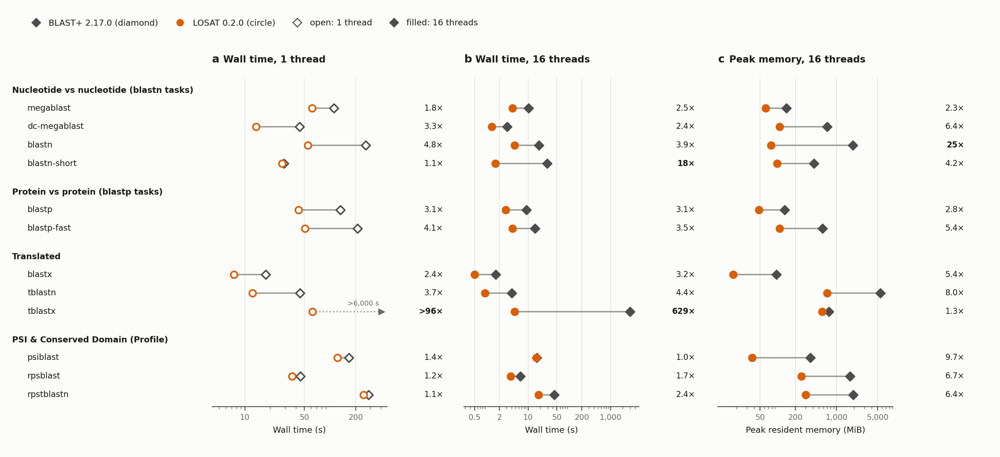
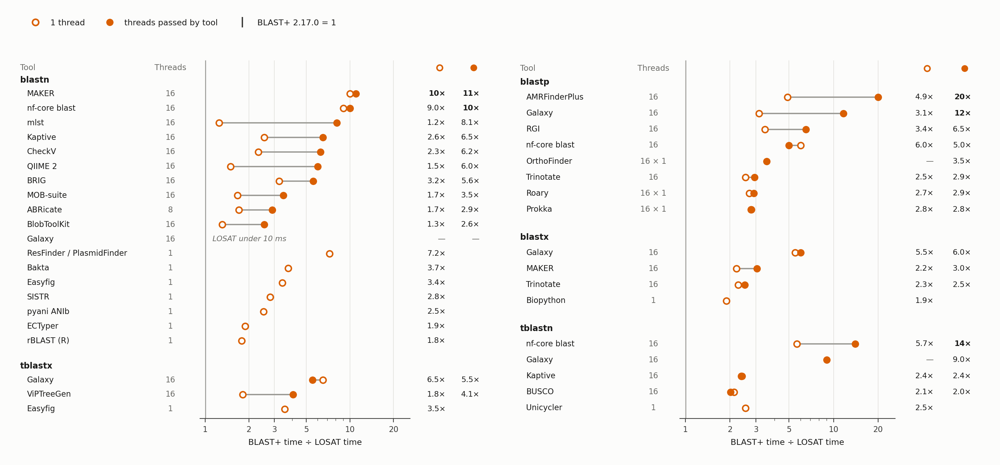

<p align="center">
  <picture>
    <source media="(prefers-color-scheme: dark)" srcset="docs/assets/losat-logo-white.svg">
    
  </picture>
</p>

<h3 align="center">Pure-Rust local BLAST+ engine — CLI, Rust crate, Python package, and WebAssembly</h3>

<p align="center">
  <a href="https://satoshikawato.github.io/LOSAT/">User Manual</a> •
  <a href="benchmarks/v0.2.0/README.md">v0.2.0 Benchmarks</a> •
  <a href="LOSAT/README.md">Rust Crate</a> •
  <a href="python/README.md">Python Package</a> •
  <a href="web/packages/losat/README.md">WebAssembly</a>
</p>

---

**LOSAT** is a pure-Rust reimplementation of the local NCBI **BLAST+ 2.17.0** search suite and database utilities. It ships as one static binary with zero C or C++ runtime dependencies, drops straight into existing command-line pipelines via `--install-shims`, and also exposes native **Rust**, **Python** (`pylosat` with Arrow/Polars zero-copy results), and **WebAssembly / browser** libraries.

Across the v0.2.0 release test suite, LOSAT produces **byte-identical output to single-threaded NCBI BLAST+ 2.17.0** at every `-num_threads` setting, parallelizes both `-db` and `-subject` searches, reads `.gz`/`.bz2`/`.zst` inputs natively, and slashes peak memory on multi-gigabyte databases (holding `core_nt`, `319.4 GB`, to **407 MiB** peak RSS vs **263.6 GiB** for NCBI BLAST+ — **647× less memory**).

<p align="center">
  <picture>
    <source media="(prefers-color-scheme: dark)" srcset="benchmarks/v0.2.0/figures/fig1_standard_workloads_dark.png">
    
  </picture>
</p>

*Standard single-node workloads on Dual Xeon Gold 6338 (`64` cores total; commit `93ca2f652`). At 16 threads, LOSAT is **1.7×–18.3× faster** across `megablast`, `blastn`, `dc-megablast`, `blastn-short`, `blastp`, `blastp-fast`, `blastx`, `tblastn`, `rpsblast`, and `rpstblastn`, and **629× faster** on `tblastx` (`4.72 s` vs `2,970.75 s`). See [benchmarks/v0.2.0/README.md](benchmarks/v0.2.0/README.md).*

---

## Installation

### Bioconda (Linux & macOS)

```bash
conda install -c bioconda -c conda-forge losat
# or with mamba / pixi
mamba install -c bioconda -c conda-forge losat
pixi add losat
```

### Pre-built Binaries (GitHub Releases)

Every v0.2.0 release on [GitHub Releases](https://github.com/satoshikawato/LOSAT/releases) provides self-contained archives plus `SHA256SUMS`, the CycloneDX SBOM (`LOSAT-0.2.0.cdx.json`), and build attestations:

| Platform | Target | Artifact | Binary |
| --- | --- | --- | --- |
| Linux x86_64 | `x86_64-unknown-linux-gnu` | `.tar.gz` | `losat` |
| Linux aarch64 | `aarch64-unknown-linux-gnu` | `.tar.gz` | `losat` |
| macOS arm64 | `aarch64-apple-darwin` | `.tar.gz` | `losat` |
| macOS x86_64 | `x86_64-apple-darwin` | `.tar.gz` | `losat` |
| Windows x86_64 | `x86_64-pc-windows-msvc` | `.zip` | `losat.exe` |
| WASI serial | `wasm32-wasip1` | `.tar.gz` | `losat.wasm` |
| WASI threads | `wasm32-wasip1-threads` | `.tar.gz` | `losat.wasm` |

### Rust, Python & Source Builds

> **Package channels:** `v0.2.0` launches via GitHub Releases and Bioconda; the `losat` crate on [crates.io](https://crates.io/crates/losat) and `pylosat` on [PyPI](https://pypi.org/project/pylosat/) will be published immediately after `v0.2.0`.

```bash
# Build CLI from source (requires Rust 1.92+)
git clone https://github.com/satoshikawato/LOSAT.git
cd LOSAT/LOSAT
cargo build --release
```

---

## Quick Start

Run any NCBI BLAST+ subcommand directly under `losat`, or install symlink shims on `PATH` so existing scripts call LOSAT automatically without edits:

```bash
# 1. Build a database and search with 16 threads (gz/bz2/zst queries work directly)
losat makeblastdb -in 16s_all.fna -dbtype nucl -out 16s_db
losat blastn -query reads.fna.gz -db 16s_db -evalue 1e-5 -outfmt 6 -num_threads 16

# 2. Multi-round PSI-BLAST and Conserved Domain search
losat psiblast -query proteins.faa -db swissprot -num_iterations 3 -outfmt 6 -num_threads 8
losat rpsblast -query proteins.faa -db Cdd -evalue 0.01 -outfmt 6 -num_threads 8

# 3. Drop-in replacement for existing pipelines (blastn, blastp, makeblastdb, ...)
losat --install-shims ~/.local/share/losat-shims
export PATH="$HOME/.local/share/losat-shims:$PATH"
blastp -version   # Package: LOSAT 0.2.0, output compatible with blast 2.17.0
```

<a id="common-command-line-options"></a>
<a id="database-searches"></a>

All search programs support `-db` (BLAST DB v4/v5 on local disk or via `BLASTDB`), `-subject` (FASTA/compressed FASTA, multi-threaded), streaming `-query -`, and custom `-outfmt` columns.

---

## Supported Programs (14)

| Program | Role | Output Formats / Notes | Reference |
| --- | --- | --- | --- |
| `blastn` | Nucleotide–nucleotide (`megablast`, `blastn`, `dc-megablast`, `blastn-short`) | `-outfmt` `0`–`18`, `20` (`-subject` & `-db`) | [blastn](docs/manual/src/programs/blastn.md) |
| `blastp` | Protein–protein (`blastp`, `blastp-fast`, `blastp-short`) | `-outfmt` `0`–`16`, `18`, `20` | [blastp](docs/manual/src/programs/blastp.md) |
| `blastx` | Translated nucleotide vs protein (`blastx`, `blastx-fast`) | `-outfmt` `0`–`16`, `18`, `20` | [blastx](docs/manual/src/programs/blastx.md) |
| `tblastn` | Protein or PSSM (`-in_pssm`) vs translated nucleotide | `-outfmt` `0`–`16`, `18`, `20`; genetic code 32 supported | [tblastn](docs/manual/src/programs/tblastn.md) |
| `tblastx` | Six-frame translated nucleotide vs six-frame nucleotide | `-outfmt` `0`–`16`, `18`, `20` | [tblastx](docs/manual/src/programs/tblastx.md) |
| `psiblast` | Iterative protein / PSSM search (`-num_iterations`, `-in_pssm`, `-out_pssm`) | `-outfmt` `0`, `6`, `7`, `10`, `20` (`-in_pssm`: `0`, `6`, `7`) | [psiblast](docs/manual/src/programs/psiblast.md) |
| `rpsblast` | Protein vs Conserved Domain / PSSM database (`Cdd`) | `-outfmt` `0`, `6`, `7`, `10`; `-comp_based_stats` `0`–`3` | [rpsblast](docs/manual/src/programs/rpsblast.md) |
| `rpstblastn` | Six-frame nucleotide vs Conserved Domain / PSSM database | `-outfmt` `0`–`4`, `6`, `7`, `10`; `-comp_based_stats` `0`–`3` | [rpstblastn](docs/manual/src/programs/rpstblastn.md) |
| `makeblastdb` | Build BLAST v5 databases (`-parse_seqids`, `-taxid`, `-mask_data`, v4→v5) | Supports `.gz`/`.bz2`/`.zst` FASTA inputs | [makeblastdb](docs/manual/src/programs/makeblastdb.md) |
| `blastdbcmd` | Extract sequences, metadata (`-info`), and taxonomy IDs | Compatible with `-entry`, `-entry_batch`, `-outfmt` | [blastdbcmd](docs/manual/src/programs/blastdbcmd.md) |
| `dustmasker` | Symmetric DUST low-complexity masking (nucleotide) | Interval, masked FASTA, ASN.1/XML maskinfo | [dustmasker](docs/manual/src/programs/dustmasker.md) |
| `segmasker` | SEG low-complexity masking (protein) | Interval, masked FASTA, ASN.1/XML maskinfo | [segmasker](docs/manual/src/programs/segmasker.md) |
| `convert2blastmask` | Convert lowercase FASTA or interval lists to maskinfo | ASN.1 text/binary, XML, interval | [convert2blastmask](docs/manual/src/programs/convert2blastmask.md) |
| `rpsbproc` | Annotate CDD domain hits, active sites, and motifs (`0.5.1` compat.) | Reads `rpsblast`/`rpstblastn` `-outfmt 11` archive or XML | [rpsbproc](docs/manual/src/programs/rpsbproc.md) |

---

## Benchmarks & Downstream Pipelines

Running unchanged tools and workflow managers (`AMRFinderPlus`, `nf-core/blast`, `Galaxy`, `MAKER`, `Prokka`, `Roary`, `OrthoFinder`, `Kaptive`, `mlst`, `BRIG`, `CheckV`, `BUSCO`, `ResFinder / PlasmidFinder`, `Bakta`, and more) through `--install-shims` speeds up BLAST stages by **1.8×–20×** with byte-identical outputs across all compared cases:

<p align="center">
  <picture>
    <source media="(prefers-color-scheme: dark)" srcset="benchmarks/v0.2.0/figures/fig3_downstream_tools_dark.png">
    
  </picture>
</p>

See [benchmarks/v0.2.0/README.md](benchmarks/v0.2.0/README.md) for all four figures (standard workloads, thread/query/DB scaling, downstream tools, and WebAssembly) and frozen raw TSV data.

---

## Libraries & WebAssembly

- **Rust (`losat`):** Call `losat::api` directly for in-memory FASTA or `-db` searches with typed `HspRecord`s and byte-identical CLI report bytes (`no_std`-free pure Rust, optional `parallel` / `wasm-threads` features). See [LOSAT/README.md](LOSAT/README.md) and [Rust bindings manual](docs/manual/src/libraries/rust.md).
- **Python (`pylosat`):** Native PyO3 bindings returning **31-column zero-copy Arrow tables** (`to_arrow()`, `to_polars()`, `to_pandas()`, `blastdbcmd()`, `makeblastdb()`, `version()`, `is_available`). See [python/README.md](python/README.md) and [Python bindings manual](docs/manual/src/libraries/python.md).
- **WebAssembly (`@losat/losat`):** Runs in browsers (Reactors / Web Workers) and Node/WASI (`losat.wasm`) at 1.3×–2.4× of native LOSAT wall time. See [web/packages/losat/README.md](web/packages/losat/README.md) and [WebAssembly manual](docs/manual/src/libraries/webassembly.md).

---

<a id="scope--differences-from-ncbi-blast"></a>

## Documentation & Compatibility

- **[Online User Manual](https://satoshikawato.github.io/LOSAT/)** (`docs/manual/src/`):
  - [Introduction](docs/manual/src/introduction.md) • [Quick Start](docs/manual/src/quick-start.md) • [Common Workflows](docs/manual/src/workflows.md) • [Installation](docs/manual/src/installation.md)
  - [Coming from NCBI BLAST+](docs/manual/src/from-ncbi-blast.md) • [Upgrading from LOSAT v0.1](docs/manual/src/from-losat-v0-1.md) • [Threads, Speed & Memory](docs/manual/src/performance.md)
  - [Differences from NCBI BLAST+](docs/manual/src/differences.md) • [What LOSAT Refuses](docs/manual/src/refusals.md) • [Databases](docs/manual/src/databases.md) • [Output Formats](docs/manual/src/output-formats.md) • [Environment Variables](docs/manual/src/environment.md)
- **Known intentional differences & unsupported modes:** Remote/network flags (`-remote`, `-entrez_query`), GI/IPG server lists (`-gilist`, `-ipglist`), `-import_search_strategy`, `deltablast`, `makeprofiledb`, `windowmasker`, `psiblast -in_msa`/`-phi_pattern`, and `-html` are refused upfront with clear errors. See [Differences](docs/manual/src/differences.md) and [Refusals](docs/manual/src/refusals.md).

## License & Citation

Licensed under the [MIT License](LICENSE). See [CITATION.cff](CITATION.cff) for citation metadata. Algorithmic designs follow the public NCBI C++ Toolkit (`ncbi-blast`), reimplemented natively in safe Rust.
