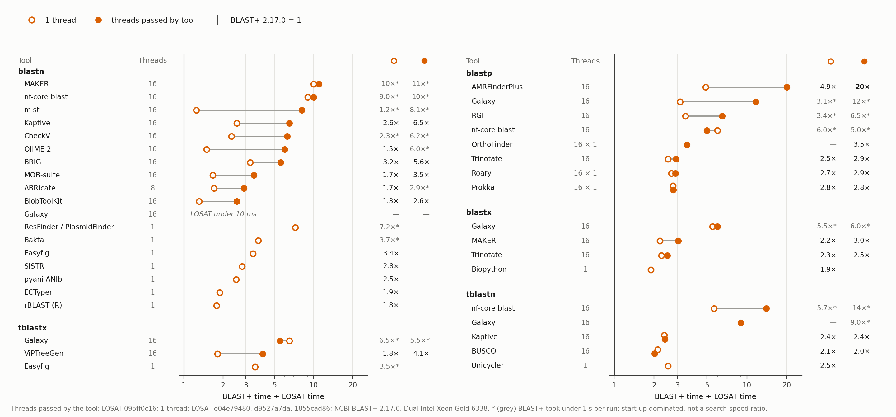

# LOSAT v0.2.0 benchmarks

Wall time and peak resident memory of LOSAT and NCBI BLAST+ 2.17.0 on the same machine: twelve search
modes at 1 and 16 threads, two database utilities, scaling with threads, query count and database size,
the BLAST steps of published tools, and the WebAssembly build. Every number on this page is in the TSV
files of [`snapshot/`](snapshot/); the figures are drawn from them.

How to read the numbers:

- A ratio is BLAST+ ÷ LOSAT, from the medians. Above 1 means LOSAT took less time (or less memory).
  Tables and text round ratios to one decimal, and to whole numbers from 100; the figures round to whole
  numbers from 10.
- Memory is the peak resident memory of the process (`max RSS`). NCBI BLAST+ maps database files into
  memory (`mmap`), so its `max RSS` on a large `-db` search includes file-backed database pages that the
  kernel can drop and reload rather than heap alone; LOSAT's `max RSS` stays small on the same databases.
  Cache states are named where they matter: "warm" means the database files were read once before the timed
  runs, "cold" that their pages were dropped from the page cache before each run.
- The same output means the same SHA-256 of the output file.

## Builds and machine

| | |
| --- | --- |
| LOSAT | Commit `93ca2f652` (v0.2.0 release candidate) for Table 2, the utilities, thread and query scaling, and the `abr_genes`, `16s_all` and warm `ref_prok_rep_genomes` runs. Development builds for the rest: `095ff0c16` (`core_nt`, the cold `ref_prok_rep_genomes` runs, published tools at the tools' thread counts), `e04e79480`, `d9527a7da` and `1855cad86` (published tools at 1 thread), `7f7db49c` (WebAssembly). [`snapshot/metadata.json`](snapshot/metadata.json) lists each. |
| Baseline | NCBI BLAST+ 2.17.0 and NCBI `rpsbproc` 0.5.1; LOSAT v0.1.0 where named |
| Machine | Two Intel Xeon Gold 6338 CPUs (2.00 GHz, 64 cores in two NUMA nodes), Linux |
| Placement | Each run's CPUs and memory were bound to one NUMA node with `numactl` (the `core_nt` runs: CPUs only). One-thread runs used one core of node 0, whose other cores ran other jobs, with both programs on the same core; most runs with 2 to 16 threads used 2 to 16 cores of node 1. LOSAT and NCBI BLAST+ ran in alternation. |

## Standard searches (Tables 1 and 2, Figure 1)

**Table 1.** Inputs and commands. For a FASTA subject, LOSAT ran `-subject FILE` and NCBI BLAST+ ran
`-db` on a database made from the same FASTA, because NCBI BLAST+ runs a `-subject` search on one thread
whatever `-num_threads` says. All searches wrote `-outfmt 6`.

| Search | Query | Subject or database | LOSAT / BLAST+ form | Options |
| --- | --- | --- | --- | --- |
| `megablast` | 16S rRNA genes, 100 full-length (143,418 nt) | RefSeq 16S rRNA, 28,036 sequences (40.6 Mb) | `-subject` / `-db` | `-task megablast` |
| `dc-megablast` | *D. melanogaster* cDNAs, 31,168 (89.3 Mb) | *D. melanogaster* chromosome 2L, first 3 Mb | `-subject` / `-db` | `-task dc-megablast` |
| `blastn` | the same cDNAs | the same 3 Mb | `-subject` / `-db` | `-task blastn` |
| `blastn-short` | synthetic 24-mers, 30,000 (720,000 nt) | the same 3 Mb | `-subject` / `-db` | `-task blastn-short -evalue 0.001` |
| `blastp` | human proteins, first 3,000 of a proteome (1,196,107 aa) | *S. cerevisiae* proteome, 6,600 proteins (2.9 M aa) | `-subject` / `-db` | `-evalue 0.001` |
| `blastp-fast` | human proteome, 23,879 proteins (13.4 M aa) | the same proteome | `-subject` / `-db` | `-task blastp-fast -evalue 0.001` |
| `blastx` | *D. melanogaster* chromosome 2L, 50 kb | *D. melanogaster* proteome database, 30,802 proteins | `-db` / `-db` | `-evalue 1e-5` |
| `tblastn` | human protein ENSP00000343742.5 (411 aa) | human genome GRCh38 database, 194 sequences (3.1 Gb) | `-db` / `-db` | `-evalue 1e-5 -max_target_seqs 5` |
| `tblastx` | three *Candidatus* genomes (1.9 Mb) | three *Candidatus* genomes (1.9 Mb) | `-subject` / `-db` | `-query_gencode 4 -db_gencode 4` |
| `psiblast` | *E. coli* MG1655 proteins, 20 (5,882 aa) | UniProtKB/Swiss-Prot database `swissprot`, 487,728 proteins | `-db` / `-db` | `-num_iterations 3 -evalue 0.001` |
| `rpsblast` | *E. coli* MG1655 proteins, 300 (98,758 aa) | NCBI CDD v3.22, 71,136 profiles in 29 volumes | `-db` / `-db` | `-evalue 0.01` |
| `rpstblastn` | *E. coli* MG1655, 100 segments of 5 kb | NCBI CDD v3.22 | `-db` / `-db` | (defaults) |

File names, sizes and SHA-256 of every input: [`snapshot/inputs.tsv`](snapshot/inputs.tsv).

<p align="center">
  <picture>
    <source media="(prefers-color-scheme: dark)" srcset="figures/fig1_standard_workloads_dark.png">
    
  </picture>
</p>

**Figure 1.** LOSAT `93ca2f652` (circles) and NCBI BLAST+ 2.17.0 (diamonds), in the forms of Table 1.
**a**, wall time at 1 thread; **b**, wall time at 16 threads; **c**, max RSS at 16 threads. The numbers
right of each panel are BLAST+ ÷ LOSAT.

**Table 2.** Medians. At 16 threads: 8 rounds for LOSAT and NCBI BLAST+ after a discarded warm-up round
(`psiblast`, `rpsblast`, `rpstblastn`: 3 rounds); NCBI BLAST+ `tblastx`: one run. At 1 thread: 5 LOSAT
runs and one NCBI BLAST+ run (`psiblast`, `rpsblast`: 3 each; `rpstblastn`: one each).

| Search | 1 thread: LOSAT / BLAST+ (s) | BLAST+ ÷ LOSAT | 16 threads: LOSAT / BLAST+ (s) | BLAST+ ÷ LOSAT | Max RSS, 16 threads: LOSAT / BLAST+ (MiB) | BLAST+ ÷ LOSAT | Output |
| --- | ---: | ---: | ---: | ---: | ---: | ---: | --- |
| `megablast` | 61.52 / 111.22 | 1.8 | 4.20 / 10.30 | 2.5 | 62.0 / 140.0 | 2.3 | same |
| `dc-megablast` | 13.50 / 44.21 | 3.3 | 1.31 / 3.12 | 2.4 | 107.4 / 690.5 | 6.4 | same |
| `blastn` | 54.93 / 262.44 | 4.8 | 4.67 / 18.37 | 3.9 | 76.7 / 1,889.0 | 24.6 | same |
| `blastn-short` | 27.31 / 28.84 | 1.1 | 1.59 / 29.09 | 18.3 | 97.9 / 411.8 | 4.2 | same |
| `blastp` | 42.86 / 132.42 | 3.1 | 2.87 / 9.02 | 3.1 | 47.5 / 131.0 | 2.8 | see note |
| `blastp-fast` | 50.95 / 210.68 | 4.1 | 4.20 / 14.65 | 3.5 | 107.6 / 580.1 | 5.4 | see note |
| `blastx` | 7.46 / 17.59 | 2.4 | 0.51 / 1.64 | 3.2 | 17.5 / 95.3 | 5.4 | same |
| `tblastn` | 12.23 / 44.64 | 3.7 | 0.90 / 3.99 | 4.4 | 695.1 / 5,539.7 | 8.0 | same |
| `tblastx` | 62.35 / 6,493.88 | 104 | 4.72 / 2,970.75 | 629 | 567.5 / 738.7 | 1.3 | same |
| `psiblast` | 122.45 / 166.55 | 1.4 | 15.95 / 16.33 | 1.0 | 36.9 / 356.8 | 9.7 | same |
| `rpsblast` | 35.99 / 44.97 | 1.2 | 3.77 / 6.49 | 1.7 | 254.5 / 1,693.3 | 6.7 | same |
| `rpstblastn` | 248.98 / 284.10 | 1.1 | 18.00 / 42.90 | 2.4 | 297.3 / 1,916.8 | 6.4 | same |

At 16 threads LOSAT took less time than NCBI BLAST+ in all twelve modes. NCBI BLAST+ took from about
as long (`psiblast`, 16.33 s against 15.95 s, ratio 1.0) to 18.3 times as long (`blastn-short`), and
629 times as long in `tblastx`. At 1 thread the ratio is 1.1 (`blastn-short`, `rpstblastn`) to 4.8
(`blastn`), and 104 in `tblastx`. NCBI BLAST+'s max RSS at 16 threads was 1.3 (`tblastx`) to 24.6
(`blastn`) times LOSAT's. Each LOSAT search wrote the same bytes at 1 and at 16 threads.

Notes:

- **`blastp` and `blastp-fast`.** A `-db` search and a `-subject` search of the same proteins give
  different statistics in NCBI BLAST+ too, so the two timed outputs differ. The forms were also compared
  one by one at 1 thread: LOSAT `-subject` and NCBI BLAST+ `-subject` wrote the same bytes
  (`354b7a793402c0ac`, `1dd47f97d8c77ca2`; NCBI BLAST+ took 132.06 s and 213.88 s), and so did LOSAT
  `-db` and NCBI BLAST+ `-db` (`3a92bc0410a1ac8a`, `f4ecd9f36f7f2ea1`).
- **`tblastx`.** NCBI BLAST+ ran `-db` and used its threads (6,494 s at 1 thread, 2,971 s at 16 threads,
  one run each); LOSAT ran `-subject`. The output was the same (`ea54151b99edecb9`). The first 1-thread
  NCBI BLAST+ run stopped at its 6,000 s limit; the table has the run that finished.
- **Against LOSAT v0.1.0** (16 threads, same rounds): `blastn` 212.38 s and 3,858.5 MiB with v0.1.0,
  4.67 s and 76.7 MiB with `93ca2f652` (v0.1.0 took 45.5 times as long and used 50.3 times as much memory); `megablast`
  57.66 s and 2,031.0 MiB, now 4.20 s and 62.0 MiB (13.7 and 32.8 times); `tblastx` 188.02 s and
  1,605.4 MiB, now 4.72 s and 567.5 MiB (39.8 and 2.8 times); `blastp` 15.74 s and 578.9 MiB, now 2.87 s
  and 47.5 MiB (5.5 and 12.2 times). v0.1.0's `megablast` and `tblastx` outputs differ from NCBI
  BLAST+'s; its `blastn` and `blastp` outputs are the same.

## Database construction and domain reports (Table 3)

**Table 3.** One thread, medians of 3 alternated runs, LOSAT `93ca2f652`
([`snapshot/utilities.tsv`](snapshot/utilities.tsv)).

| Program and input | LOSAT / NCBI (s) | NCBI ÷ LOSAT | Max RSS: LOSAT / NCBI (MiB) | NCBI ÷ LOSAT | Output |
| --- | ---: | ---: | ---: | ---: | --- |
| `makeblastdb -dbtype nucl`, RefSeq 16S rRNA (28,036 sequences, 40.6 Mb) | 0.193 / 0.691 | 3.6 | 9.0 / 52.0 | 5.8 | not compared |
| `makeblastdb -dbtype prot`, UniProtKB/Swiss-Prot (575,748 sequences, 209.0 M aa) | 2.197 / 8.537 | 3.9 | 16.0 / 58.4 | 3.6 | not compared |
| `rpsbproc -t both -m rep -f`, `rpsblast` XML of 4,300 *E. coli* proteins against CDD v3.22, against NCBI `rpsbproc` 0.5.1 | 1.309 / 2.610 | 2.0 | 62.0 / 331.0 | 5.3 | same |

## Scaling with threads, query count and database size (Figure 2)

<p align="center">
  <picture>
    <source media="(prefers-color-scheme: dark)" srcset="figures/fig2_scaling_dark.png">
    
  </picture>
</p>

**Figure 2.** LOSAT (circles) and NCBI BLAST+ 2.17.0 (diamonds); labels are BLAST+ ÷ LOSAT
([`snapshot/scaling.tsv`](snapshot/scaling.tsv)). **a**, wall time at 1, 2, 4, 8 and 16 threads for the
`blastn`, `blastp` and `tblastn` searches of Table 1 (in its forms); dotted lines are ideal linear
scaling from 1 thread. **b**, `megablast` of 10,000, 100,000 and 1,000,000 reads of 150 nt against the
RefSeq 16S rRNA database, both programs `-db`, 16 threads (`-evalue 1e-5 -max_target_seqs 5`).
**c**, wall time and **d**, max RSS of `megablast` of 210 draft contigs (5.50 Mb) against databases from
`abr_genes` (0.16 MB on disk, 340 sequences) and RefSeq 16S rRNA (15.3 MB) to `ref_prok_rep_genomes`
(26.8 GB, 1.14 million sequences) and NCBI's `core_nt` (319.4 GB, 132.3 million sequences), both
programs `-db`, 16 threads, `-max_target_seqs 10 -max_hsps 1 -evalue 1e-25 -lcase_masking -dust "20 64 1"`;
faded points are cold-cache runs. LOSAT `93ca2f652` except the `core_nt` points and the cold-cache
points, which are `095ff0c16`.

- **Threads (a).** From 1 to 16 threads LOSAT's wall time fell 11.8 times on `blastn` (54.93 s to
  4.67 s), 14.9 times on `blastp` (42.86 s to 2.87 s) and 13.6 times on `tblastn` (12.23 s to 0.90 s);
  NCBI BLAST+'s fell 14.3, 14.7 and 11.2 times. BLAST+ ÷ LOSAT stayed between 3.1 and 4.9 at every thread
  count. LOSAT wrote the same bytes at every thread count.
- **Query count (b).** 10,000 reads: 0.075 s against 1.49 s (19.8 times). 1,000,000 reads: 3.60 s and
  302 MiB against 12.01 s and 5,145 MiB (BLAST+ ÷ LOSAT: 3.3 for time, 17.0 for memory).
- **Database size (c, d).** `ref_prok_rep_genomes`, warm: 29.37 s and 358 MiB against 47.28 s and
  25,580 MiB (BLAST+ ÷ LOSAT: 1.6 for time, 71.4 for memory); cold: 44.96 s against 87.22 s. `core_nt`, warm:
  391.74 s and 407 MiB against 542.14 s and 263,594 MiB, that is 257.4 GiB (1.4 for time,
  647 for memory); cold: 491.16 s against 775.83 s. On `abr_genes` NCBI BLAST+ took 0.90 s, most of
  it start-up. The outputs were the same in every run of b, c and d.

## Published tools (Figure 3)

<p align="center">
  <picture>
    <source media="(prefers-color-scheme: dark)" srcset="figures/fig3_downstream_tools_dark.png">
    
  </picture>
</p>

**Figure 3.** Total time of the BLAST commands that each tool runs on its own test data, with the tool's
command lines, NCBI BLAST+ 2.17.0 ÷ LOSAT ([`snapshot/downstream_tools.tsv`](snapshot/downstream_tools.tsv)).
Filled: the thread count the tool passes (16; ABRicate 8; Prokka, Roary and OrthoFinder as 16
one-thread BLAST processes at once), LOSAT `095ff0c16`, medians of 3 alternated rounds. Open: one
thread, LOSAT `e04e79480`, `d9527a7da` or `1855cad86`, medians of 4 alternated runs. Grey ratios marked
`*`: NCBI BLAST+ took less than 1 s per BLAST run, so the ratio measures program start-up more than
search speed.

- Quoting only rows where NCBI BLAST+ took at least 1 s per run: at the tools' thread counts NCBI BLAST+
  took 2.0 (BUSCO, `tblastn`) to about 20 (AMRFinderPlus, `blastp`: 1.60 s against 0.08 s) times as long
  as LOSAT, over 14 tool rows; at one thread, 1.3 (BlobToolKit) to 4.9 (AMRFinderPlus) times as long,
  over 22 rows.
- Tools measured: ABRicate, AMRFinderPlus, Bakta, Biopython, BlobToolKit, BRIG, BUSCO, CheckV, ECTyper,
  Easyfig, Galaxy, Kaptive, MAKER, mlst, MOB-suite, nf-core/blast, OrthoFinder, Prokka, pyani (ANIb),
  QIIME 2, rBLAST, ResFinder and PlasmidFinder, RGI, Roary, SISTR, Trinotate, Unicycler and ViPTreeGen.
- Output: in every compared run LOSAT wrote NCBI BLAST+'s output. In BUSCO and QIIME 2, NCBI BLAST+'s own
  8- and 16-thread output differs from its 1-thread output; there LOSAT's output at every thread count
  equals NCBI BLAST+'s 1-thread output.

## WebAssembly (Figure 4)

<p align="center">
  <picture>
    <source media="(prefers-color-scheme: dark)" srcset="figures/fig4_webassembly_dark.png">
    
  </picture>
</p>

**Figure 4.** NCBI BLAST+ 2.17.0 (native) ÷ LOSAT for native LOSAT and the threaded WASI build
(`wasm32-wasip1-threads`, run by Node.js), development build `7f7db49c`, on the searches of Table 1
([`snapshot/webassembly.tsv`](snapshot/webassembly.tsv)). In this snapshot (`wasm_derived: true` in
[`snapshot/metadata.json`](snapshot/metadata.json)), the `7f7db49c` values are derived from the measured
times of build `6a0a8719` scaled by the ratio of `7f7db49c` vs `6a0a8719` run side by side (1 thread:
CPU cycles on the same core; 16 threads: wall time, 3 rounds) and are marked on the figure as estimates
from `6a0a8719`. NCBI BLAST+ `tblastx` was not run in this set.

- The WebAssembly build took 1.3 to 1.6 times the time of native LOSAT at 1 thread, and 1.5 to 2.4 times
  at 16 threads.
- Against native NCBI BLAST+ at 16 threads, NCBI BLAST+ took from about as long (`dc-megablast`, 1.0)
  to 12.3 times as long (`blastn-short`). At 1 thread the ratio is 0.8 (`blastn-short`, where the
  WebAssembly build took longer) to 3.1 (`blastn`).

## Reproducing the tables and figures

The raw measurements are outside this repository; [`snapshot/metadata.json`](snapshot/metadata.json)
lists every input file with its SHA-256. From the repository root:

```bash
python3 -I benchmarks/v0.2.0/scripts/build_snapshot.py
python3 -I benchmarks/v0.2.0/scripts/render_figures.py
```

`build_snapshot.py` takes the input paths (defaulting under `$LOSAT_BASELINES_DIR` / `~/losat-baselines`,
stored in `metadata.json` without user home prefixes), `--losat-commit`, `--wasm-paired`, and
`--wasm-derived-from` as options (`--help`). The figures were rendered with Matplotlib 3.10.3 and
NumPy 2.2.5; the same snapshot and versions give the same PNG files, and `render_figures.py` writes
both `figures/` and `docs/manual/src/images/` for the user manual.

[All benchmark sets](../README.md)
