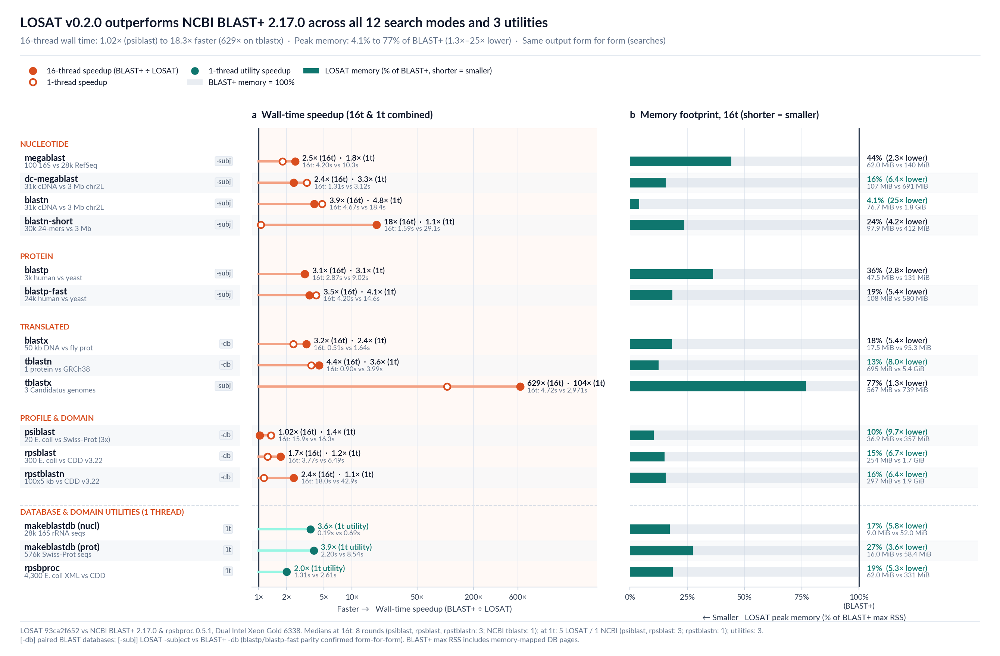
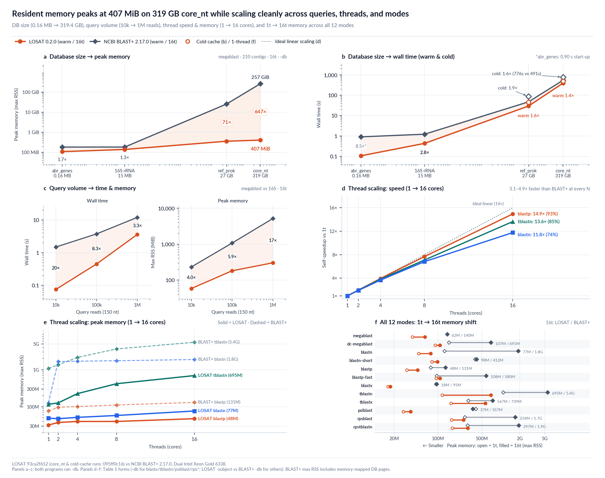

# LOSAT v0.2.0 benchmarks

Wall time, peak resident memory, and output parity of LOSAT and NCBI BLAST+ 2.17.0 on the same Linux workstation across six benchmark views:

1. **Suite overview (`Figure 1`)** — all 12 search modes (1 and 16 threads) plus 3 single-threaded utilities (`makeblastdb` nucleotide/protein, `rpsbproc`).
2. **Real workflows & published tools (`Figure 2`)** — 9 large reference workflows (`core_nt`, `ref_prok_rep_genomes`, UniRef50, QIIME 2, Trinotate, 1M reads via file and `stdin`) and unmodified commands from 28 published tools, plotting only workloads where BLAST+ took at least 1 s per run.
3. **Scaling (`Figure 3`)** — database size from 0.16 MB (`abr_genes`) to 319.4 GB (`core_nt`, warm and cold page cache), query volume (10k to 1M reads, time and peak memory), thread speed and peak memory scaling (1 to 16 cores), and the 1-to-16-thread peak memory shift across all 12 search modes.
4. **Exact BLAST+ parity vs. heuristic aligners (`Figure 4`)** — UniRef50 (38.8M proteins, 32 threads) against DIAMOND 2.2.8 and MMseqs2 18.8cc5c (with and without its 101 GiB index), plus SILVA 144 NR99 (905k 16S rRNAs, 16 threads) against vsearch 2.32.0.
5. **WebAssembly portability (`Figure 5`)** — `wasm32-wasip1-threads` (Node.js) vs. native LOSAT and native NCBI BLAST+ 2.17.0 (speed, `Wasm / native %`, and 16-thread peak memory).
6. **Generational leap: v0.1.0 to v0.2.0 (`Figure 6`)** — wall time and peak memory across all four search modes present in LOSAT v0.1.0 alongside NCBI BLAST+ 2.17.0.

Every number on this page comes directly from the checksummed TSV tables in [`snapshot/`](snapshot/), from which all figures are rendered deterministically.

How to read the numbers:

- A ratio is `BLAST+ ÷ LOSAT`. Tables 1–4 use medians across rounds; Table 5 (UniRef50) uses one chosen round per arm; Table 6 (SILVA 144) uses the mean of 2 alternated runs (`vsearch`: 1 run). Above `1×` means LOSAT took less time or less memory. Tables round ratios to one decimal (and whole numbers from 100); figures round to whole numbers from 10 (and two decimals near `1.0×` so `1.02×` is distinguishable from a tie).
- Memory is peak resident set size (`max RSS`), with anonymous heap (`RssAnon`) separated where measured (`Figure 4c`, UniRef50 and SILVA 144 tables). NCBI BLAST+ maps database files into memory (`mmap`), so its `max RSS` on large `-db` searches includes file-backed pages that the OS kernel can reclaim. "Warm" means database files were read once before timed runs; "cold" means Linux page-cache entries were dropped before each run.
- "Same output" means byte-identical SHA-256 checksums of the output files.

## Builds and machine

| | |
| --- | --- |
| LOSAT | Commit `93ca2f652` (v0.2.0 release candidate) for Figures 1 and 6, Tables 1–3, thread/query scaling, and `abr_genes`, `16s_all`, and warm `ref_prok_rep_genomes` scaling. Development builds for the rest: `095ff0c16` (`core_nt`, cold `ref_prok_rep_genomes`, large reference workflows, multi-thread published tools), `e04e79480`, `d9527a7da`, and `1855cad86` (single-thread published tools), `995281681` (UniRef50 vs. heuristic aligners), `dde737f18` (SILVA 144 vs. vsearch), and `7f7db49c` derived from `6a0a8719` (WebAssembly). [`snapshot/metadata.json`](snapshot/metadata.json) records every build and input SHA-256. |
| Baselines | NCBI BLAST+ 2.17.0, NCBI `rpsbproc` 0.5.1, DIAMOND 2.2.8, MMseqs2 18.8cc5c, vsearch 2.32.0, and LOSAT v0.1.0 where named |
| Machine | Dual Intel Xeon Gold 6338 CPUs (2.00 GHz, 64 physical cores across 2 NUMA nodes), Linux |
| Placement | Each timed run was pinned to one NUMA node with `numactl` (`core_nt`: CPU-pinned). Single-thread runs alternated on the same core of node 0; multi-thread runs alternated on 2–16 cores (32 cores for UniRef50) of node 1. |

## 1. All 12 search modes and 3 utilities (Tables 1–3, Figure 1)

**Table 1.** Standard workload inputs and commands. Where the subject is a FASTA file, LOSAT ran `-subject FILE` and NCBI BLAST+ ran `-db` on a database built from the same FASTA (because NCBI BLAST+ ignores `-num_threads` with `-subject`). All searches wrote `-outfmt 6`.

| Search | Query | Subject or database | LOSAT / BLAST+ form | Options |
| --- | --- | --- | --- | --- |
| `megablast` | 16S rRNA genes, 100 full-length (143,418 nt) | RefSeq 16S rRNA, 28,036 sequences (40.6 Mb) | `-subject` / `-db` | `-task megablast` |
| `dc-megablast` | *D. melanogaster* cDNAs, 31,168 (89.3 Mb) | *D. melanogaster* chromosome 2L, first 3 Mb | `-subject` / `-db` | `-task dc-megablast` |
| `blastn` | the same cDNAs | the same 3 Mb | `-subject` / `-db` | `-task blastn` |
| `blastn-short` | synthetic 24-mers, 30,000 (720,000 nt) | the same 3 Mb | `-subject` / `-db` | `-task blastn-short -evalue 0.001` |
| `blastp` | human proteins, first 3,000 of a proteome (1,196,107 aa) | *S. cerevisiae* proteome, 6,600 proteins (2.9 M aa) | `-subject` / `-db` | `-evalue 0.001` |
| `blastp-fast` | human proteome, 23,879 proteins (13.4 M aa) | the same proteome | `-subject` / `-db` | `-task blastp-fast -evalue 0.001` |
| `blastx` | *D. melanogaster* chromosome 2L, 50 kb | *D. melanogaster* proteome database, 30,802 proteins | `-db` / `-db` | `-evalue 1e-5` |
| `tblastn` | human protein ENSP00000343742.5 (411 aa) | human genome GRCh38 database, 194 sequences (3.1 Gb) | `-db` / `-db` | `-evalue 1e-5 -max_target_seqs 5` |
| `tblastx` | three *Candidatus* genomes (1.9 Mb) | three *Candidatus* genomes (1.9 Mb) | `-subject` / `-db` | `-query_gencode 4 -db_gencode 4` |
| `psiblast` | *E. coli* MG1655 proteins, 20 (5,882 aa) | UniProtKB/Swiss-Prot database `swissprot`, 487,728 proteins | `-db` / `-db` | `-num_iterations 3 -evalue 0.001` |
| `rpsblast` | *E. coli* MG1655 proteins, 300 (98,758 aa) | NCBI CDD v3.22, 71,136 profiles in 29 volumes | `-db` / `-db` | `-evalue 0.01` |
| `rpstblastn` | *E. coli* MG1655, 100 segments of 5 kb | NCBI CDD v3.22 | `-db` / `-db` | (defaults) |

File names, sizes, and SHA-256 digests of every input are recorded in [`snapshot/inputs.tsv`](snapshot/inputs.tsv).

<p align="center">
  <picture>
    <source media="(prefers-color-scheme: dark)" srcset="figures/fig1_suite_overview_dark.png">
    
  </picture>
</p>

**Figure 1.** LOSAT `93ca2f652` vs. NCBI BLAST+ 2.17.0 and `rpsbproc` 0.5.1 across all 12 search modes and 3 single-threaded utilities ([`snapshot/standard_workloads.tsv`](snapshot/standard_workloads.tsv), [`snapshot/utilities.tsv`](snapshot/utilities.tsv)). **a**, combined 16-thread (filled) and 1-thread (open) wall-time speedup lollipops, plus 1-thread utilities (`makeblastdb`, `rpsbproc`). **b**, LOSAT peak resident memory at 16 threads (1 thread for utilities) as a percentage of NCBI BLAST+ 2.17.0 (`100%` reference track; shorter bars indicate smaller memory).

**Table 2.** Search mode medians. At 16 threads: 8 rounds after a discarded warm-up (`psiblast`, `rpsblast`, `rpstblastn`: 3 rounds; NCBI `tblastx`: 1 run). At 1 thread: 5 LOSAT runs and 1 NCBI run (`psiblast`, `rpsblast`: 3 each; `rpstblastn`: 1 each).

| Search | 1t: LOSAT / BLAST+ (s) | BLAST+ ÷ LOSAT | 16t: LOSAT / BLAST+ (s) | BLAST+ ÷ LOSAT | Max RSS, 16t: LOSAT / BLAST+ (MiB) | BLAST+ ÷ LOSAT | Output |
| --- | ---: | ---: | ---: | ---: | ---: | ---: | --- |
| `megablast` | 61.52 / 111.22 | 1.8 | 4.20 / 10.30 | 2.5 | 62.0 / 140.0 | 2.3 | same |
| `dc-megablast` | 13.50 / 44.21 | 3.3 | 1.31 / 3.12 | 2.4 | 107.4 / 690.5 | 6.4 | same |
| `blastn` | 54.93 / 262.44 | 4.8 | 4.67 / 18.37 | 3.9 | 76.7 / 1,889.0 | 24.6 | same |
| `blastn-short` | 27.31 / 28.84 | 1.1 | 1.59 / 29.09 | 18.3 | 97.9 / 411.8 | 4.2 | same |
| `blastp` | 42.86 / 132.42 | 3.1 | 2.87 / 9.02 | 3.1 | 47.5 / 131.0 | 2.8 | see note |
| `blastp-fast` | 50.95 / 210.68 | 4.1 | 4.20 / 14.65 | 3.5 | 107.6 / 580.1 | 5.4 | see note |
| `blastx` | 7.46 / 17.59 | 2.4 | 0.51 / 1.64 | 3.2 | 17.5 / 95.3 | 5.4 | same |
| `tblastn` | 12.23 / 44.64 | 3.7 | 0.90 / 3.99 | 4.4 | 695.1 / 5,539.7 | 8.0 | same |
| `tblastx` | 62.35 / 6,493.88 | 104 | 4.72 / 2,970.75 | 629 | 567.5 / 738.7 | 1.3 | same |
| `psiblast` | 122.45 / 166.55 | 1.4 | 15.95 / 16.33 | 1.02 | 36.9 / 356.8 | 9.7 | same |
| `rpsblast` | 35.99 / 44.97 | 1.2 | 3.77 / 6.49 | 1.7 | 254.5 / 1,693.3 | 6.7 | same |
| `rpstblastn` | 248.98 / 284.10 | 1.1 | 18.00 / 42.90 | 2.4 | 297.3 / 1,916.8 | 6.4 | same |

Notes on Table 2:

- **`blastp` and `blastp-fast`.** A `-db` search and a `-subject` search of the same proteins give different statistics in NCBI BLAST+ as well, so the timed `-subject` vs. `-db` outputs differ. Compared form-for-form at 1 thread, LOSAT `-subject` matched NCBI BLAST+ `-subject` byte-for-byte (`354b7a793402c0ac`, `1dd47f97d8c77ca2`; NCBI took 132.06 s and 213.88 s), and LOSAT `-db` matched NCBI BLAST+ `-db` byte-for-byte (`3a92bc0410a1ac8a`, `f4ecd9f36f7f2ea1`).
- **`tblastx`.** NCBI BLAST+ ran `-db` and used its threads (6,494 s at 1 thread, 2,971 s at 16 threads, one run each); LOSAT ran `-subject`. Output matched byte-for-byte (`ea54151b99edecb9`).
- **Thread invariance.** Every LOSAT search wrote identical bytes at 1 and 16 threads.

**Table 3.** Single-threaded database construction and conserved-domain annotation utilities (medians of 3 alternated runs, LOSAT `93ca2f652`; [`snapshot/utilities.tsv`](snapshot/utilities.tsv)).

| Program and input | LOSAT / NCBI (s) | NCBI ÷ LOSAT | Max RSS: LOSAT / NCBI (MiB) | NCBI ÷ LOSAT | Output |
| --- | ---: | ---: | ---: | ---: | --- |
| `makeblastdb -dbtype nucl`, RefSeq 16S rRNA (28,036 sequences, 40.6 Mb) | 0.193 / 0.691 | 3.6 | 9.0 / 52.0 | 5.8 | not compared |
| `makeblastdb -dbtype prot`, UniProtKB/Swiss-Prot (575,748 sequences, 209.0 M aa) | 2.197 / 8.537 | 3.9 | 16.0 / 58.4 | 3.6 | not compared |
| `rpsbproc -t both -m rep -f`, `rpsblast` XML of 4,300 *E. coli* proteins vs. CDD v3.22 | 1.309 / 2.610 | 2.0 | 62.0 / 331.0 | 5.3 | same |

## 2. Large reference workflows and published tools (Table 4, Figure 2)

To separate genuine search performance from process start-up latency, Figure 2 plots **only workloads where NCBI BLAST+ took at least 1 s per BLAST invocation**, displaying both wall-time speedup and peak resident memory reduction side by side. Start-up-dominated official tool test suites (`< 1 s/run` in BLAST+: ABRicate at 0.78 s/run across 9 runs, Bakta, CheckV, Easyfig `tblastx`, Galaxy, MAKER `blastn`, mlst, nf-core/blast, QIIME 2 small test, ResFinder/PlasmidFinder, and RGI) also matched NCBI output and remain recorded in full in [`snapshot/downstream_tools.tsv`](snapshot/downstream_tools.tsv).

<p align="center">
  <picture>
    <source media="(prefers-color-scheme: dark)" srcset="figures/fig2_real_pipelines_dark.png">
    
  </picture>
</p>

**Figure 2.** Unmodified BLAST+ commands run through `losat --install-shims` ([`snapshot/large_workflows.tsv`](snapshot/large_workflows.tsv), [`snapshot/downstream_tools.tsv`](snapshot/downstream_tools.tsv)). Each panel pairs wall-time speedup (`BLAST+ ÷ LOSAT`, longer = faster) with LOSAT's remaining peak resident memory as a percentage of BLAST+ (`100%` reference track, shorter = smaller). **a**, 9 large reference workflows at 16 threads (earlier development build `095ff0c16`, medians of 3 rounds; warm `ref_prok_rep_genomes` on release candidate `93ca2f652` appears in §3 / Figure 3a–b). On 1M reads against 16S rRNA, piping the query through `stdin` slows NCBI BLAST+ `15.9×` compared with reading from a file (`174.53 s` vs. `10.98 s`), whereas LOSAT takes `1.19×` as long (`4.31 s` vs. `3.63 s`), yielding `40.5×` via `stdin` vs. `3.0×` from a query file (consistent with Figure 3c's `3.3×` on build `93ca2f652`). **b**, 14 multi-thread published tool rows taking ≥ 1 s/run (16 threads; Prokka, Roary, and OrthoFinder as 16 concurrent 1-thread processes; LOSAT `095ff0c16`). **c**, 7 single-thread-only published tool rows taking ≥ 1 s/run (LOSAT `e04e79480`, `d9527a7da`, `1855cad86`, medians of 4 runs). Plotted times for multi-call tools are summed over the BLAST calls in each workflow. `†` marks workloads where NCBI BLAST+'s multi-thread output drifts from its own 1-thread output; LOSAT matches 1-thread NCBI byte-for-byte.

**Table 4.** Large reference workflows at 16 threads (earlier development build `095ff0c16` vs. NCBI BLAST+ 2.17.0, warm page cache; [`snapshot/large_workflows.tsv`](snapshot/large_workflows.tsv)). Across the 8 query-file workflows, LOSAT ran `1.4×` to `5.0×` faster (`3.0×` on 1M reads from a file, matching Figure 3c's `3.3×` on build `93ca2f652`), and `40.5×` faster when piping those 1M reads through `stdin`, where NCBI BLAST+ takes `15.9×` longer than from a file (`174.53 s` vs. `10.98 s`) while LOSAT takes `1.19×` (`4.31 s` vs. `3.63 s`). For warm `ref_prok_rep_genomes` on release candidate `93ca2f652` (`29.37 s` / `1.6×`, `71.4×` memory), see §3 and Figure 3a–b.

| Workflow | Program | LOSAT / BLAST+ (s) | Speedup | Max RSS: LOSAT / BLAST+ (MiB) | Memory ratio | Output |
| --- | --- | ---: | ---: | ---: | ---: | --- |
| 1M reads (150 nt) vs. 16S rRNA (`stdin`) | `blastn` | 4.31 / 174.53 | 40.5 | 344.0 / 498.0 | 1.4 | same |
| 1M reads (150 nt) vs. 16S rRNA (query file) | `blastn` | 3.63 / 10.98 | 3.0 | 294.2 / 5,221.6 | 17.7 | same |
| QIIME 2 (100k amplicons, 253 nt) vs. 16S rRNA | `blastn` | 493.37 / 2,444.29 | 5.0 | 107.9 / 359.5 | 3.3 | same |
| Trinotate proteome vs. Swiss-Prot | `blastp` | 169.64 / 501.44 | 3.0 | 64.8 / 447.6 | 6.9 | same |
| UniRef50 (100 human proteins vs. 38.8M seqs) | `blastp` | 615.90 / 1,755.51 | 2.9 | 92.6 / 13,702.5 | 148 | same |
| QIIME 2 (10k amplicons) vs. 16S rRNA | `blastn` | 49.18 / 115.19 | 2.3 | 87.7 / 100.8 | 1.1 | same as NCBI 1t (`†`) |
| Trinotate transcripts vs. Swiss-Prot | `blastx` | 152.30 / 331.20 | 2.2 | 57.0 / 332.0 | 5.8 | same |
| BlobToolKit (`ref_prok_rep_genomes`, 27 GB) | `blastn` | 34.17 / 47.47 | 1.4 | 372.1 / 25,538.5 | 68.6 | same |
| BlobToolKit (`core_nt`, 319 GB) | `blastn` | 391.74 / 542.14 | 1.4 | 407.2 / 263,593.7 | 647 | same |

All 28 published tools tested (ABRicate, AMRFinderPlus, Bakta, Biopython, BlobToolKit, BRIG, BUSCO, CheckV, ECTyper, Easyfig, Galaxy, Kaptive, MAKER, mlst, MOB-suite, nf-core/blast, OrthoFinder, Prokka, pyani ANIb, QIIME 2, rBLAST, ResFinder/PlasmidFinder, RGI, Roary, SISTR, Trinotate, Unicycler, ViPTreeGen) produced identical output to NCBI BLAST+ 2.17.0 (matching NCBI's 1-thread output where NCBI's multi-thread output drifts in BUSCO and QIIME 2). Among the `≥ 1 s/run` tool rows plotted in Figure 2b–c, LOSAT ran `2.0×` (BUSCO) to `20×` (AMRFinderPlus) faster at the tools' thread counts with `1.3×` to `8.3×` lower peak RSS, and `1.8×` to `3.4×` faster in the 7 single-thread-only suites with `1.3×` to `22.5×` lower peak RSS. Single-thread timings for the multi-thread tool rows (for example, AMRFinderPlus `4.88×`, BRIG `3.24×`, Prokka `2.77×`) remain recorded in full in [`snapshot/downstream_tools.tsv`](snapshot/downstream_tools.tsv).

## 3. Scaling with database size, query volume, and threads (Figure 3)

<p align="center">
  <picture>
    <source media="(prefers-color-scheme: dark)" srcset="figures/fig3_scaling_dark.png">
    
  </picture>
</p>

**Figure 3.** LOSAT (circles) vs. NCBI BLAST+ 2.17.0 (diamonds) across database size, query volume, threads, and modes ([`snapshot/scaling.tsv`](snapshot/scaling.tsv), [`snapshot/standard_workloads.tsv`](snapshot/standard_workloads.tsv)). **a**, peak memory and **b**, warm-cache (filled) and cold-cache (open) wall time of `megablast` of 210 draft contigs (5.50 Mb) against databases from `abr_genes` (0.16 MB) and RefSeq 16S rRNA (15.3 MB) to `ref_prok_rep_genomes` (26.8 GB, 1.14M seqs) and NCBI `core_nt` (319.4 GB, 132.3M seqs), both programs `-db`, 16 threads, `-max_target_seqs 10 -max_hsps 1 -evalue 1e-25 -lcase_masking -dust "20 64 1"`. **c**, wall time and peak memory of `megablast` for 10k, 100k, and 1M reads (150 nt) against RefSeq 16S rRNA (16t, both `-db`). **d**, multi-core speed efficiency (`1` to `16` cores vs. the dotted ideal linear diagonal) and **e**, peak memory curves (`1` to `16` cores; solid = LOSAT, dashed = BLAST+) for `blastn`, `blastp`, and `tblastn` in Table 1 forms. **f**, 1-thread (open) to 16-thread (filled) peak memory shift across all 12 search modes. LOSAT `93ca2f652`, except `core_nt` and cold-cache runs (`095ff0c16`).

- **Database size (a, b).** On `ref_prok_rep_genomes` (26.8 GB), warm cache: 29.37 s and 358 MiB vs. 47.28 s and 25,580 MiB (`1.6×` faster, `71.4×` lower max RSS); cold cache: 44.96 s vs. 87.22 s (`1.9×`). On `core_nt` (319.4 GB), warm cache: 391.74 s and 407 MiB vs. 542.14 s and 263,594 MiB / 257.4 GiB (`1.4×` faster, `647×` lower max RSS); cold cache: 491.16 s vs. 775.83 s (`1.6×`, peak 409 MiB vs. 257.4 GiB). On `abr_genes` (0.16 MB), BLAST+ spent 0.90 s mostly in start-up.
- **Query volume (c).** From 10,000 to 1,000,000 reads, LOSAT scaled from 0.075 s / 58.3 MiB to 3.60 s / 302.3 MiB, while BLAST+ rose from 1.49 s / 232.1 MiB to 12.01 s / 5,145.2 MiB (`3.3×` faster and `17.0×` lower max RSS at 1M reads).
- **Threads and modes (d–f).** From 1 to 16 cores, LOSAT achieved `11.8×` scaling on `blastn`, `14.9×` on `blastp`, and `13.6×` on `tblastn`, staying `3.1×` to `4.9×` faster than BLAST+ at every thread count while keeping peak memory far below BLAST+ across every thread count (`e`) and across all 12 search modes (`f`).

## 4. Exact BLAST+ parity vs. heuristic aligners (Tables 5–6, Figure 4)

Heuristic protein and nucleotide aligners (DIAMOND, MMseqs2, vsearch) give up exact BLAST+ score and E-value equivalence for higher throughput, and some spend a large memory or disk index. Figure 4 quantifies those trade-offs on two large real-world benchmarks where all tools searched identical databases on the same hardware.

<p align="center">
  <picture>
    <source media="(prefers-color-scheme: dark)" srcset="figures/fig4_vs_heuristics_dark.png">
    
  </picture>
</p>

**Figure 4.** **a, b**, UniRef50 (38.8M proteins, 32 threads, node 1; [`snapshot/vs_heuristics_uniref50.tsv`](snapshot/vs_heuristics_uniref50.tsv)): wall time vs. uncapped recall of NCBI `blastp` hits for 100 (`a`) and 1,000 (`b`) human protein queries, where bubble area scales with the square root of peak `max RSS` plus a minimum size (`0.11 GiB` LOSAT vs. `200 GiB` MMseqs2; size key at lower right of panel a). Solid arrows link NCBI BLAST+ to LOSAT at identical sensitivity (`100%` for `blastp`, exact parity for `blastp-fast`). **c**, SILVA 144 NR99 (905k 16S rRNAs, 16 threads; [`snapshot/vs_heuristics_silva.tsv`](snapshot/vs_heuristics_silva.tsv)): horizontal dumbbells for wall time (top, left = faster) and peak memory (bottom, left = smaller; open marker = `max RSS`, solid marker = `RssAnon`) across 1M shotgun reads (`megablast`) and 1k / 10k amplicons (QIIME 2 settings).

**Table 5.** UniRef50 protein search (38.8M sequences, 32 threads; one chosen round per arm: round 2 for 100q because NCBI round 1 had concurrent load, round 1 for 1,000q; LOSAT `995281681`, NCBI BLAST+ 2.17.0, DIAMOND 2.2.8, MMseqs2 18.8cc5c, all Bioconda builds; [`snapshot/vs_heuristics_uniref50.tsv`](snapshot/vs_heuristics_uniref50.tsv)). LOSAT rows come from a separate run (`bp16_summary.tsv`, 2026-11-02, build `995281681`) in which NCBI BLAST+ `blastp` at 100q re-timed at `1,069.9 s` vs. `1,067.9 s` below. `max RSS` uses kernel `maxrss` uniformly across every arm while `RssAnon` is sampled separately from `/proc/status`, so near-equal values can differ by up to 5%.

| Tool & mode | 100q time (s) | 100q RSS / Anon (GiB) | 100q recall | 1,000q time (s) | 1,000q RSS / Anon (GiB) | 1,000q recall | Exact NCBI parity |
| --- | ---: | ---: | ---: | ---: | ---: | ---: | --- |
| **LOSAT `blastp`** | **407.0** | **0.11 / 0.12** | **100.0%** | **3,873.5** | **0.33 / 0.33** | **100.0%** | **yes** |
| NCBI BLAST+ `blastp` | 1,067.9 | 13.40 / 0.20 | 100.0% | 10,692.3 | 15.97 / 0.25 | 100.0% | baseline |
| **LOSAT `blastp-fast`** | **28.1** | **0.14 / 0.14** | **89.1%** | **214.4** | **0.35 / 0.35** | **86.2%** | **yes (`blastp-fast`)** |
| NCBI BLAST+ `blastp-fast` | 91.7 | 13.39 / 0.19 | 89.1% | 860.5 | 15.97 / 0.27 | 86.2% | baseline (`fast`) |
| DIAMOND `default` | 39.6 | 5.02 / 5.03 | 64.7% | 51.6 | 5.68 / 5.69 | 59.2% | no |
| DIAMOND `--more-sensitive` | 162.8 | 9.00 / 9.00 | 89.7% | 220.9 | 7.63 / 7.65 | 85.7% | no |
| DIAMOND `--ultra-sensitive` | 836.3 | 3.56 / 3.57 | 94.1% | 1,467.4 | 5.58 / 5.58 | 90.4% | no |
| MMseqs2 `-s 5.7` (no index) | 244.8 | 94.91 / 94.92 | 85.5% | 259.9 | 104.10 / 104.11 | 81.8% | no |
| MMseqs2 `-s 7.5` (no index) | 265.7 | 115.74 / 115.76 | 91.2% | 349.3 | 116.59 / 116.60 | 85.8% | no |
| MMseqs2 `-s 5.7` (101 GiB idx) | 14.4 | 94.69 / 10.57 | 85.5% | 29.6 | 102.81 / 18.54 | 81.8% | no |
| MMseqs2 `-s 7.5` (101 GiB idx) | 93.8 | 199.00 / 114.88 | 91.2% | 170.7 | 199.97 / 115.71 | 85.8% | no |

**Table 6.** SILVA 144 NR99 16S rRNA search (905k sequences, 16 threads; mean of 2 alternated runs, `vsearch`: 1 run; LOSAT `dde737f18`, NCBI BLAST+ 2.17.0, vsearch 2.32.0 with QIIME 2 `--maxrejects 0`; [`snapshot/vs_heuristics_silva.tsv`](snapshot/vs_heuristics_silva.tsv)). On the amplicon workloads, NCBI's `532–575 MiB` max RSS is mostly memory-mapped database pages (`RssAnon` `20.8 MiB`), whereas LOSAT's anonymous heap is larger (`90.9–98.8 MiB` at 16 threads). Because `max RSS` and `RssAnon` come from separate kernel counters, near-equal values can differ by up to 5%.

| Workload | Tool | Wall time (s) | Max RSS (MiB) | `RssAnon` (MiB) | Output parity |
| --- | --- | ---: | ---: | ---: | --- |
| 1M shotgun reads (`megablast`) | **LOSAT** | **23.29** | **599.7** | **593.4** | same (`378cff80bd4324c2`) |
| 1M shotgun reads (`megablast`) | NCBI BLAST+ | 59.11 | 5,809.5 | 5,402.6 | baseline |
| 1,000 amplicons (QIIME 2) | **LOSAT** | **115.19** | **90.7** | **90.9** | same (`51388b942d840d62`) |
| 1,000 amplicons (QIIME 2) | NCBI BLAST+ | 179.53 | 531.7 | 20.8 | baseline |
| 1,000 amplicons (QIIME 2) | vsearch | 349.04 | 15,426.2 | 15,432.1 | heuristic (56% hit overlap) |
| 10,000 amplicons (QIIME 2) | **LOSAT** | **1,173.36** | **100.1** | **98.8** | same as NCBI 1t (`9a94ceff9d8941d3`) |
| 10,000 amplicons (QIIME 2) | NCBI BLAST+ | 1,845.71 | 574.6 | 20.8 | 16t drifts (+5 rows vs. 1t) |

## 5. WebAssembly portability (Figure 5)

<p align="center">
  <picture>
    <source media="(prefers-color-scheme: dark)" srcset="figures/fig5_webassembly_dark.png">
    
  </picture>
</p>

**Figure 5.** Physical-scale comparison (left = faster / smaller) of native LOSAT, threaded WASI WebAssembly (`wasm32-wasip1-threads` under Node.js), and native NCBI BLAST+ 2.17.0 on the searches of Table 1 ([`snapshot/webassembly.tsv`](snapshot/webassembly.tsv)). **a**, 16-thread wall time (s) with `Wasm / native %` (`native time ÷ Wasm time`); **b**, 1-thread wall time (s) and `Wasm / native %`; **c**, 16-thread peak resident memory (MiB). In this snapshot (`wasm_derived: true` in [`snapshot/metadata.json`](snapshot/metadata.json)), build `7f7db49c` times are derived from measured build `6a0a8719` scaled by a side-by-side ratio run (1t: CPU cycles on the same core; 16t: 3 rounds). NCBI BLAST+ `tblastx` was not measured in this set.

- Under those estimated times (build `7f7db49c` scaled from measured build `6a0a8719`), the threaded WebAssembly build achieved `63%`–`80%` of native LOSAT speed at 1 thread (`1.25×`–`1.59×` overhead) and `42%`–`68%` at 16 threads (`1.47×`–`2.36×` overhead).
- Even inside the WebAssembly sandbox, LOSAT is estimated faster than native C++ NCBI BLAST+ 2.17.0 in 7 of 8 modes at 16 threads (`1.33×` on `blastx` to `12.3×` on `blastn-short`) and about equal on `dc-megablast` (`3.06 s` vs. `3.111 s`, `1.02×` / 1.7% difference, within scaling estimate precision). At 1 thread it is estimated faster in 7 of 8 modes (`1.34×` on `megablast` to `3.08×` on `blastn`) and slower on `blastn-short` (`0.83×`).
- At 16 threads, WebAssembly peak memory remained below native NCBI BLAST+ in 4 of 8 modes with BLAST+ measurements (`blastn`: 332 vs. 1,876 MiB; `dc-megablast`: 392 vs. 671 MiB; `blastp-fast`: 344 vs. 600 MiB; `tblastn`: 1,041 vs. 5,534 MiB).

## 6. Generational progress: LOSAT v0.1.0 to v0.2.0 (Table 7, Figure 6)

<p align="center">
  <picture>
    <source media="(prefers-color-scheme: dark)" srcset="figures/fig6_v01_to_v02_dark.png">
    
  </picture>
</p>

**Figure 6.** Three-stage generational slopegraph (`LOSAT v0.1.0 → NCBI BLAST+ 2.17.0 → LOSAT v0.2.0`) across all four search modes present in LOSAT v0.1.0 at 16 threads on the same machine ([`snapshot/standard_workloads.tsv`](snapshot/standard_workloads.tsv)). **a**, wall time (log s, lower = faster); **b**, peak resident memory (log MiB, lower = smaller). Beyond speed and memory, v0.2.0 expands from 3 to 17 programs, adds `-db` support and the NCBI output formats ([Output formats](../../docs/manual/src/output-formats.md)), and brings `megablast` and `tblastx` into exact byte-for-byte parity with NCBI BLAST+ 2.17.0 (with both arms using genetic code 4 on `tblastx`, and `blastp` matched form for form; see Table 2 notes).

**Table 7.** LOSAT v0.1.0 release binary vs. LOSAT `93ca2f652` (v0.2.0) and NCBI BLAST+ 2.17.0 at 16 threads.

| Mode | v0.1.0 time (s) | BLAST+ time (s) | v0.2.0 time (s) | Speedup vs. v0.1.0 | v0.1.0 RSS (MiB) | BLAST+ RSS (MiB) | v0.2.0 RSS (MiB) | Memory vs. v0.1.0 |
| --- | ---: | ---: | ---: | ---: | ---: | ---: | ---: | ---: |
| `blastn` | 212.38 | 18.37 | 4.67 | 45.5× | 3,858.5 | 1,889.0 | 76.7 | 50.3× |
| `tblastx`* | 188.02 | 2,970.75 | 4.72 | 39.8× | 1,605.4 | 738.7 | 567.5 | 2.8× |
| `megablast`* | 57.66 | 10.30 | 4.20 | 13.7× | 2,031.0 | 140.0 | 62.0 | 32.8× |
| `blastp` | 15.74 | 9.02 | 2.87 | 5.5× | 578.9 | 131.0 | 47.5 | 12.2× |

*\*LOSAT v0.1.0 outputs for `megablast` and `tblastx` differed from NCBI BLAST+; v0.2.0 matches NCBI BLAST+ 2.17.0 form for form (Table 2 notes).*

## Reproducing the tables and figures

Raw benchmark logs live outside this repository; [`snapshot/metadata.json`](snapshot/metadata.json) records every input path (relative to the baselines root) and its SHA-256 checksum. From the repository root:

```bash
python3 -I benchmarks/v0.2.0/scripts/build_snapshot.py
python3 -I benchmarks/v0.2.0/scripts/render_figures.py
python3 scripts/check_manual_links.py docs/manual/src --repo-root . --check-figure-sync
```

`build_snapshot.py` accepts explicit input paths (defaulting under `$LOSAT_BASELINES_DIR` / `~/losat-baselines`), `--losat-commit`, `--wasm-paired`, and `--wasm-derived-from` (`--help`). Figures were rendered deterministically with Matplotlib 3.10.3, NumPy 2.2.5, and the Lato font (reproducing identical PNG bytes requires Lato installed; otherwise Matplotlib falls back to Liberation Sans / DejaVu Sans). `render_figures.py` writes all 12 PNGs (6 figures × light/dark) to `figures/` and mirrors the exact bytes to `docs/manual/src/images/`.

[All benchmark sets](../README.md)
