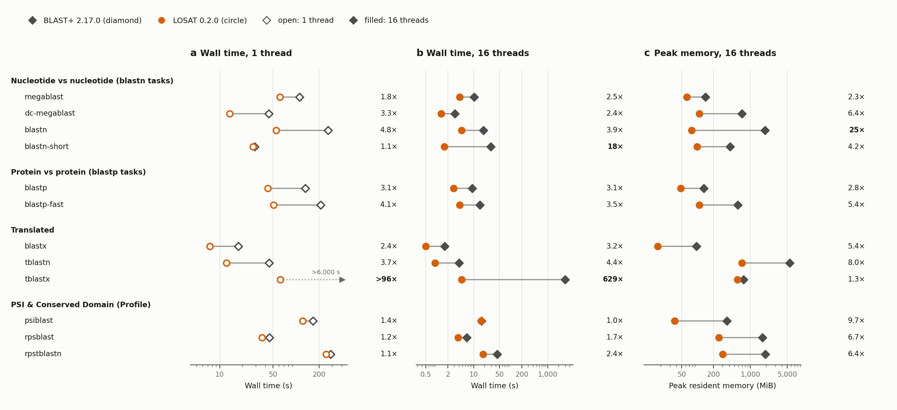
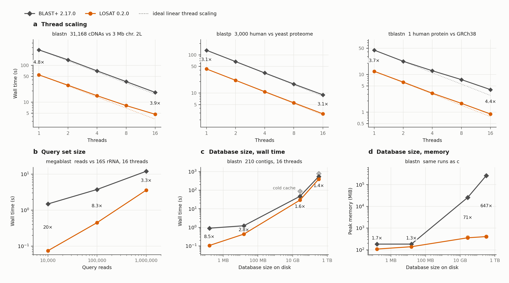
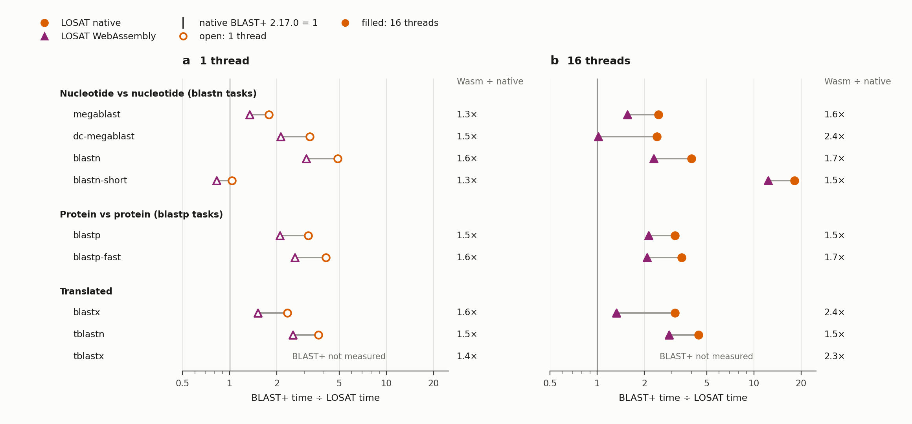

# LOSAT v0.2.0 Benchmarks

Measured comparison between **LOSAT 0.2.0** (commit `93ca2f652`, pure Rust) and **NCBI BLAST+ 2.17.0** (and **`rpsbproc` 0.5.1**) across single-node workloads, multi-gigabyte scaling, downstream bioinformatics pipelines, and WebAssembly.

## Test environment

| Component | Specification |
| --- | --- |
| Hardware | Dual Intel(R) Xeon(R) Gold 6338 CPU @ 2.00GHz (2 NUMA nodes, 64 physical cores total) |
| OS & isolation | Linux (`numactl` single-node pinning; `1` thread on node 0, `2`–`16` threads on node 1) |
| LOSAT binary | `losat` v0.2.0 release build (commit `93ca2f652617acac09d416c28c293cc8a1a501d1`) |
| Reference | NCBI BLAST+ `2.17.0` (`env_blast`), NCBI `rpsbproc` `0.5.1`, and LOSAT `0.1.0` where applicable |
| Databases & data | Warm OS page cache unless explicitly labeled `cold cache`; output bytes compared via SHA-256 |

---

## Standard workloads (Table 1 & Figure 1)

**Table 1.** Standard single-node workloads covering all 12 search modes across Figures 1, 2a, and 4.

| Group | Mode | Query | Query seqs | Query letters | Subject / DB | Target seqs | Target letters | Target flag | Options |
| --- | --- | --- | ---: | ---: | --- | ---: | ---: | --- | --- |
| Nucleotide vs nucleotide | `megablast` | 16S rRNA genes, full length (`q100.fna`) | 100 | 143,418 nt | RefSeq 16S rRNA (`16s_all.fna`) | 28,036 | 40,608,964 nt | `-subject` | — |
| Nucleotide vs nucleotide | `dc-megablast` | *D. melanogaster* cDNA | 31,168 | 89,286,901 nt | *D. melanogaster* chr. 2L (3 Mb) | 1 | 3,000,000 nt | `-subject` | `-task dc-megablast` |
| Nucleotide vs nucleotide | `blastn` | *D. melanogaster* cDNA | 31,168 | 89,286,901 nt | *D. melanogaster* chr. 2L (3 Mb) | 1 | 3,000,000 nt | `-subject` | `-task blastn` |
| Nucleotide vs nucleotide | `blastn-short` | Synthetic 24-mer reads | 30,000 | 720,000 nt | *D. melanogaster* chr. 2L (3 Mb) | 1 | 3,000,000 nt | `-subject` | `-task blastn-short -evalue 0.001` |
| Protein vs protein | `blastp` | Human proteins (`sp4_first3000.fa`) | 3,000 | 1,196,107 aa | *S. cerevisiae* proteome | 6,600 | 2,914,067 aa | `-subject` | `-evalue 0.001` |
| Protein vs protein | `blastp-fast` | Human proteome (`Species4.fa`) | 23,879 | 13,375,567 aa | *S. cerevisiae* proteome | 6,600 | 2,914,067 aa | `-subject` | `-task blastp-fast -evalue 0.001` |
| Translated | `blastx` | *D. melanogaster* chr. 2L (50 kb) | 1 | 50,000 nt | *D. melanogaster* proteome (`dmel_pep`) | 30,802 | 20,379,496 aa | `-db` | `-evalue 1e-5` |
| Translated | `tblastn` | Human protein `ENSP00000343742.5` | 1 | 411 aa | Human genome GRCh38 (`hsap_dna`) | 194 | 3,099,750,718 nt | `-db` | `-evalue 1e-5 -max_target_seqs 5` |
| Translated | `tblastx` | *Candidatus* genomes (3 seqs) | 3 | 1,911,341 nt | *Candidatus* genomes (3 seqs) | 3 | 1,883,924 nt | `-subject` | `-query_gencode 4 -db_gencode 4` |
| PSI & Domains | `psiblast` | *E. coli* MG1655 proteins | 20 | 5,882 aa | UniProtKB/Swiss-Prot (`swissprot`) | 487,728 | 186,063,409 aa | `-db` | `-num_iterations 3 -evalue 0.001` |
| PSI & Domains | `rpsblast` | *E. coli* MG1655 proteins | 300 | 98,758 aa | NCBI CDD v3.22 (29 vol.) | 71,136 PSSMs | 15,821,058 res | `-db` | `-evalue 0.01` |
| PSI & Domains | `rpstblastn` | *E. coli* MG1655 5-kb segments | 100 | 500,000 nt | NCBI CDD v3.22 (29 vol.) | 71,136 PSSMs | 15,821,058 res | `-db` | — |

<p align="center">
  <picture>
    <source media="(prefers-color-scheme: dark)" srcset="figures/fig1_standard_workloads_dark.png">
    
  </picture>
</p>

**Figure 1.** Wall time (1 thread and 16 threads) and peak resident memory (16 threads) across all 12 standard search modes. Symbols plot medians across timed rounds (see [snapshot/standard_workloads.tsv](snapshot/standard_workloads.tsv)).

| Mode | 1t LOSAT (s) | 1t NCBI (s) | 1t Speedup | 16t LOSAT (s) | 16t NCBI (s) | 16t Speedup | 16t LOSAT RSS (MiB) | 16t NCBI RSS (MiB) | Memory Ratio | Output Parity |
| --- | ---: | ---: | ---: | ---: | ---: | ---: | ---: | ---: | ---: | --- |
| `megablast` | 61.52 | 111.22 | 1.8× | 4.20 | 10.30 | 2.5× | 62.0 | 140.0 | 2.3× | Byte-identical |
| `dc-megablast` | 13.50 | 44.21 | 3.3× | 1.31 | 3.12 | 2.4× | 107.4 | 690.5 | 6.4× | Byte-identical |
| `blastn` | 54.93 | 262.44 | 4.8× | 4.67 | 18.37 | 3.9× | 76.6 | 1,889.0 | 24.6× | Byte-identical |
| `blastn-short` | 27.31 | 28.84 | 1.1× | 1.59 | 29.09 | 18.3× | 97.9 | 411.8 | 4.2× | Byte-identical |
| `blastp` | 42.86 | 132.42 | 3.1× | 2.87 | 9.02 | 3.1× | 47.5 | 131.0 | 2.8× | Byte-identical (`-db` & `-subject`) |
| `blastp-fast` | 50.95 | 210.68 | 4.1× | 4.20 | 14.65 | 3.5× | 107.6 | 580.1 | 5.4× | Byte-identical (`-db` & `-subject`) |
| `blastx` | 7.46 | 17.59 | 2.4× | 0.51 | 1.64 | 3.2× | 17.5 | 95.3 | 5.4× | Byte-identical |
| `tblastn` | 12.23 | 44.64 | 3.7× | 0.90 | 3.99 | 4.4× | 695.1 | 5,539.7 | 8.0× | Byte-identical |
| `tblastx` | 62.35 | >6,000 s (t/o) | >96× | 4.72 | 2,970.75 | 629× | 567.5 | 738.7 | 1.3× | Byte-identical |
| `psiblast` | 122.45 | 166.55 | 1.4× | 15.95 | 16.33 | 1.0× | 36.9 | 356.8 | 9.7× | Byte-identical |
| `rpsblast` | 35.99 | 44.97 | 1.2× | 3.77 | 6.49 | 1.7× | 254.5 | 1,693.3 | 6.7× | Byte-identical |
| `rpstblastn` | 248.98 | 284.10 | 1.1× | 18.00 | 42.90 | 2.4× | 297.3 | 1,916.8 | 6.4× | Byte-identical |

**Notes on standard workloads:**
- **`blastp` / `blastp-fast`:** LOSAT ran `-subject` against FASTA, while NCBI BLAST+ ran `-db BlastDBSpecies6` (since NCBI ignores `-num_threads` on `-subject`). When both run `-subject`, and when both run `-db`, LOSAT and NCBI BLAST+ produce identical SHA-256 digests (`354b7a793402c0ac` / `1dd47f97d8c77ca2` for `-subject`; `3a92bc0410a1ac8a` / `f4ecd9f36f7f2ea1` for `-db`).
- **`tblastx`:** At 1 thread, NCBI BLAST+ exceeded the 6,000 s timeout (`rc=124`) while LOSAT finished in `62.35 s` (`>96×`). At 16 threads, NCBI BLAST+ completed in `2,970.75 s` (~49.5 min) vs LOSAT's `4.72 s` (`629×`), with identical output SHA-256 `ea54151b99edecb9`. Compared with LOSAT v0.1.0 (`188.02 s` and `1,605.4 MiB` at 16 threads), v0.2.0 is `39.8×` faster while matching NCBI output bytes.
- **`blastn` / `megablast` vs LOSAT v0.1.0:** On 16 threads, `blastn` improved from `212.38 s` / `3,858.5 MiB` (v0.1.0) to `4.67 s` / `76.6 MiB` (`45.5×` faster, `50×` less RAM), and `megablast` improved from `57.66 s` / `2,031.0 MiB` to `4.20 s` / `62.0 MiB` (`13.7×` faster, `32.8×` less RAM).

---

## Database construction & domain post-processing (Utilities)

Single-threaded benchmarks comparing `losat makeblastdb` and `losat rpsbproc` against NCBI BLAST+ `2.17.0` and `rpsbproc 0.5.1` (`3` timed rounds each; [snapshot/utilities.tsv](snapshot/utilities.tsv)):

| Utility & Workload | LOSAT (s) | NCBI (s) | Speedup | LOSAT RSS (MiB) | NCBI RSS (MiB) | Memory Ratio | Output Parity |
| --- | ---: | ---: | ---: | ---: | ---: | ---: | --- |
| `makeblastdb` (nucl: 16S rRNA, 28,036 seqs, 40.6 Mb) | 0.193 | 0.691 | 3.6× | 9.0 | 52.0 | 5.8× | — |
| `makeblastdb` (prot: Swiss-Prot, 575,748 seqs, 209.0 M aa) | 2.197 | 8.537 | 3.9× | 16.0 | 58.4 | 3.6× | — |
| `rpsbproc` (4,300 *E. coli* proteins XML vs CDD v3.22, `-t both -m rep -f`) | 1.309 | 2.610 | 2.0× | 62.0 | 331.0 | 5.3× | Byte-identical |

---

## Scaling with threads, query batch size, and database size (Figure 2)

<p align="center">
  <picture>
    <source media="(prefers-color-scheme: dark)" srcset="figures/fig2_scaling_dark.png">
    
  </picture>
</p>

**Figure 2.** **a**, Thread scaling (`1`, `2`, `4`, `8`, `16` threads) on `blastn`, `blastp`, and `tblastn`; dotted lines mark ideal linear speedup from `1` thread. **b**, `megablast` scaling across `10,000`, `100,000`, and `1,000,000` reads (`16` threads vs 16S rRNA). **c**, **d**, `blastn` wall time and peak resident memory (`210` draft contigs, `5.50 Mb`, `16` threads) across databases from `abr_genes` (`0.16 MB`, `340` seqs) and `16s_all` (`15.3 MB`, `28,036` seqs) to `ref_prok_rep_genomes` (`26.8 GB`, `1.14M` seqs) and NCBI `core_nt` (`319.4 GB`, `132.3M` seqs); faded points mark cold OS page-cache runs ([snapshot/scaling.tsv](snapshot/scaling.tsv)).

- **Thread scaling (2a):** `blastp` scales almost linearly (`42.86 s` → `2.87 s`, `3.1×` over NCBI at all thread counts). `tblastn` improves its lead with more threads (`3.7×` at `1` thread → `4.4×` at `16` threads, `695 MiB` vs `5,540 MiB`).
- **Query size (2b):** At `10,000` reads, LOSAT finishes in `0.075 s` vs `1.49 s` (**`19.8×`**). At `1,000,000` reads (`150 Mb`), LOSAT takes `3.60 s` (`302 MiB` RSS) vs NCBI `12.01 s` (`5,145 MiB` RSS).
- **Database size (2c, 2d):** On `ref_prok_rep_genomes` (`26.8 GB`), LOSAT runs in `29.37 s` warm (`44.96 s` cold) vs NCBI `47.28 s` warm (`87.22 s` cold) using **`358 MiB`** vs **`25,580 MiB`** (`71×` less peak memory). On `core_nt` (`319.4 GB`), LOSAT runs in `391.74 s` warm (`491.16 s` cold) vs NCBI `542.14 s` warm (`775.83 s` cold) while holding peak resident memory to **`407 MiB`** vs **`263,594 MiB`** (**`647×`** less memory).

---

## Downstream bioinformatics pipelines (Figure 3)

<p align="center">
  <picture>
    <source media="(prefers-color-scheme: dark)" srcset="figures/fig3_downstream_tools_dark.png">
    
  </picture>
</p>

**Figure 3.** Total BLAST stage wall time inside published bioinformatics tools on each tool's own command lines and official test datasets ([snapshot/downstream_tools.tsv](snapshot/downstream_tools.tsv)). Multi-thread comparisons were run at the thread count each tool passes to BLAST (`8` for ABRicate, `16 × 1` concurrent single-thread workers for OrthoFinder/Roary/Prokka, `16` otherwise); single-thread tools come from the official single-thread drop-in test suites. Every compared output pair matches NCBI BLAST+ `2.17.0` byte for byte.

Highlights:
- **`AMRFinderPlus` (`blastp`, 16t):** `0.08 s` vs `1.60 s` (**`20×`**)
- **`nf-core/blast` (`tblastn` / `blastn`, 16t):** `0.01 s` vs `0.14 s` (**`14×`**) and `0.01 s` vs `0.10 s` (**`10×`**)
- **`Galaxy` (`blastp`, 16t):** `0.03 s` vs `0.35 s` (**`12×`**)
- **`MAKER` (`blastn`, 16t):** `0.01 s` vs `0.11 s` (**`11×`**)
- **`mlst` (`blastn`, 16t):** `0.15 s` vs `1.22 s` (**`8.1×`**)
- **`ResFinder / PlasmidFinder` (`blastn`, 1t):** `0.49 s` vs `3.55 s` (**`7.2×`**)
- **`BRIG` (`blastn`, 16t):** `11.82 s` vs `65.94 s` (**`5.6×`**)
- **`Prokka` / `Roary` / `OrthoFinder` (`blastp`, 16 × 1):** `2.8×`–`3.5×` faster total BLAST stage time across concurrent workers.

*(Additional single-thread suites not plotted: `Biopython` `blastx` `1.9×`, `rBLAST` `blastn` `1.8×`, `ECTyper` `blastn` `1.9×`, `Unicycler` `tblastn` `2.5×`, `Easyfig` `blastn` `3.4×` & `tblastx` `3.5×` are included in the figure and TSV.)*

---

## WebAssembly vs native builds (Figure 4)

<p align="center">
  <picture>
    <source media="(prefers-color-scheme: dark)" srcset="figures/fig4_webassembly_dark.png">
    
  </picture>
</p>

**Figure 4.** Speedup over native BLAST+ `2.17.0` for native LOSAT and the WebAssembly (`wasm32-wasip1` / `wasm32-wasip1-threads` running under Node.js) builds from paired runs (`7f7db49c`; [snapshot/webassembly.tsv](snapshot/webassembly.tsv)). Across 1-thread runs, WebAssembly overhead relative to native LOSAT ranges from **`1.3×`** (`megablast`, `blastn-short`) to **`1.6×`** (`blastn`, `blastp-fast`, `blastx`); at 16 threads, WebAssembly remains **`1.0×`–`12.3×` faster than native BLAST+** across the measured grid (`tblastx` was omitted from the paired Wasm-vs-BLAST+ baseline grid and shows WebAssembly ÷ native ratios of `1.4×` at 1t and `2.3×` at 16t).

---

## Methodology & reproducibility

- **Isolation:** Every timed benchmark pinned the process cleanly to one NUMA node (`numactl --physcpubind=... --membind=...`) after an untimed cache warm-up, alternating execution order between LOSAT and NCBI across rounds.
- **Snapshots:** All numeric tables plotted here are frozen in [`snapshot/`](snapshot/):
  - [`standard_workloads.tsv`](snapshot/standard_workloads.tsv)
  - [`utilities.tsv`](snapshot/utilities.tsv)
  - [`scaling.tsv`](snapshot/scaling.tsv)
  - [`downstream_tools.tsv`](snapshot/downstream_tools.tsv)
  - [`webassembly.tsv`](snapshot/webassembly.tsv)
  - [`inputs.tsv`](snapshot/inputs.tsv) & [`metadata.json`](snapshot/metadata.json)
- **Regenerating figures:** Run deterministically from the frozen snapshot tables:

```bash
python3 -B benchmarks/v0.2.0/scripts/render_figures.py
```

See also [benchmarks/README.md](../README.md) for the directory index across v0.1.0 and v0.2.0.
