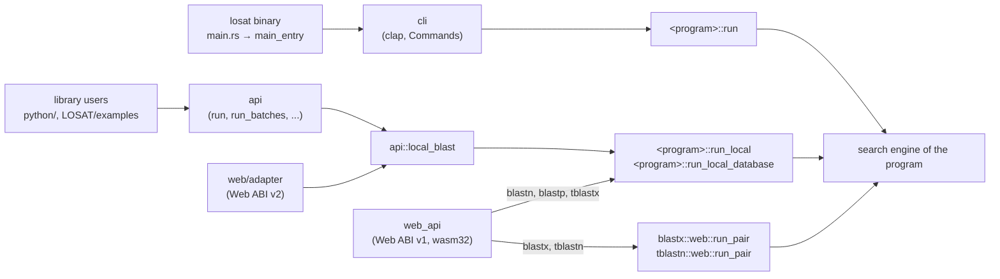
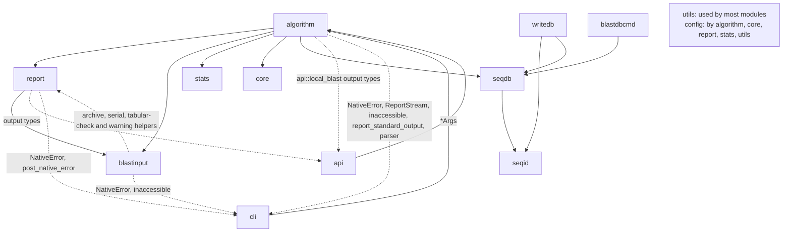
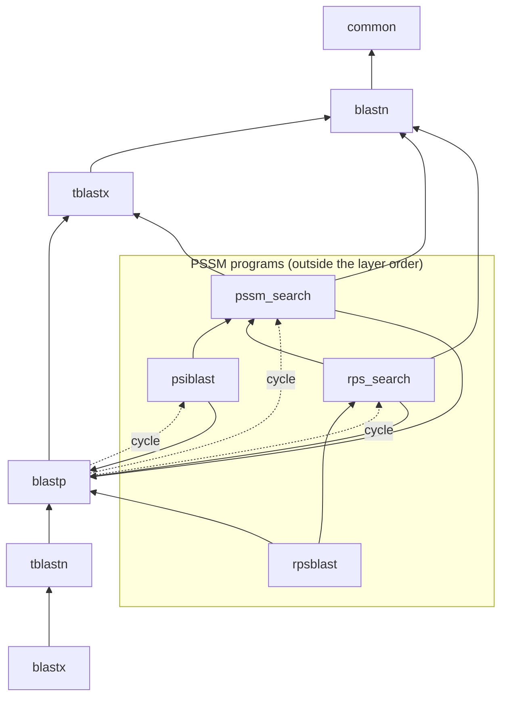
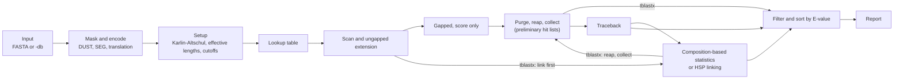

# The LOSAT engine

This page describes how the engine in `LOSAT/src/` is built: which module holds what, how one
search runs from the command line to the report, how threads are used, how the speed-up switches
work, and how errors end a run. It is written for a contributor who is new to the code. The rules
that bind a change are in [AGENTS.md](../../AGENTS.md); this page explains the structure those
rules act on and points to the code.

It was written against `dev` at `9d8d153c8` (2026-11-08). Files, functions and types are named so
that they can be found with a search; counts are those of that commit and are marked as such.

## The contract the structure serves

LOSAT is a port of NCBI BLAST+ 2.17.0 whose output must be NCBI's byte for byte. Three things
follow from that and shape everything below:

- Each ported piece names its NCBI source in an `NCBI reference` comment next to it (AGENTS.md,
  "Mandatory Compliance Requirements"), and code with no NCBI counterpart (scheduling, switches,
  diagnostics) usually says so in a `No NCBI counterpart` comment. The pinned NCBI source is
  `satoshikawato/ncbi-blast` at `598d8ae6` (AGENTS.md, "NCBI Source Locations").
- The output does not depend on the number of threads: it is NCBI's output with
  `-num_threads 1` at every thread count (README, "Database searches"; PD-LOSAT-DATABASE-SEARCH
  P1.1). Parallel work must put its results back in NCBI's order ([Parallelism](#parallelism)).
- What LOSAT does not do exactly as NCBI does, it refuses with an error instead of doing something
  close ([Errors and exit codes](#errors-and-exit-codes)), except for the approved differences of
  `docs/product_decisions/`.

## Three ways in

The same engine is reached three ways. Each of the five programs blastn, blastp, blastx, tblastn
and tblastx has three entry functions: `run` for the command line (`BlastxArgs::run` and
`TblastnArgs::run` in blastx and tblastn), `run_local` for records in memory against records, and
`run_local_database` for records against a BLAST database. psiblast and rpsblast have only `run`,
which runs blastp's; the library runs psiblast through blastp's `run_local*`.

- The binary: `main.rs` only calls `main_entry` (`cli/main_entry.rs`, re-exported at the crate
  root). `main_entry` reads a few words before clap (`blastdbcmd`, `--install-shims`, `-version`),
  then `cli::try_parse_from`, then dispatches on `cli::Commands` to the program.
  `losat blastdbcmd` bypasses clap and reads its arguments as NCBI's `blastdbcmd` does
  (`blastdbcmd::run`).
- The library: `api` is the only documented module of the crate (`lib.rs`). It reads FASTA
  records, validates a command line and runs it through `api::local_blast`, which re-exports the
  programs' `run_local*` functions. A library search writes nothing to the process's standard
  output or error and never ends the process (`api/mod.rs`).
- The Web: Web ABI v1 is the `extern "C"` exports of `web_api` (built only for `wasm32`), which
  call `run_local` for blastn, blastp and tblastx and `web::run_pair` for blastx and tblastn; Web
  ABI v2 is the separate crate `web/adapter`, which calls `run_local*` like the library.

`-db` is not a separate entry: each program's `run` branches on `args.db` and opens the database
through `algorithm::common::database`.

## Module map

`lib.rs` declares 17 modules. Only `api` is documented. The others are private to the crate, or
`pub` but hidden from the documentation and outside the compatibility promise of the version
number (the Web adapter and the tests name them); the `losat` binary calls one hidden function,
`main_entry`, and names no module (`lib.rs`, module comment).

| Module | Holds | NCBI counterpart |
| :--- | :--- | :--- |
| `algorithm` | the search programs, one directory each ([Programs](#programs)) | `app/blast/*_app.cpp` and the per-program code of `algo/blast/core` |
| `api` | the library API; `api::local_blast` routes reports to outputs | `algo/blast/api` (`CLocalBlast`) |
| `blastinput` | NCBI's application layer: FASTA reader, query batches, ranges, input files, the environment and registry check, value parsers | `algo/blast/blastinput` |
| `cli` | the command line's entry `main_entry`, clap `Cli` and `Commands`, NCBI-style `-help` and `-version`, `NativeError` and the exit, the report stream | `blastinput/blast_args.cpp`, `cmdline_flags.cpp`, `blast_app_util.hpp` |
| `core` | ports of `core/` that several programs share: encoding, composition-based statistics, HSP filters, the PSSM engine | `algo/blast/core`, `algo/blast/composition_adjustment` |
| `stats` | Karlin-Altschul parameters, length adjustment, search space, Spouge's finite-size correction, sum statistics, the matrix tables | `core/blast_stat.c`, `core/blast_setup.c` (`BLAST_CalcEffLengths`) |
| `report` | every output format: pairwise, tabular, XML, XML2, JSON, archive, SAM, serial ASN.1 | `objtools/align_format`, `algo/blast/format` |
| `seqdb` | reader of BLAST database volumes (versions 4 and 5), alias files, taxonomy, masks | `objtools/blast/seqdb_reader` (`CSeqDB`) |
| `seqid` | Seq-ids of database sequences, defline sets | `objects/seqloc`, `objects/blastdb` |
| `writedb` | writer of BLAST database volumes and `losat makeblastdb` | `objtools/blast/seqdb_writer`, `app/blastdb/makeblastdb.cpp` |
| `blastdbcmd` | `losat blastdbcmd` with its own argument reader | `app/blastdb/blastdbcmd.cpp` |
| `utils` | DUST, SEG, window masking, matrices, genetic codes, threads (`threading`), the X-drop SIMD kernels, switches and diagnostics (`xswitch`, `xreach`, `xstats`, `xtiming`, `xdiag`) | `blast_seg.c`, `symdust.cpp`, `algo/winmask`, NCBI's packed score matrices, `CGen_code_table`, `prelim_stage.cpp` (threads); none for the X-drop kernels, switches and diagnostics |
| `config` | scoring specifications, a compatibility mode (`CompatMode`) and configuration structs (`SeedConfig`, ..., `BlastnConfig`, `TblastxConfig`) | none |
| `common` (the file `common.rs`) | `Hit`, `GapEditOp`, the HSP sort comparisons and the `write_output*` writers | `core/blast_hits.c`, `gapinfo.h` |
| `sequence` | packed letters and packed subjects | via `core/blast_encoding.c` |
| `web_api` | Web ABI v1 exports (`wasm32` only) | none |
| `record` | the type `api::FastaRecord` | `CBlastFastaInputSource` |

Four names are used more than once: the file `common.rs` and the directory `algorithm/common/` are
different modules, and so are `seqid/` and `report::seqid`, `record.rs` and `report::record`, and
the crate's `report` and `algorithm::blastx::report` / `algorithm::tblastx::report`.

The top-level modules are not a strict stack. Most of the engine (`algorithm`) uses `utils`,
`report`, `blastinput`, `stats`, `core` and `seqdb`, but some edges point back up, and in non-test
code they tie 12 of the 17 modules into one cycle at `9d8d153c8` (all but `config`, `utils`,
`stats`, `seqid` and `web_api`). The diagram shows the main edges; the dashed ones point back up.

The dashed edges carry the output-routing types of `api::local_blast` (`OutputSink`,
`ReportOutputs`, ...), the error type `cli::NativeError` with `cli::post_native_error`,
`cli::ReportStream`, `cli::inaccessible`, `cli::report_standard_output` and, in the Web ABI v1
paths of blastx and tblastn, the command-line parser, and the archive, serial, tabular-check and
warning helpers of `report` that `blastinput` uses. Edges that
the diagram leaves out also close the cycle: `core` → `common` (`GapEditOp`), `common` → `api` and
`report` (its writers), `sequence` → `core` and `seqdb`, `seqdb` → `writedb` (one helper),
`writedb` ↔ `blastinput`, `cli` → `writedb`, `api` → `writedb` and `blastdbcmd`, `blastdbcmd` →
`algorithm`, `algorithm` → `sequence`, `api` and `blastinput` → `record`, and `record` →
`blastinput`.

## Programs

`algorithm/` holds one directory per program and `common`, the code they share:

| Directory | Command line | Library and Web | Notes |
| :--- | :--- | :--- | :--- |
| `blastn` | `blast_engine::run` | `run_local`, `run_local_database` | megablast, blastn, dc-megablast, blastn-short; `blast_engine/run.rs` holds the search |
| `blastp` | `blast_engine::run` | `run_local`, `run_local_database` | also the driver of psiblast and rpsblast (`args::BlastpApp`) |
| `blastx` | `BlastxArgs::run` → `native::run` | `local::run_local`, `run_local_database`; Web ABI v1 `web::run_pair` | its own FASTA reader in `input.rs` |
| `tblastn` | `TblastnArgs::run` | `run_local`, `run_local_database`; Web ABI v1 `web::run_pair` | |
| `tblastx` | `blast_engine::run` | `run_local`, `run_local_database` | `lookup/` is the protein word lookup that the other protein programs also use |
| `psiblast` | `psiblast::run` → `blastp::run` | through `api` as `Program::Psiblast` | PSSM build and files, rounds, `-in_pssm` |
| `rpsblast` | `rpsblast::run` → `blastp::run` | none | arguments only |
| `pssm_search` | none | none | the search of a query given as a PSSM, reached from blastp's hooks |
| `rps_search` | none | none | the search of a profile database, reached from blastp's hooks |
| `common` | none | none | `-db` glue (`database.rs`), masks, tabular helpers, chaining |

The five layered programs are ordered `common < blastn < tblastx < blastp < tblastn < blastx`
(`algorithm/mod.rs`): a program uses only the programs below it. `LOSAT/tests/check_program_edges.py`
(CI job `rust lint`) fails on an edge up this order and on an edge between two programs that
`LOSAT/tests/program_edges.tsv` does not list. It checks direction only for the six names in its
`LAYERS`, and it counts edges, not the places that make up an edge.

An arrow means "uses". Each of the five layered programs also uses every program below it
(`program_edges.tsv` lists each edge).

Some code that several programs share lives in a program directory: `tblastx::lookup` and
`tblastx::blast_aascan` (used by blastp, tblastn, blastx and pssm_search), `tblastx::translation`
(used by blastp, tblastn and blastx), and `blastn::interval_tree`, `blastn::query_split` and `blastn::hsp`. That is why
tblastx sits below blastp in the order.

### Remaining cycles

The statistics layer is one module (`stats`; `core/blast_stat` is gone) and the five layered
programs have no cycle. The PSSM programs still form one with blastp: blastp's driver names their
types (in `blastp/args.rs`, `blastp/blast_engine.rs` and the hook files `blast_engine/psi_round.rs`,
`pssm_hooks.rs` and `rps_hooks.rs`), and they use blastp's kernels and HSP types (`blastp::hsp`,
`blastp::gapalign`, `blastp::extension`). The cycles are blastp↔psiblast, blastp↔pssm_search and
blastp↔rps_search. Once they are cut, psiblast and pssm_search join the layer order above blastp
(`algorithm/mod.rs`, `LOSAT/tests/check_program_edges.py`); neither file places rps_search and
rpsblast yet.

### Shared code and its owner

| Piece | Owner |
| :--- | :--- |
| Karlin-Altschul, length adjustment, search space, sum statistics | `stats` |
| scoring matrices | `utils::matrix`; their Karlin tables in `stats::protein_tables` |
| composition-based statistics | `core::composition_adjustment` |
| PSSM engine | `core::psi` |
| sequence encoding | `core::blast_encoding`, `sequence` |
| `-max_hsps`, `-qcov_hsp_perc`, `-culling_limit` | `core::blast_hits`, `core::hspfilter_culling` |
| SEG, DUST, window masking, genetic codes | `utils::seg`, `utils::dust`, `utils::winmask`, `utils::genetic_code` |
| X-drop SIMD kernels | `utils::xdrop_simd` (AVX2, 128-bit, NEON) |
| threads | `utils::threading` |
| speed-up switches | `utils::xswitch`, `utils::xreach` |
| `-db` glue | `algorithm::common::database`, `algorithm::common::x_db_stream` |
| report writers | `report` |
| output routing | `api::local_blast` |
| FASTA reader | `blastinput::fasta_reader` (makeblastdb reuses it) |
| errors | `cli::NativeError` |

Known copies that remain: blastx keeps its own FASTA reader types in `blastx/input.rs`
(`FastaRecord`, `EolStyle`, `PushbackBuffer`, `FastaStream`) next to the shared ones in
`blastinput/fasta_reader`; each program has its own function that purges HSPs with common
endpoints, written for its own HSP type; blastx has its own port of `hspfilter_culling.c`
(`blastx/culling.rs`) instead of `core::hspfilter_culling`; and each of the five programs keeps its own report glue
(`tabular.rs`, `blast_xml.rs`, `seqalign.rs`, `archive.rs`) in front of `report`.

Files whose name starts with `x_` hold a speed-up path, behind a switch or graduated
([Switches](#switches)), or a diagnostic. Most of the speed-up paths port an NCBI function in
another form and cite it.

## One search, stage by stage

Every program ports the same NCBI engine: `BLAST_PreliminarySearchEngine` and
`s_BlastSearchEngineCore` (`core/blast_engine.c`) for the preliminary search, then
`BLAST_ComputeTraceback_MT` (`core/blast_traceback.c`), then the formatter
(`CBlastFormat`, `format/blast_format.cpp`). In NCBI the programs differ by callbacks and options;
in LOSAT each program has its own copy of the stages, each a port of the NCBI functions below.
tblastx has no gapped stage and no traceback: it links its HSPs in the preliminary stage
([below](#the-translated-programs-and-rpsblast)).

| Stage | NCBI | blastn | blastp |
| :--- | :--- | :--- | :--- |
| input | `CBlastInput::GetNextSeqBatch`; subjects as a `BlastSeqSrc` (`MultiSeqBlastSeqSrcInit`, `SeqDbBlastSeqSrcInit`) | `read_cli_subjects` or `open_search_database`, then `search_cli` reads the queries | the same names in `blast_engine.rs` |
| query batches | `CBatchSizeMixer` (blastn), `GetQueryBatchSize` | `run_in_pool` with the adaptive `BatchSizeMixer` (`blastinput/query_batch.rs`) | a fixed size: 10,000 letters unless `BATCH_SIZE` is set; psiblast one query |
| masking, encoding | `Blast_FindDustFilterLoc`, `BlastSetUp_Filter`, `SetupQueries_OMF` | `blastn/coordination.rs` (`query_masks`) | SEG in `blastp/encoding.rs` |
| setup | `BlastSetup_ScoreBlkInit`, `BLAST_CalcEffLengths`, `BlastInitialWordParametersUpdate` | the head of `search_query_batch` | the head of `run_resolved_in_pool` |
| lookup table | `LookupTableWrapInit` (`BlastMBLookupTableNew`, `BlastAaLookupTableNew`, ...) | `build_lookup_tables` (`blastn/coordination.rs`); discontiguous tables in `disc_lookup.rs` | `blastp_aa_lookup` or `blastp_compressed_lookup` (blastp-fast); PSSM and RPS tables through the hooks |
| scan, ungapped | `BlastNaWordFinder` with `s_BlastNaExtend`; `BlastAaWordFinder` with `s_BlastAaExtendTwoHit` | `scan_subject_kmers_with_ranges` and `blastn/extension.rs` | `x_seed_fused` (the scan and the two-hit test in one loop) and `blastp/extension.rs` |
| gapped (score only) | `BLAST_GetGappedScore`; greedy `BLAST_GreedyGappedAlignment` for megablast | `alignment/gapped.rs` or the greedy aligner | `extend_preliminary_blastp_hit` |
| purge, reap, collect | `Blast_HSPListPurgeHSPsWithCommonEndpoints`, `s_Blast_HSPListReapByPrelimEvalue`, `s_BlastHSPCollectorRun` | `purge_prelim_hits_with_common_endpoints`, `PrelimHitCollector` | `prepare_preliminary_hits_for_kappa_in_place`, `PrelimCollector` |
| traceback | `Blast_TracebackFromHSPList`, `BLAST_GappedAlignmentWithTraceback` | inside `process_subject`, called a second time per subject | `traceback::OrdinaryTraceback` |
| composition-based statistics | `Blast_RedoAlignmentCore_MT` (`blast_kappa.c`) | none | `kappa::postprocess_preliminary_hits` (default `-comp_based_stats 2`) |
| filter, sort | `s_FilterBlastResults`, `Blast_HSPResultsSortByEvalue` | `finish_query_hit_list` | `culling::cull_traceback`, `sort_by_evalue` |
| report | `CBlastFormat::PrintOneResultSet` | `write_reports` → `post_process_hits_and_write` | the `match outfmt` at the end of `run_resolved_in_pool` |

Neither blastn nor blastp links HSPs or uses sum statistics: NCBI's option handles start with
sum statistics off (`api/blast_options_local_priv.cpp`), only those of tblastn, blastx and
tblastx turn it on (`SetSumStatisticsMode()` in `tblastn_options.cpp`, `blastx_options.cpp`,
`tblastx_options.cpp`), blastn and blastp have no `-sum_stats` option (`blastinput/blast_args.cpp`,
`blastp_args.cpp`), and `-ungapped` changes only the gapped mode (`SetGappedMode`).

### The shape of the code

blastn, blastp and tblastx run the stages inside one very large function each, with a closure
`process_subject` for one subject, which calls helpers for some stages. blastx and tblastn spread
their stages over files (blastx `preliminary.rs`, `traceback.rs`, `runtime.rs`; tblastn
`search_init.rs`, `search_seed.rs`, `search_gapped.rs`, `stage_d_*.rs`).

- **blastn** (`algorithm/blastn/blast_engine/run.rs`): `run` → `search_cli` → `search` →
  `run_in_pool`, which loops
  over the query batches and calls `search_query_batch::<UNGAPPED>` for each. The const generic
  `UNGAPPED` (for `-ungapped`) makes two copies of the function. Its closure `process_subject` runs
  twice per subject: with `prelim_source` `None` it does the preliminary search, with `Some` the
  traceback.
- **blastp** (`algorithm/blastp/blast_engine.rs`): `run` → `search_cli` → `search` →
  `run_resolved_in_pool`, once for the queries of every batch that NCBI does not split (a blastp
  query's preliminary hit list does not depend on the other queries of its batch), once per query
  block, or once per query and round of psiblast. Its
  `process_subject` does the preliminary search; the traceback, the composition redo and the report
  follow in the same function.
- **Long queries.** Both re-enter their batch function for NCBI's query chunks (`SplitQuery_GetChunkSize`,
  `CQuerySplitter`): blastn through `search_query_chunks`, blastp through
  `search_split_query_batches`. Only the preliminary stage runs per chunk; the chunks' hit lists are
  merged and the traceback runs on the whole batch. blastn also splits subjects longer than
  5,000,000 letters into overlapping chunks (`s_GetNextSubjectChunk`).

### `-subject` and `-db`

NCBI reads both through one `BlastSeqSrc` iterator. LOSAT splits them where subjects reach the
kernel: a `-subject` set is encoded first and searched by `search_subjects` (blastn) or the subject
loop of `run_resolved_in_pool` (blastp); a database is read in blocks by
`database::search_blocks` (`blastn/blast_engine/database.rs`, `blastp/blast_engine/database.rs`),
and the sequences with hits are read again for the traceback (`traceback_listed`) or the
composition redo (`ListedSubjects`). Both paths share `process_subject`, the hit lists and the
report writers. `algorithm::common::database` holds what all `-db` programs share: opening a
database by name, NCBI's error messages, titles, and the prefetch rule. After blastp lists the
subjects of a `-db` search, a hit's subject index is its rank among the listed subjects, not its
OID.

### psiblast

psiblast is blastp with a round driver (`blastp/blast_engine/psi_round.rs`, `search_rounds`):

| Step | LOSAT | NCBI |
| :--- | :--- | :--- |
| rounds | `psi_round::run_queries` with `psiblast::rounds::IterationState`, one `run_resolved_in_pool` per query and round | `CPsiBlastApp::x_RunLocalPsiBlastIterations`, `CPsiBlastIterationState` |
| sequences to include | `psi_round::round_outcome` (`-inclusion_ethresh`) | `CPsiBlastIterationState::GetSeqIds` |
| next PSSM | `psiblast::pssm::query_pssm` → `core::psi::create_pssm_with_diagnostics` | `CPssmEngine::Run`, `PSICreatePssmWithDiagnostics` |
| search with a PSSM | blastp's hooks (`pssm_hooks.rs`) call `pssm_search` (lookup, preliminary, traceback, redo) | `Blast_QueryIsPssm` paths of `core/` |

`-in_pssm` starts at the PSSM search. rpsblast runs the same way through `rps_hooks.rs` and
`rps_search`.

### The translated programs and rpsblast

blastx, tblastn and tblastx follow the same stages with their own drivers: blastx in
`blastx/native.rs`, `search.rs` and `runtime.rs`; tblastn in `tblastn/tblastn_app.rs` and
`stage_d_pipeline.rs`; tblastx in `tblastx/blast_engine/run_impl.rs`. rpsblast has no driver of its
own: it runs blastp's (`BlastpApp::Rpsblast`), which hands the search to `rps_search` from
`blastp/blast_engine/rps_hooks.rs`. In RPS the roles are swapped as in NCBI: the profiles are the
"query" and the user's query is the "subject".

| | blastx | tblastn | tblastx | rpsblast |
| :--- | :--- | :--- | :--- | :--- |
| translated in six frames | the query (`-query_gencode`) | the subject (`-db_gencode`) | both | nothing |
| gapped | yes, or `-ungapped` | yes | no: ungapped only, no traceback | yes |
| HSP linking (`core/link_hsps.c`) | uneven gaps; even gaps when ungapped with no intron length | uneven gaps | even gaps, before and after the re-evaluation for ambiguities | none |
| composition-based statistics | modes 0 and 2 | modes 0 and 2 (1 and 3 refused) | none | mode 0 |
| reports written | after each query batch | after the last batch | after each batch when its stream check passes, otherwise at the end | as blastp |

The shared protein code sits low in the layer order: `tblastx::lookup` (the protein word lookup
table), `tblastx::blast_aascan` (the scan), `tblastx::translation` and `tblastx::ncbi_cutoffs`, and
from blastp the two-hit extension (`blastp::extension`) and the gapped and traceback kernels
(`blastp::gapalign`). tblastx's per-subject work after the scan is NCBI's ungapped path: link and
reap by E-value (`s_BlastSearchEngineCore`), then re-evaluate with ambiguities and link again
(`BLAST_PreliminarySearchEngine`); its preliminary hit lists are its final ones.

NCBI BLAST+ 2.17.0 has no out-of-frame stage on these command lines (`CFrameShiftArgs` is
disabled), so LOSAT has none either.

### Reports

A report is written in two tiers. Each program has adapters (`tabular.rs`, `blast_xml.rs`,
`seqalign.rs`, `archive.rs` in its directory) that build the views of its hits; `report/` turns
those views into bytes. Which formats a program writes is one table, `Program::writes`
(`blastinput/app.rs`): `0`, `5` to `16`, `17` (blastn only) and `20`, with custom tabular fields in
`6`, `7`, `10` and `20`.

| Format | Writer in `report/` | NCBI |
| :--- | :--- | :--- |
| 0 pairwise | `pairwise.rs` (`write_<program>_pairwise_report`) | `CBlastFormat::PrintProlog`, `CDisplaySeqalign` (`align_format/showalign.cpp`) |
| 6, 7, 10, 20 tabular | `tabular.rs` (`TabularWriter`), `outfmt6.rs` | `CBlastTabularInfo` (`align_format/tabular.cpp`) |
| 5 XML | `blast_xml/` | `BlastXML_FormatReport` |
| 13 to 16 XML2 and JSON | `blast_xml2/` | `blastxml2_format.cpp` |
| 8, 9, 12 Seq-align | `serial/` (text ASN.1, BER, JSON) | `BlastHitList2SeqAlign_OMF` |
| 11 archive | `archive/` | `s_BuildArchiveAll`, `CBlastFormat::PrintArchive` |
| 17 SAM | `sam.rs` | `format/sam.cpp` |

Deflines and sequence ids are written by `report/defline.rs` and `report/seqid.rs`, with the
parsed Seq-ids of database sequences in the crate module `seqid`. The bytes go to the outputs of
`api::local_blast::ReportOutputs`: one format on the command line, several for a library caller.

## Parallelism

Threads change who computes what and when, never a value or the order in which values reach a hit
list. AGENTS.md reads its rule 8 ("Correct timing, order, and context") this way for performance
paths: "work may run earlier, in another order or on other threads when every value and every
decision the output depends on is the same" ("Performance work boundaries", Owner approval
2026-10-15), and it requires that "any native or Wasm work partitioning must reduce results back
into the NCBI order" ("Program and target boundaries").

### One pool per search

- `utils::threading::with_search_pool(N, program, work)` builds a local rayon pool of exactly `N`
  threads for one search. The calling thread is slot zero and `N - 1` scoped threads are the rest.
  With `N = 1` no pool is built and the work runs on the calling thread.
- `x_with_search_pool_local` keeps one pool across a loop of query batches, and `with_run_pool`
  keeps one pool across the searches of a run (the library and the Web adapter).
- The code receives a `&SearchPool` and runs parallel work inside `pool.install(..)`, after
  checking `pool.enabled()`. Free rayon calls (`rayon::scope`, `in_place_scope`, `broadcast`,
  `spawn`) run on the pool of the calling worker; outside a worker they would start rayon's global
  pool, so such code checks `rayon::current_thread_index().is_some()` first or runs only inside
  `pool.install`.
- `-num_threads` is never reduced: LOSAT does not read the CPU count (NCBI caps the count at the
  number of CPUs and warns; `blast_args.cpp`), and an unsupported count is an error
  (`validate_threads`). No code calls rayon's `build_global`, and `with_search_pool` refuses to
  start a pool of more than one thread from a rayon worker.

### Back to NCBI's order

NCBI's threads each take the next chunk of subjects and write into a shared stream that is sorted
by OID when it closes (`blast_engine.c`, `blast_hspstream.c`). LOSAT reproduces the order in which a
single-threaded run inserts results into the hit lists. The patterns, each with an example:

| Pattern | Example |
| :--- | :--- |
| ordered `par_iter().map(..).collect()`, then a serial merge | blastp and blastn `-db` blocks (`blast_engine/database.rs`) |
| state fixed to the one-thread order before the parallel work | blastp's diagonal offsets per block (`diag_offset_after`) |
| a result slot per index, merged in index order | blastp `-subject` runs (`x_subject_runs.rs`), tblastx units (`x_pair_par.rs`) |
| a collector that holds early results until their OID is next | tblastx `HitCollector` (`hit_collector.rs`) |
| a bounded window whose owner merges in OID order | blastn `x_bnstream.rs`, tblastn `x_oid_flow.rs`, blastp `database/x_db_keep.rs` |
| an owner loop in NCBI's order with look-ahead helpers that compute values ahead | `utils/xahead.rs` (`with_helpers`) |
| a writer that writes batches in reading order | blastx `native.rs` (`LOSAT_X_BXFLOW`) |

### Parallel work outside the pool's own methods

| Where | What | Runs on |
| :--- | :--- | :--- |
| `tblastx/blast_engine/run_impl.rs` | the writer thread that collects subject results (`std::thread::spawn`) | a new OS thread (native only) |
| `blastn/blast_engine/x_query_scan_par.rs` | the first reading of a large query file by several threads, before the search pool exists | scoped OS threads (Unix) |
| `tblastn/stage_d_pipeline.rs` | the last query batches searched at the same time, each with its own pool (`LOSAT_X_TBNOWNPOOLS`) | scoped OS threads (native) |
| `blastinput/x_packed_subjects.rs` | packing `-subject` records while the reader reads the next ones | one scoped OS thread (native) |
| `rayon::scope`, `in_place_scope`, `broadcast` and `spawn` in about twenty files | lookup table builds, ordered windows, flows, composition redo jobs | the search pool |

### Traps

- A job that waits for progress made elsewhere deadlocks when a thread waiting in nested parallel
  work steals it. The code avoids it with one `rayon::broadcast` job per thread, which is never
  stolen, with a start barrier (`x_bnstream.rs`), or with jobs that never wait (the broadcast loops
  of `x_subject_next.rs`).
- The release profile sets `panic = "abort"` (`LOSAT/Cargo.toml`), and a panic in a `rayon::spawn`
  job aborts in every build.
- `thread_local!` caches start cold on each pool thread, and memory that a pool thread allocates
  stays in its glibc arena.

### WebAssembly

Plain `wasm32-wasip1` builds are serial: `-num_threads` above 1 is refused, not reduced. Threaded
Wasm (`wasm32-wasip1-threads` with the `wasm-threads` feature; `LOSAT/build.rs` sets the cfg
`losat_wasi_threads`) uses the same pool code without the native-only threads listed above.
`std::thread::sleep` panics under the browser's WASI shim, so no code path reaches it on `wasm32`
(`x_bnstream.rs`, `pause`).

## Switches

A speed-up switch is an environment variable `LOSAT_X_<NAME>` that chooses between two LOSAT paths
with the same output. It has no NCBI counterpart, and no switch of the set changes the report
(`utils/xswitch.rs`, module comment). The binding rules are in AGENTS.md, "Speed-up switches".

- **Values.** A switch is on unless its value, trimmed, is exactly `0`; unset and empty are on.
  A value switch takes a number in its range and otherwise uses its built-in number
  (`xswitch::on`, `xswitch::value`). Nothing checks the names: a misspelt `LOSAT_X_*` variable is
  ignored.
- **Two lists.** `STRICT_SET` holds the switches that are on by default and still have a variable
  (145 at `9d8d153c8`); `GRADUATED` holds the switches whose variable is gone but whose rule and
  fallback stay (23). `STRICT_SET` and the `export` block of
  [docs/agents/diagnostics.md](../agents/diagnostics.md) are the same list, which a unit test in
  `xswitch.rs` enforces.
- **Reading.** `xswitch::on` reads the environment each time it is called; callers keep the result
  where it matters, usually in a `OnceLock`. The Web gives the engine an empty environment, so the
  Web always runs the defaults.
- **Reach.** A switch whose path runs only under a rule (on sizes, threads, options) marks the
  decision with `x_reach!("LOSAT_X_<NAME>", own_path)` inside the switch-on branch (at the
  decision, never in a per-hit loop), and has a row
  in `LOSAT/tests/switch_reach_expected.tsv` with the class `conditional` (`always` for a switch
  without a rule, `platform` for one chosen by the CPU or target). CI's fast output regressions
  run with `LOSAT_X_REACH` set, and `LOSAT/tests/switch_reach_check.py` fails when a required side
  of a conditional switch was not reached.
- **Life.** A switch lands on by default in its own pull request, and `LOSAT_X_<NAME>=0` runs the
  previous path; both sides are tested against each other. When it graduates its variable and the
  `=0` tests go; an always-on switch also loses its old code, while a conditional or platform
  switch keeps its rule and fallback and moves to `GRADUATED`. While the structural items of
  AGENTS.md are open, a new rule-limited switch lands only as a deadline fallback that the Owner
  approves; [SWITCH_APPROVALS.md](../decisions/SWITCH_APPROVALS.md) records the conditional
  switches added since the rule.

The diagnostic variables are not switches: `LOSAT_X_STATS` (work counters; those of
`utils::xstats` count only with the cargo feature `xstats`, the others in every build),
`LOSAT_TIMING` (`[TIMING]` lines: each program's own and one common line), `LOSAT_X_REACH`, and
the trace and debug variables (those of `xdiag` are read only in a build with the feature
`diagnostics`). They write to standard error or to files. `main_entry` writes the reach files, the
counters and the common timing line only when the run succeeds; the programs' own timing lines
and the traces are written as the run goes. [docs/user/environment.md](../user/environment.md)
lists NCBI's variables and names the development ones as a group.

## Errors and exit codes

There are two kinds of error:

- **NCBI's errors.** Where NCBI BLAST+ ends with an error, LOSAT builds a `cli::NativeError
  { exit, message }` with NCBI's exit status and its exact text on standard error, and returns it
  through `anyhow::Result`. Helpers build the common ones: `blastinput::app::options_error`,
  `blastinput::app::engine_error`, `cli::inaccessible` and
  `algorithm::common::database::database_error`.
- **LOSAT's refusals and other errors.** Everything else is a plain `anyhow` error. `main_entry`
  returns it to `main`, and Rust prints `Error: ` with the message and exits with status 1. A refusal says what is
  not supported, for example `... is not supported by LOSAT's BLASTN`.

Only `main_entry` ends the process on an error: it calls `cli::exit_on_native_error` (which
nothing else calls), and that writes a `NativeError`'s text and exits with its status, or aborts
for a negative status; any other error is returned to `main`. In a release build a panic aborts
wherever it happens (`panic = "abort"` in the release profile).

| Status | NCBI's meaning (`app/blast/blast_app_util.hpp`) | LOSAT |
| :--- | :--- | :--- |
| 0 | success | success |
| 1 | input error (`BLAST query/options error:`, `Command line argument error:`, ...) | the same errors, and every LOSAT refusal (`Error: ...`) |
| 2 | database error (`BLAST Database error:`) | the same; also clap's parser errors (NCBI exits 1 there, an approved difference) |
| 3 | engine error (`BLAST engine error:`) | the same |
| 4 | out of memory | makeblastdb only; the search programs abort on a failed allocation |
| 5 | network error | not used (no `-remote`) |
| 6 | output error (`BLAST failed to write output`) | the same |
| 255 | unknown error (`Error: `) | the same |
| abort | `std::terminate` after a failed flush in `~CBlastTabularInfo` (`align_format/tabular.cpp`) | blastx `-outfmt 6`/`7` (`NativeError` with exit `-6`) |

The approved differences in exit status are listed in
[PD-LOSAT-CLI-NONSEARCH-DIFFERENCES](../product_decisions/PD-LOSAT-CLI-NONSEARCH-DIFFERENCES.md).
A library search returns `api::Error` (`Argv`, `Input` or `Search`) with the command line's
message and no exit status. `losat makeblastdb` and `losat blastdbcmd` return their status as a
number.

## The environment

The engine reads its environment in three layers:

1. NCBI's application layer: at the start of every program,
   `blastinput::ncbi_environment::check_ncbi_application_settings` reads the whole environment and
   NCBI's configuration files (`.ncbirc`, `<program>.ini`). It takes `[BLAST] BLASTDB` and refuses
   the variables and entries that would change NCBI's output in a way LOSAT does not reproduce.
2. NCBI's program variables (`BLASTDB`, `BATCH_SIZE`, `CHUNK_SIZE`, ...), read where NCBI reads
   them.
3. LOSAT's own variables: the switches and the diagnostics above.

[docs/user/environment.md](../user/environment.md) is the operator's list.
[docs/agents/diagnostics.md](../agents/diagnostics.md) describes each development variable.

## Historical records

- [pure_rust_runtime_authority.md](pure_rust_runtime_authority.md): the 2026-08-30 audit of the
  pure-Rust runtime and of where production code delegated to C. It is kept as it was written; its
  dated note says which of its statements no longer describe `dev`.
