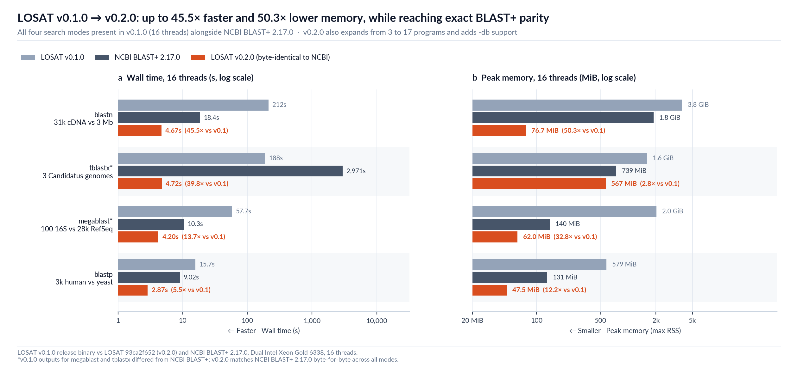
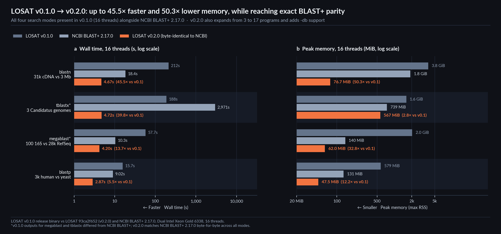

# Coming from LOSAT v0.1.0

v0.1.0 compared two FASTA files with `blastn`, `blastp` and `tblastx`. v0.2.0 keeps that and adds the rest of the NCBI BLAST+ search programs, BLAST databases, the database tools and the NCBI output formats. This page lists what you need to change, and what is new.

## What to change

### The executable is `losat`

The program is now called `losat`. The release archives keep the name `LOSAT` of v0.1.0, for example `LOSAT-0.2.0-x86_64-unknown-linux-gnu.tar.gz`, but the program inside is `losat` (`losat.exe` on Windows). The Bioconda package was `losat` already. Change `LOSAT blastp ...` in your scripts to `losat blastp ...`.

### Use NCBI's option spellings

LOSAT takes NCBI's single-dash, underscore option names: `-query`, `-subject`, `-task`, `-query_gencode`, `-db_gencode`, `-num_threads`, `-outfmt`. The v0.1.0 command line already worked this way, so scripts written for it need no change. If an old script uses the double-dash or hyphen spellings that appear in the v0.1.0 scope document, such as `--task` or `--db-gencode`, LOSAT rejects them. Use the name that NCBI BLAST+ uses:

| Not accepted | Write |
|:---|:---|
| `--task megablast` | `-task megablast` |
| `--query_gencode 11` | `-query_gencode 11` |
| `--db-gencode 11` | `-db_gencode 11` |
| `--outfmt 6` | `-outfmt 6` |

LOSAT does not accept the old spellings under another name. A command that uses one stops with an error before any search runs.

### Commands that worked in v0.1.0 still work

A search that v0.1.0 supported gives NCBI BLAST+ 2.17.0's output in v0.2.0 too. The one deliberate difference from NCBI that v0.1.0 had is still there: a local `-subject` search of `tblastx` translates the subject with the genetic code that `-db_gencode` selects, where NCBI uses code 1. See [Differences from NCBI BLAST+](differences.md).

## What is new

| Area | v0.1.0 | v0.2.0 |
|:---|:---|:---|
| Search programs | `blastn`, `blastp`, `tblastx` | Also `blastx`, `tblastn`, `psiblast`, `rpsblast` and `rpstblastn` |
| Database tools | none | `makeblastdb`, `blastdbcmd`, `dustmasker`, `segmasker`, `windowmasker`, `convert2blastmask`, `makembindex`, `makeprofiledb` (profile databases for `rpsblast`, `rpstblastn` and DELTA-BLAST), `blastdb_aliastool` (alias files and binary lists), `blastdbcheck` (database checks), `cleanup-blastdb-volumes.py` (removes orphaned volume files), `blast_formatter` for the reports of a BLAST archive, and `rpsbproc` for domain annotation |
| Databases | `-query` against a `-subject` FASTA file only | `-db` searches BLAST databases made by `losat makeblastdb` or NCBI's `makeblastdb`, including NCBI's distributed databases |
| Standard input | not available | `-query -` in every search program |
| Tasks | `megablast` and `blastn` for `blastn`; `blastp` for `blastp` | Also `dc-megablast`, `blastn-short`, `rmblastn`, `blastp-fast`, `blastp-short`, `blastx-fast`, `tblastn-fast` |
| Output formats | Tabular (`-outfmt 6`, `7`) for `blastn`, plus pairwise text (`-outfmt 0`) for `blastp` | The NCBI formats, including pairwise text, XML, JSON, ASN.1, SAM and custom tabular fields. See [Output formats](output-formats.md) |
| NCBI program names | none | `losat --install-shims` links `blastn`, `makeblastdb` and the other names to `losat` ([Coming from NCBI BLAST+](from-ncbi-blast.md)) |
| Genetic codes | The 26 codes of NCBI's `-db_gencode` for `tblastx` | The same, and `tblastn` also accepts code 32 |
| WASI threads | Preview | Supported: tested in CI, outside the release's NCBI parity claim ([Platforms and WebAssembly](platforms.md)) |
| Libraries and WebAssembly | Internal only | A public Rust library (`losat::api`), a Python package (`pylosat` on PyPI), and a WebAssembly npm package (`losat`, built from the repository) ([Using LOSAT as a library](library.md)) |
| Web GUI | not part of the release | Preview ([Platforms and WebAssembly](platforms.md)) |

### Speed and memory since v0.1.0

Across all four search modes present in v0.1.0 (`blastn`, `tblastx`, `megablast`, and `blastp`), v0.2.0 runs `5.5×` to `45.5×` faster using `2.0% (1/50.3)` to `35% (1/2.8)` of v0.1.0's peak resident memory at 16 threads while bringing `megablast` and `tblastx` into exact byte-for-byte parity with NCBI BLAST+ 2.17.0 (apart from the local `-subject` genetic-code difference noted above; in the benchmark both arms used genetic code 4, and `blastp` matched form for form — see [Threads, speed and memory](performance.md) for the full v0.2.0 benchmark suite):

### Databases and `-db`

In v0.1.0 you could not search a database. Now every search program except `rpsblast` and `rpstblastn` reads either `-subject` or `-db`, and these two read only `-db`, as in NCBI. See [BLAST databases](databases.md).

### Output formats

If you parsed `-outfmt 6` or `7` output in v0.1.0, nothing changes: the columns are the same 12 standard fields, and you can now also choose your own with `-outfmt "6 qseqid sseqid ..."`. Every program reads `-outfmt` as NCBI does. A format NCBI writes and LOSAT does not write is refused with an error before any input is read.

## What is still not available

`deltablast`, `makeprofiledb -dbtype cobalt`, `blast_formatter` formats other than `8`, `9` and `12` (and binary or XML archives), `psiblast -phi_pattern` and the options that need NCBI's servers (`-remote`, `-entrez_query`) are not in v0.2.0. The [Introduction](introduction.md) lists them, and [What LOSAT refuses](refusals.md) shows the error you get.
