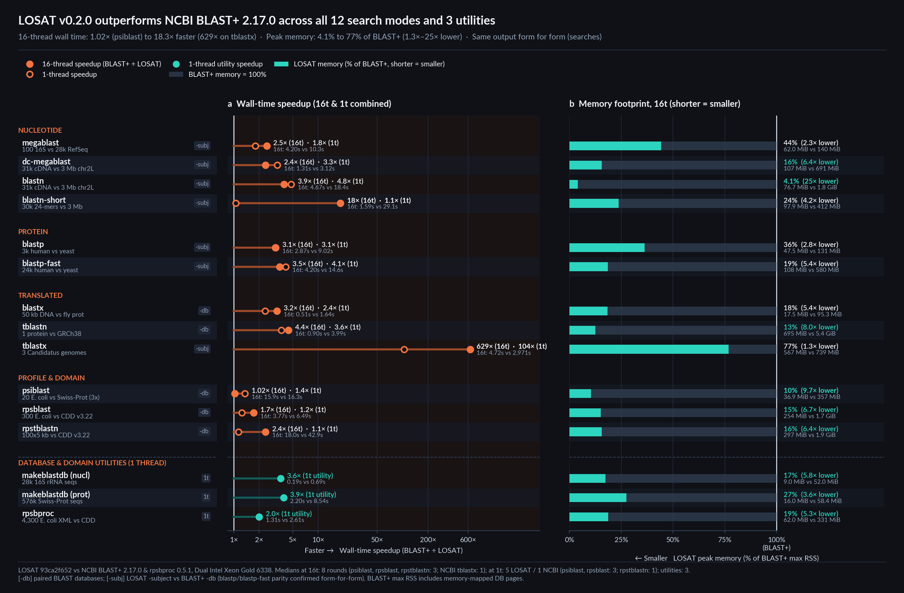
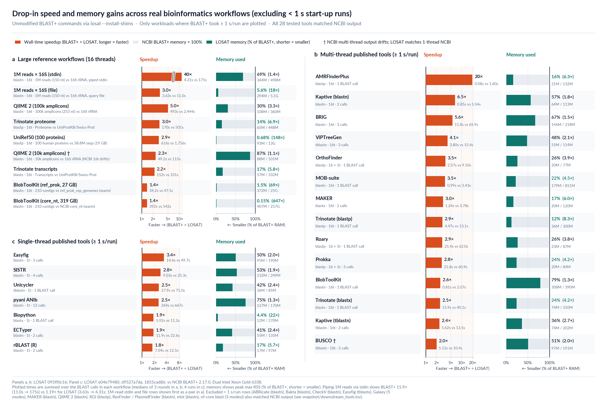
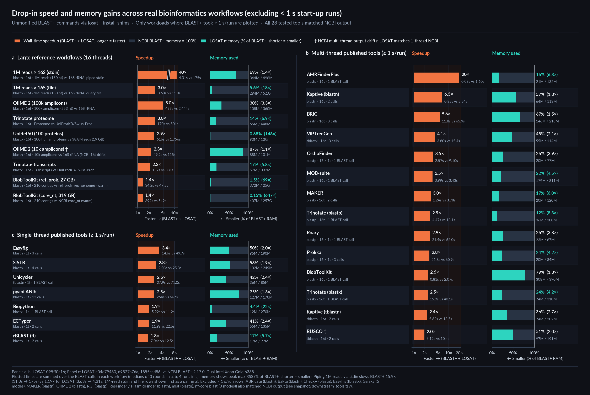
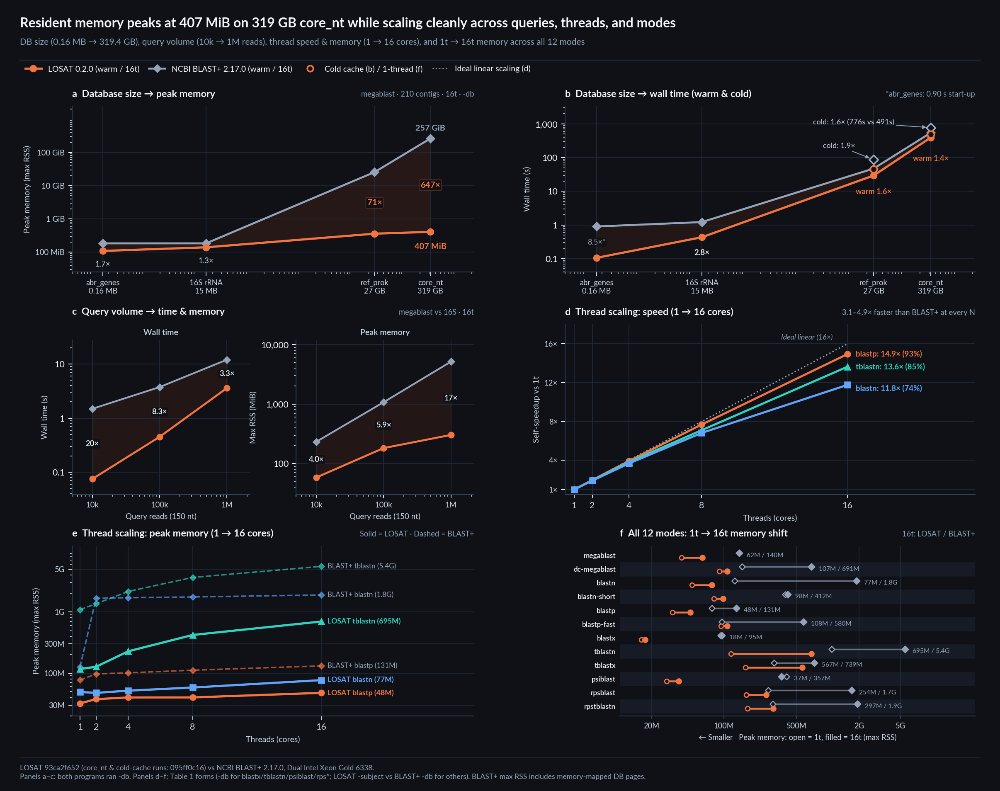
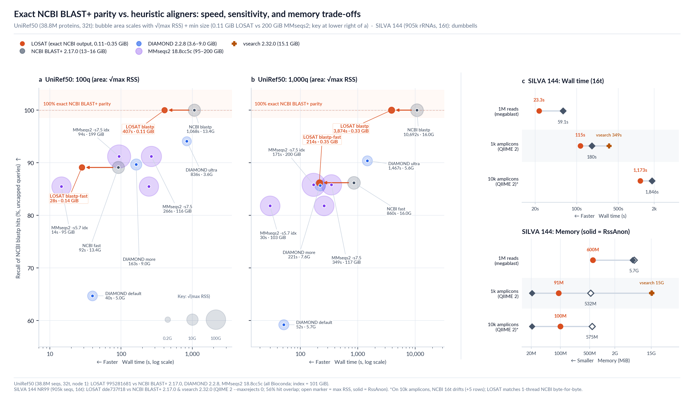
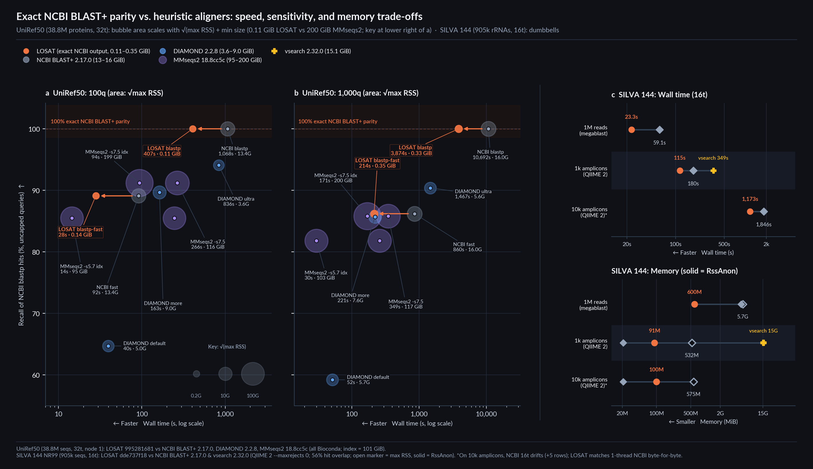
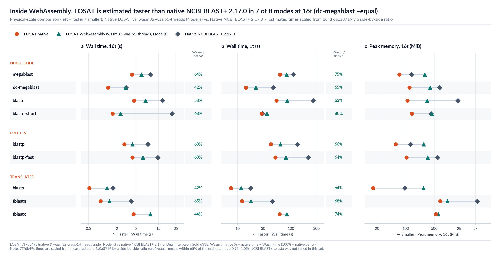
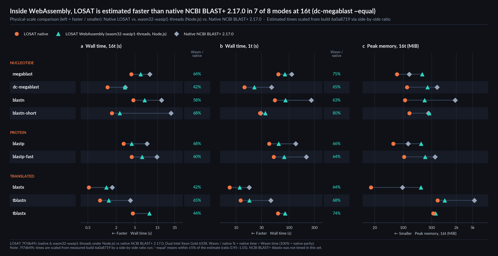

# Threads, speed and memory

LOSAT writes the output of NCBI BLAST+ 2.17.0 in less time and with less memory. In the v0.2.0
benchmarks:

- At 16 threads LOSAT was faster in all twelve search modes: `1.02×` on `psiblast`, `1.7×` to
  `18.3×` on ten other modes, and `629×` on `tblastx` (with `1.3×` to `24.6×` lower peak resident
  memory).
- LOSAT's output does not change with `-num_threads`, and LOSAT uses every thread for `-subject`
  searches too.
- On NCBI's `core_nt` database (319.4 GB), LOSAT's resident memory peaked at 407 MiB where NCBI
  BLAST+ peaked at 257.4 GiB.

This page gives the numbers for each program, explains how LOSAT performs inside published tools and
across threads and memory, shows how LOSAT compares against heuristic aligners (DIAMOND, MMseqs2,
vsearch), and summarizes the WebAssembly build. The
[v0.2.0 benchmark report](https://github.com/satoshikawato/LOSAT/blob/v0.2.0/benchmarks/v0.2.0/README.md)
has the full inputs, commands, TSV snapshots, and reproduction scripts for all six figures (see also
[Coming from LOSAT v0.1.0](from-losat-v0-1.md) for the v0.1.0 to v0.2.0 comparison).

## How the numbers were measured

- **Builds.** LOSAT commit `93ca2f652` (the v0.2.0 release candidate), unless a section names a
  development build, against NCBI BLAST+ 2.17.0 and NCBI `rpsbproc` 0.5.1.
- **Machine.** Two Intel Xeon Gold 6338 CPUs (64 cores across 2 NUMA nodes), Linux. Programs ran in
  alternation on the same pinned cores.
- **Ratios.** `BLAST+ ÷ LOSAT`, from medians: `3.9×` means NCBI BLAST+ took 3.9 times as long as
  LOSAT (or used 3.9 times as much memory). Above `1×`, LOSAT used less.
- **Memory.** Peak resident memory of the process (`max RSS`), plus anonymous heap (`RssAnon`) where
  measured. NCBI BLAST+ maps database files into memory (`mmap`), so on a large `-db` search its
  `max RSS` includes file-backed database pages that the OS kernel can drop and reload rather than
  heap alone. "Warm" means database files were read once before timed runs; "cold" means page-cache
  entries were dropped before each run.
- **Same output.** Byte-identical SHA-256 of the output file.

## Speed and memory by program

For a FASTA subject, LOSAT ran `-subject FILE` and NCBI BLAST+ ran `-db` on a database made from the
same FASTA, because NCBI BLAST+ ignores `-num_threads` with `-subject`. All searches wrote
`-outfmt 6`.

| Search | Form: LOSAT / BLAST+ | Time, 1t | Time, 16t | 16t: LOSAT / BLAST+ (s) | Max RSS, 16t |
| --- | --- | ---: | ---: | ---: | ---: |
| `blastn -task megablast` | `-subject` / `-db` | 1.8× | 2.5× | 4.20 / 10.30 | 2.3× |
| `blastn -task dc-megablast` | `-subject` / `-db` | 3.3× | 2.4× | 1.31 / 3.12 | 6.4× |
| `blastn -task blastn` | `-subject` / `-db` | 4.8× | 3.9× | 4.67 / 18.37 | 24.6× |
| `blastn -task blastn-short` | `-subject` / `-db` | 1.1× | 18.3× | 1.59 / 29.09 | 4.2× |
| `blastp` | `-subject` / `-db` | 3.1× | 3.1× | 2.87 / 9.02 | 2.8× |
| `blastp -task blastp-fast` | `-subject` / `-db` | 4.1× | 3.5× | 4.20 / 14.65 | 5.4× |
| `blastx` | `-db` / `-db` | 2.4× | 3.2× | 0.51 / 1.64 | 5.4× |
| `tblastn` | `-db` / `-db` | 3.7× | 4.4× | 0.90 / 3.99 | 8.0× |
| `tblastx` | `-subject` / `-db` | 104× | 629× | 4.72 / 2,970.75 | 1.3× |
| `psiblast`, 3 iterations | `-db` / `-db` | 1.4× | 1.02× | 15.95 / 16.33 | 9.7× |
| `rpsblast` | `-db` / `-db` | 1.2× | 1.7× | 3.77 / 6.49 | 6.7× |
| `rpstblastn` | `-db` / `-db` | 1.1× | 2.4× | 18.00 / 42.90 | 6.4× |

Ratios are `BLAST+ ÷ LOSAT`. LOSAT `93ca2f652` against NCBI BLAST+ 2.17.0; medians of 8 rounds at
16 threads after a discarded warm-up round (`psiblast`, `rpsblast`, `rpstblastn`: 3 rounds; NCBI
BLAST+ `tblastx`: one run), and of 5 LOSAT runs and one NCBI BLAST+ run at 1 thread (`psiblast`,
`rpsblast`: 3 each; `rpstblastn`: one each).

- At 16 threads LOSAT was faster in all twelve modes: `1.02×` on `psiblast` (15.95 s vs. 16.33 s),
  `1.7×` to `18.3×` on ten modes, and `629×` on `tblastx`. At 1 thread the range is `1.1×`
  (`blastn-short`, `rpstblastn`) to `4.8×` (`blastn`), and `104×` on `tblastx` (62.35 s vs.
  6,493.88 s).
- NCBI BLAST+'s max RSS at 16 threads was `1.3×` (`tblastx`) to `24.6×` (`blastn`) LOSAT's.
- LOSAT wrote NCBI BLAST+'s output (apart from the version line, which names LOSAT) in every search
  but `blastp` and `blastp-fast`. There a `-db` search and a `-subject` search give different
  statistics in NCBI BLAST+ too; compared form by form at 1 thread, LOSAT `-subject` wrote the bytes
  of NCBI BLAST+ `-subject`, and LOSAT `-db` those of NCBI BLAST+ `-db`.
- Each LOSAT search wrote the same bytes at 1 and at 16 threads.

**Figure 1.** All 12 search modes and 3 single-threaded utilities (`makeblastdb`, `rpsbproc`), LOSAT
`93ca2f652` vs. NCBI BLAST+ 2.17.0 and `rpsbproc` 0.5.1. **a**, combined 16-thread (filled) and
1-thread (open) wall-time speedup lollipops, plus 1-thread utilities; **b**, 16-thread peak resident
memory footprint as `% of BLAST+` (shorter bars indicate smaller memory; 1 thread for utilities).

## Database construction and domain reports

One thread, LOSAT `93ca2f652` against NCBI BLAST+ 2.17.0 and NCBI `rpsbproc` 0.5.1, medians of 3
alternated runs (also shown at the bottom of Figure 1):

| Program and input | Time: LOSAT / NCBI (s) | NCBI ÷ LOSAT | Max RSS: LOSAT / NCBI (MiB) | NCBI ÷ LOSAT |
| --- | ---: | ---: | ---: | ---: |
| `makeblastdb -dbtype nucl`, RefSeq 16S rRNA (28,036 sequences) | 0.193 / 0.691 | 3.6× | 9.0 / 52.0 | 5.8× |
| `makeblastdb -dbtype prot`, UniProtKB/Swiss-Prot (575,748 sequences) | 2.197 / 8.537 | 3.9× | 16.0 / 58.4 | 3.6× |
| `rpsbproc -t both -m rep -f`, `rpsblast` XML of 4,300 *E. coli* proteins against CDD v3.22 | 1.309 / 2.610 | 2.0× | 62.0 / 331.0 | 5.3× |

`rpsbproc` wrote the same report as NCBI's. The databases from `makeblastdb` were not compared in
this benchmark.

## Inside published tools

A tool that calls NCBI BLAST+ by its program names runs LOSAT without changes once the names are
installed (see [Coming from NCBI BLAST+](from-ncbi-blast.md)). The benchmark ran unmodified BLAST
commands from 28 published tools (ABRicate, AMRFinderPlus, Bakta, Biopython, BlobToolKit, BRIG,
BUSCO, CheckV, ECTyper, Easyfig, Galaxy, Kaptive, MAKER, mlst, MOB-suite, nf-core/blast,
OrthoFinder, Prokka, pyani ANIb, QIIME 2, rBLAST, ResFinder/PlasmidFinder, RGI, Roary, SISTR,
Trinotate, Unicycler, and ViPTreeGen) plus 9 large reference workflows (`core_nt`,
`ref_prok_rep_genomes`, UniRef50, QIIME 2 10k/100k amplicons, Trinotate proteome/transcripts, and
1M reads from a query file and piped through `stdin`).

- **Output.** In every compared run LOSAT wrote NCBI BLAST+ 2.17.0's output (apart from the version
  line in formats that have one). In BUSCO and QIIME 2, NCBI BLAST+'s multi-thread output differs
  from its 1-thread output; there LOSAT's output at every thread count equals NCBI BLAST+'s 1-thread
  output.
- **Speed and memory.** Figure 2 plots only workloads where NCBI BLAST+ took at least 1 s per BLAST
  invocation (excluding `< 1 s/run` start-up-dominated test suites, which remain listed in
  `snapshot/downstream_tools.tsv`). On large reference workflows (panel a), LOSAT ran `1.4×` to
  `5.0×` faster across the 8 query-file workflows (`3.0×` on 1M reads from a file, consistent with
  Figure 3c's `3.3×` on release candidate `93ca2f652`) and `40.5×` faster when piping those 1M reads
  through `stdin` — where NCBI BLAST+ takes `15.9×` longer than from a file (`174.53 s` vs.
  `10.98 s`) while LOSAT takes `1.19×` (`4.31 s` vs. `3.63 s`) — with `1.1×` to `647×` lower peak
  RSS (`17.7×` lower on the 1M-read query file, `1.4×` via `stdin`). Across the `≥ 1 s/run`
  multi-thread tool runs (panel b), LOSAT ran `2.0×` (BUSCO) to `20×` (AMRFinderPlus) faster with
  `1.3×` to `8.3×` lower peak RSS; across the 7 `≥ 1 s/run` single-thread-only suites (panel c),
  `1.8×` to `3.4×` faster with `1.3×` to `22.5×` lower peak RSS. Single-thread timings for the
  multi-thread tool rows (e.g. AMRFinderPlus `4.88×`, BRIG `3.24×`, Prokka `2.77×`) remain in
  `snapshot/downstream_tools.tsv`.

**Figure 2.** Drop-in speed and memory gains on real workloads taking ≥ 1 s per BLAST run (wall-time
speedup alongside remaining memory footprint as `% of BLAST+ max RSS`, shorter = smaller). **a**,
9 large reference workflows at 16 threads (earlier development build `095ff0c16`; warm
`ref_prok_rep_genomes` on release candidate `93ca2f652` is shown in Figure 3a–b); piping 1M reads
via `stdin` slows NCBI BLAST+ `15.9×` (`174.53 s` vs. `10.98 s`) versus `1.19×` for LOSAT
(`4.31 s` vs. `3.63 s`). **b**, multi-thread published tools (LOSAT `095ff0c16`). **c**,
single-thread-only published tools (LOSAT `e04e79480`, `d9527a7da`, `1855cad86`). Plotted times for
multi-call tools are summed over the BLAST calls in each workflow. `†` marks runs where NCBI BLAST+
multi-thread output drifts from its 1-thread output.

## Threads

Every search program takes `-num_threads N` (default 1). LOSAT uses the threads for both kinds of
search:

- **`-db`**: the database is searched in parallel, as in NCBI BLAST+.
- **`-subject`**: LOSAT also searches FASTA subjects with `N` threads. NCBI BLAST+ runs a
  `-subject` search on one thread and prints
  `'num_threads' is currently ignored when 'subject' is specified.`, so with LOSAT a pairwise
  comparison of two genomes uses every thread you give it.

The output does not depend on the thread count: the same command writes the same bytes with any
`-num_threads`, and on the release test set those are the bytes of NCBI BLAST+ 2.17.0 run with one
thread (apart from the version line, which names LOSAT). The release tests compare 1, 2 and 4
threads, and the benchmarks on this page up to 16. You can raise `-num_threads` without checking the
results again.

`-mt_mode` is accepted for compatibility, and the output does not depend on it either. `blastn`,
`blastp`, `blastx` and `tblastn` take 0 (auto), 1 (split by queries) or 2 (split by database).
`rpsblast` and `rpstblastn` take 0 (split by database volumes) or 1 (split by queries). `tblastx`
and `psiblast` have no `-mt_mode`, as in NCBI BLAST+ 2.17.0.

LOSAT does not lower `-num_threads` to the number of CPUs, and it prints no warning about it. NCBI
BLAST+ does both. Asking for more threads than the machine has cores rarely helps; a value up to the
number of physical cores is a good start.

From 1 to 16 threads, LOSAT's wall time fell `11.8×` in `blastn`, `14.9×` in `blastp`, and `13.6×`
in `tblastn` (Figure 3d). At every thread count from 1 to 16, NCBI BLAST+ took `3.1×` to `4.9×` as
long as LOSAT in these three searches.

**Figure 3.** Scaling across database size, query volume, threads, and modes (LOSAT circles, NCBI
BLAST+ 2.17.0 diamonds). **a**, peak memory and **b**, warm-cache (filled) and cold-cache (open)
wall time of `megablast` of 210 draft contigs against databases from 0.16 MB (`abr_genes`) to NCBI's
`core_nt` (319.4 GB) at 16 threads. **c**, wall time and peak memory of `megablast` from 10,000 to
1,000,000 reads of 150 nt against RefSeq 16S rRNA at 16 threads. **d**, multi-core speed efficiency
(1 to 16 cores vs. ideal linear diagonal) and **e**, peak memory curves (1 to 16 cores; solid =
LOSAT, dashed = BLAST+) for `blastn`, `blastp`, and `tblastn`. **f**, 1-thread (open) to 16-thread
(filled) peak memory shift across all 12 search modes. In a–c both programs ran `-db`; LOSAT
`93ca2f652`, except `core_nt` and cold-cache runs (`095ff0c16`).

## Memory

Memory use grows with the size of the query batch, the database volume being searched and the number
of threads. With more than 64 threads, a search in which NCBI BLAST+'s memory does not grow with
`-num_threads` (a `-subject` search, which it runs on one thread) can use more memory in LOSAT than
in NCBI BLAST+: up to 1.44 times at 128 threads in the v0.2.0 tests of the development build
`ff07c6a7d` (see [Threads with `-subject`](differences.md#threads-with--subject)). If a large search
runs out of memory:

- lower `-num_threads`: memory use rises with the thread count;
- split a very large query file into several runs.

When memory runs out, a LOSAT search program aborts; NCBI BLAST+ reports it with exit status 4 (see
[Differences from NCBI BLAST+](differences.md#a-write-that-fails-a-closed-pipe-memory)).

In the benchmarks, LOSAT's max RSS remained small on large databases and query sets (Figure 3a–c;
16 threads, both programs `-db`, warm cache):

- `megablast` of 210 draft contigs against NCBI's `core_nt` (319.4 GB): LOSAT peaked at 407 MiB vs.
  NCBI BLAST+'s 263,594 MiB / 257.4 GiB (`647×` lower). Warm wall time: 391.74 s vs. 542.14 s
  (`1.4×`); cold cache: 491.16 s vs. 775.83 s (`1.6×`, 409 MiB peak). LOSAT development build
  `095ff0c16`.
- The same contigs against RefSeq `ref_prok_rep_genomes` (26.8 GB): LOSAT 358 MiB, NCBI BLAST+
  25,580 MiB (`71.4×` lower). Warm wall time: 29.37 s vs. 47.28 s (`1.6×`); cold cache: 44.96 s vs.
  87.22 s (`1.9×`). LOSAT `93ca2f652` (cold: `095ff0c16`).
- `megablast` of 1,000,000 reads of 150 nt against RefSeq 16S rRNA: LOSAT 302 MiB, NCBI BLAST+
  5,145 MiB (`17.0×` lower). Wall time: 3.60 s vs. 12.01 s (`3.3×`). LOSAT `93ca2f652`.

## When to choose LOSAT vs. heuristic aligners

LOSAT is built for **exact NCBI BLAST+ 2.17.0 drop-in compatibility**: the same CLI options,
E-values, bit scores, coordinates, and [output formats](output-formats.md) across nucleotide,
translated, PSI-BLAST, RPS-BLAST, and CDD workflows.

Heuristic aligners such as **DIAMOND**, **MMseqs2**, and **vsearch** use different seeding,
indexing, or prefiltering algorithms and report their own scores, E-value calibrations, and hit
sets. Figure 4 compares these trade-offs directly on two large public databases on the same machine:

- **Protein search on UniRef50 (38.8M sequences, 32 threads; Figure 4a–b).** `LOSAT blastp` matched
  NCBI `blastp` byte-for-byte (`100%` hit recall) in `407 s` (100 queries) and `3,874 s` (1,000
  queries) using `0.11–0.33 GiB` max RSS (`2.6×`–`2.8×` faster and `49×`–`121×` lower max RSS than
  NCBI `blastp`). `LOSAT blastp-fast` matched NCBI `blastp-fast` byte-for-byte in `28 s` / `214 s`
  (`0.14–0.35 GiB` RSS, `89.1%` / `86.2%` of full `blastp` hits) — faster than DIAMOND
  `--more-sensitive` (`163 s` / `221 s`, `7.6–9.0 GiB`) and unindexed MMseqs2 (`245–349 s`,
  `95–117 GiB`) at comparable recall. Without requiring BLAST+ equivalence on the 1,000-query batch,
  DIAMOND `default` ran in `52 s` (`59.2%` recall) and MMseqs2 with a prebuilt `101 GiB` index ran
  in `30–171 s` (`103–200 GiB` RSS).
- **16S rRNA search on SILVA 144 NR99 (905k sequences, 16 threads; Figure 4c).** On 1M shotgun reads
  (`megablast`), LOSAT ran in `23.3 s` / `600 MiB` vs. NCBI's `59.1 s` / `5.7 GiB` (`2.5×` faster,
  `9.7×` lower RSS). Under QIIME 2 amplicon settings, LOSAT ran 1k amplicons in `115 s` / `91 MiB`
  max RSS vs. NCBI's `180 s` / `532 MiB` and vsearch's `349 s` / `15.1 GiB` (`--maxrejects 0`; 56%
  hit overlap with BLAST+); on 10k amplicons, NCBI's 16-thread output drifted by 5 rows while LOSAT
  matched 1-thread NCBI byte-for-byte in `1,173 s` / `100 MiB` max RSS. On those amplicon runs,
  NCBI's max RSS is mostly memory-mapped database pages (`RssAnon` `20.8 MiB`), while LOSAT's
  anonymous heap is larger (`90.9 MiB` at 1k, `98.8 MiB` at 10k).

**Figure 4.** Exact NCBI BLAST+ parity vs. heuristic aligners. **a, b**, UniRef50 (38.8M proteins,
32 threads; one round per arm; LOSAT `995281681`, NCBI BLAST+ 2.17.0, DIAMOND 2.2.8, MMseqs2
18.8cc5c) for 100 and 1,000 queries; bubble area scales with the square root of peak `max RSS` (with
a minimum size; key at lower right of panel a). **c**, SILVA 144 NR99 (905k rRNAs, 16 threads; mean
of 2 runs, `vsearch`: 1 run; LOSAT `dde737f18`, NCBI BLAST+ 2.17.0, vsearch 2.32.0): horizontal
dumbbells for wall time (top) and memory (bottom; open marker = `max RSS`, solid marker = `RssAnon`).

Choose **DIAMOND**, **MMseqs2**, or **vsearch** when heuristic alignment suffices and BLAST+ output
equivalence is not required. Choose **LOSAT** when pipelines, downstream parsers, or scientific
protocols expect NCBI BLAST+ 2.17.0 options, semantics, or output formats with lower runtime and
memory.

## WebAssembly

The serial WASI build (`wasm32-wasip1`) matches NCBI BLAST+ 2.17.0 on the release test set (apart
from the version line, which names LOSAT), with the same bytes as the Linux x64 native binary. The
threaded WASI build (`wasm32-wasip1-threads`) takes `-num_threads` like the native program; it is
tested in CI, outside the release's NCBI parity claim. Both run slower than the native program,
because WebAssembly's vector instructions are narrower than those of current CPUs. See
[Platforms and WebAssembly](platforms.md).

In the benchmarks (estimated times for development build `7f7db49c`, scaled from measured build
`6a0a8719` via a side-by-side ratio run), the threaded build run by Node.js reached `63%` to `80%`
of native LOSAT speed at 1 thread (`1.25×` to `1.59×` overhead) and `42%` to `68%` at 16 threads
(`1.47×` to `2.36×` overhead). Under those estimated times at 16 threads, WebAssembly LOSAT was
faster than native C++ NCBI BLAST+ 2.17.0 in 7 of 8 modes (`1.33×` on `blastx` to `12.3×` on
`blastn-short`) and about equal on `dc-megablast` (`3.06 s` vs. `3.111 s`, `1.02×` / 1.7%
difference; Figure 5 marks estimates within ±5% as `~equal`). At 1 thread it is estimated faster in 7 of 8 modes
(`1.34×` on `megablast` to `3.08×` on `blastn`) and slower on `blastn-short` (`0.83×`). Peak memory
at 16 threads stayed below native BLAST+ in 4 of 8 modes. The serial build was not timed.

**Figure 5.** Physical-scale comparison (left = faster / smaller) of native LOSAT, threaded WASI
WebAssembly (`wasm32-wasip1-threads`, Node.js), and native NCBI BLAST+ 2.17.0 on the searches in
[Speed and memory by program](#speed-and-memory-by-program) (estimated times for development build
`7f7db49c`, derived from measured build `6a0a8719` via a side-by-side ratio run). **a**, 16-thread
wall time (s) and `Wasm / native %`; **b**, 1-thread wall time (s) and `Wasm / native %`; **c**,
16-thread peak memory (MiB). NCBI BLAST+ `tblastx` was not measured in this set.
