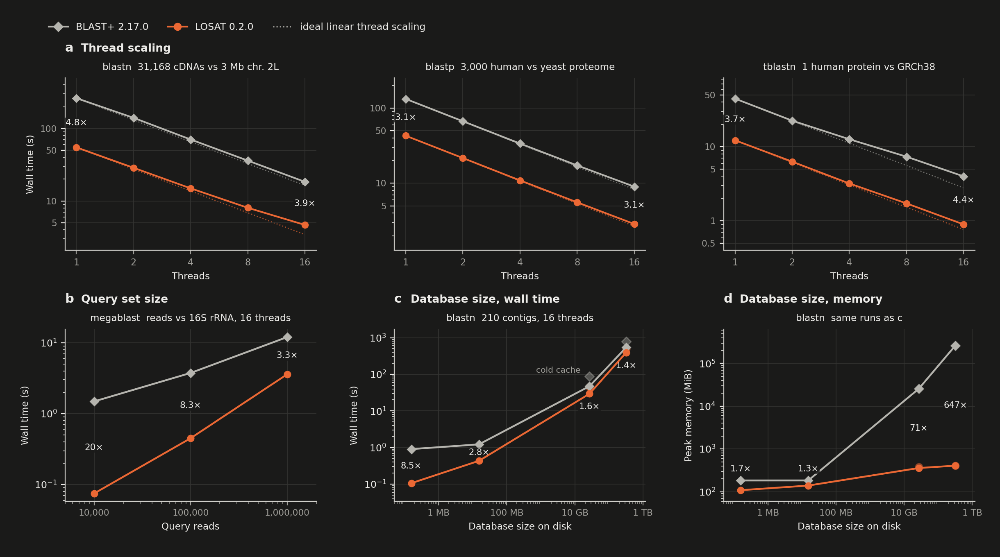
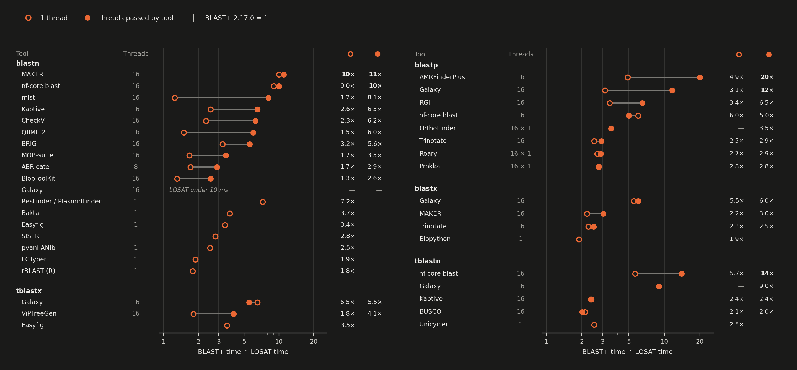
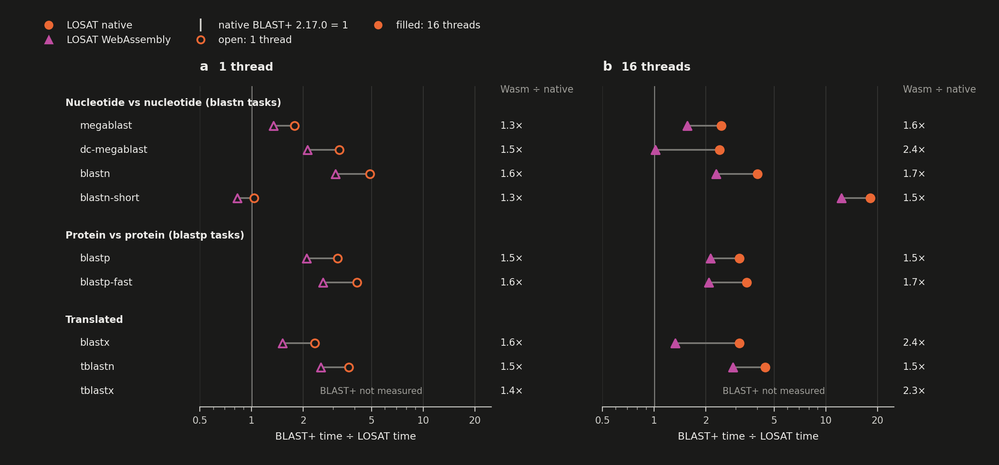

# Threads, speed and memory

LOSAT writes the output of NCBI BLAST+ 2.17.0 in less time and with less memory. In the v0.2.0
benchmarks:

- At 16 threads NCBI BLAST+ took from about as long as LOSAT (`psiblast`) to 18.3 times as long in
  eleven of the twelve search modes measured, and 629 times as long in `tblastx`.
- LOSAT's output does not change with `-num_threads`, and LOSAT uses the threads for `-subject`
  searches too.
- On NCBI's `core_nt` database (319.4 GB), LOSAT's peak resident memory was 407 MiB and NCBI BLAST+'s
  257.4 GiB.

This page gives the numbers for each program, explains how LOSAT uses threads and memory, and how the
WebAssembly build compares. The [v0.2.0 benchmark report](https://github.com/satoshikawato/LOSAT/blob/v0.2.0/benchmarks/v0.2.0/README.md)
has the inputs and commands of every search, every measured value, and the scripts that make the
tables and figures.

## How the numbers were measured

- **Builds.** LOSAT commit `93ca2f652` (the v0.2.0 release candidate), unless a section names a
  development build, against NCBI BLAST+ 2.17.0.
- **Machine.** Two Intel Xeon Gold 6338 CPUs (64 cores), Linux. The two programs ran in alternation
  on the same machine.
- **Ratios.** BLAST+ ÷ LOSAT, from the medians: 3.9 means that NCBI BLAST+ took 3.9 times as long as
  LOSAT (or used 3.9 times as much memory). Above 1, LOSAT took less.
- **Memory.** Peak resident memory of the process (max RSS). NCBI BLAST+ maps database files into
  memory (`mmap`), so on a large `-db` search its max RSS includes file-backed database pages that
  the OS kernel can drop and reload rather than heap alone. Future release-candidate (`C5`) runs
  are planned to record anonymous private memory (`RssAnon`) alongside `max RSS` for a heap-level
  comparison. "Warm" means the database files were read once before the timed runs; "cold" that
  their pages were dropped from the page cache before each run.
- **Same output.** The same SHA-256 of the output file.

## Speed and memory by program

For a FASTA subject, LOSAT ran `-subject FILE` and NCBI BLAST+ ran `-db` on a database made from the
same FASTA, because NCBI BLAST+ ignores `-num_threads` with `-subject`. All searches wrote
`-outfmt 6`.

| Search | Form: LOSAT / BLAST+ | Time, 1 thread | Time, 16 threads | 16 threads: LOSAT / BLAST+ (s) | Max RSS, 16 threads |
| --- | --- | ---: | ---: | ---: | ---: |
| `blastn -task megablast` | `-subject` / `-db` | 1.8 | 2.5 | 4.20 / 10.30 | 2.3 |
| `blastn -task dc-megablast` | `-subject` / `-db` | 3.3 | 2.4 | 1.31 / 3.12 | 6.4 |
| `blastn -task blastn` | `-subject` / `-db` | 4.8 | 3.9 | 4.67 / 18.37 | 24.6 |
| `blastn -task blastn-short` | `-subject` / `-db` | 1.1 | 18.3 | 1.59 / 29.09 | 4.2 |
| `blastp` | `-subject` / `-db` | 3.1 | 3.1 | 2.87 / 9.02 | 2.8 |
| `blastp -task blastp-fast` | `-subject` / `-db` | 4.1 | 3.5 | 4.20 / 14.65 | 5.4 |
| `blastx` | `-db` / `-db` | 2.4 | 3.2 | 0.51 / 1.64 | 5.4 |
| `tblastn` | `-db` / `-db` | 3.7 | 4.4 | 0.90 / 3.99 | 8.0 |
| `tblastx` | `-subject` / `-db` | 104 | 629 | 4.72 / 2,970.75 | 1.3 |
| `psiblast`, 3 iterations | `-db` / `-db` | 1.4 | 1.0 | 15.95 / 16.33 | 9.7 |
| `rpsblast` | `-db` / `-db` | 1.2 | 1.7 | 3.77 / 6.49 | 6.7 |
| `rpstblastn` | `-db` / `-db` | 1.1 | 2.4 | 18.00 / 42.90 | 6.4 |

Ratios are BLAST+ ÷ LOSAT. LOSAT `93ca2f652` against NCBI BLAST+ 2.17.0; medians of 8 rounds at
16 threads after a discarded warm-up round (`psiblast`, `rpsblast`, `rpstblastn`: 3 rounds; NCBI
BLAST+ `tblastx`: one run), and of 5 LOSAT runs and one NCBI BLAST+ run at 1 thread (`psiblast`,
`rpsblast`: 3 each; `rpstblastn`: one each).

- At 16 threads NCBI BLAST+ took from about as long as LOSAT (`psiblast`, 16.33 s against 15.95 s,
  ratio 1.0) to 18.3 times as long (`blastn-short`), and 629 times as long in `tblastx`. At 1 thread the
  range is 1.1 (`blastn-short`, `rpstblastn`) to 4.8 (`blastn`), and 104 in `tblastx` (62.35 s
  against 6,493.88 s).
- NCBI BLAST+'s max RSS at 16 threads was 1.3 (`tblastx`) to 24.6 (`blastn`) times LOSAT's.
- LOSAT wrote NCBI BLAST+'s output (apart from the version line, which names LOSAT) in every search but `blastp` and `blastp-fast`. There a `-db`
  search and a `-subject` search give different statistics in NCBI BLAST+ too; compared form by form
  at 1 thread, LOSAT `-subject` wrote the bytes of NCBI BLAST+ `-subject`, and LOSAT `-db` those of
  NCBI BLAST+ `-db`.
- Each LOSAT search wrote the same bytes at 1 and at 16 threads.

**Figure 1.** LOSAT `93ca2f652` (circles) and NCBI BLAST+ 2.17.0 (diamonds), in the forms of the
table. **a**, wall time at 1 thread; **b**, wall time at 16 threads; **c**, max RSS at 16 threads. The
numbers right of each panel are BLAST+ ÷ LOSAT.

## Threads

Every search program takes `-num_threads N` (default 1). LOSAT uses the threads for both kinds of
search:

- **`-db`**: the database is searched in parallel, as in NCBI BLAST+.
- **`-subject`**: LOSAT also searches FASTA subjects with `N` threads. NCBI BLAST+ runs a
  `-subject` search on one thread and prints
  `'num_threads' is currently ignored when 'subject' is specified.`, so with LOSAT a pairwise
  comparison of two genomes uses every thread you give it.

The output does not depend on the thread count: the same command writes the same bytes with any
`-num_threads`, and on the release test set those are the bytes of NCBI BLAST+ 2.17.0 run with one
thread (apart from the version line, which names LOSAT). The release tests compare 1, 2 and 4 threads, and the benchmarks on this page up to 16. You can
raise `-num_threads` without checking the results again.

`-mt_mode` is accepted for compatibility, and the output does not depend on it either.
`blastn`, `blastp`, `blastx` and `tblastn` take 0 (auto), 1 (split by queries) or 2 (split by
database). `rpsblast` and `rpstblastn` take 0 (split by database volumes) or 1 (split by queries).
`tblastx` and `psiblast` have no `-mt_mode`, as in NCBI BLAST+ 2.17.0.

LOSAT does not lower `-num_threads` to the number of CPUs, and it prints no warning about it.
NCBI BLAST+ does both. Asking for more threads than the machine has cores rarely helps; a value
up to the number of physical cores is a good start.

From 1 to 16 threads, LOSAT's wall time fell 11.8 times in the `blastn` search of the table, 14.9
times in `blastp` and 13.6 times in `tblastn` (Figure 2a). At every thread count from 1 to 16, NCBI
BLAST+ took 3.1 to 4.9 times as long as LOSAT in these three searches.

**Figure 2.** LOSAT (circles) and NCBI BLAST+ 2.17.0 (diamonds); labels are BLAST+ ÷ LOSAT.
**a**, wall time at 1, 2, 4, 8 and 16 threads for the `blastn`, `blastp` and `tblastn` searches of the
table, in its forms; dotted lines are ideal linear scaling from 1 thread. **b**, `megablast` of 10,000
to 1,000,000 reads of 150 nt against the RefSeq 16S rRNA database at 16 threads. **c**, wall time and
**d**, max RSS of `megablast` of 210 draft contigs against databases from 0.16 MB to NCBI's `core_nt`
(319.4 GB) at 16 threads; faded points are cold-cache runs. In b, c and d both programs ran `-db`.
LOSAT `93ca2f652`, except the `core_nt` points and the cold-cache points in c and d, which are the
development build `095ff0c16`.

## Memory

Memory use grows with the size of the query batch, the database volume being searched and the
number of threads. If a large search runs out of memory:

- lower `-num_threads`: memory use rises with the thread count;
- split a very large query file into several runs.

When memory runs out, a LOSAT search program aborts; NCBI BLAST+ reports it with exit status 4 (see
[Differences from NCBI BLAST+](differences.md#a-write-that-fails-a-closed-pipe-memory)).

In the benchmarks, LOSAT's max RSS stayed small on large databases and query sets (Figure 2, b to d;
16 threads, both programs `-db`, warm cache):

- `megablast` of 210 draft contigs against NCBI's `core_nt` (319.4 GB): LOSAT 407 MiB, NCBI BLAST+
  263,594 MiB, that is 257.4 GiB (647 times LOSAT's). NCBI BLAST+ took 542.14 s, 1.4 times as long as
  LOSAT's 391.74 s. LOSAT development build `095ff0c16`.
- The same contigs against RefSeq `ref_prok_rep_genomes` (26.8 GB): LOSAT 358 MiB, NCBI BLAST+
  25,580 MiB (71.4 times). NCBI BLAST+ took 47.28 s, 1.6 times as long as LOSAT's 29.37 s.
  LOSAT `93ca2f652`.
- `megablast` of 1,000,000 reads of 150 nt against RefSeq 16S rRNA: LOSAT 302 MiB, NCBI BLAST+
  5,145 MiB (17.0 times). NCBI BLAST+ took 12.01 s, 3.3 times as long as LOSAT's 3.60 s. LOSAT
  `93ca2f652`.

## Database construction and domain reports

One thread, LOSAT `93ca2f652` against NCBI BLAST+ 2.17.0 and NCBI `rpsbproc` 0.5.1, medians of 3
alternated runs:

| Program and input | Time: LOSAT / NCBI (s) | NCBI ÷ LOSAT | Max RSS: LOSAT / NCBI (MiB) | NCBI ÷ LOSAT |
| --- | ---: | ---: | ---: | ---: |
| `makeblastdb -dbtype nucl`, RefSeq 16S rRNA (28,036 sequences) | 0.193 / 0.691 | 3.6 | 9.0 / 52.0 | 5.8 |
| `makeblastdb -dbtype prot`, UniProtKB/Swiss-Prot (575,748 sequences) | 2.197 / 8.537 | 3.9 | 16.0 / 58.4 | 3.6 |
| `rpsbproc -t both -m rep -f`, `rpsblast` XML of 4,300 *E. coli* proteins against CDD v3.22 | 1.309 / 2.610 | 2.0 | 62.0 / 331.0 | 5.3 |

`rpsbproc` wrote the same report as NCBI's. The databases from `makeblastdb` were not compared in this
benchmark.

## Inside published tools

A tool that calls NCBI BLAST+ by its program names runs LOSAT without changes once the names are
installed (see [Coming from NCBI BLAST+](from-ncbi-blast.md)). The benchmark ran the BLAST commands
of 28 published tools, with each tool's command lines and its own test data: ABRicate, AMRFinderPlus,
Bakta, Biopython, BlobToolKit, BRIG, BUSCO, CheckV, ECTyper, Easyfig, Galaxy, Kaptive, MAKER, mlst,
MOB-suite, nf-core/blast, OrthoFinder, Prokka, pyani (ANIb), QIIME 2, rBLAST, ResFinder and
PlasmidFinder, RGI, Roary, SISTR, Trinotate, Unicycler and ViPTreeGen.

- **Output.** In every compared run LOSAT wrote NCBI BLAST+ 2.17.0's output, apart from the line that names the program's version in the formats that have one. In BUSCO and QIIME 2,
  NCBI BLAST+'s own output with several threads differs from its 1-thread output; there LOSAT's output
  at every thread count equals NCBI BLAST+'s 1-thread output.
- **Time.** Counting only the tools' searches in which NCBI BLAST+ took at least 1 s per BLAST run
  (below that, the ratio measures program start-up more than the search): at the thread counts the
  tools pass, NCBI BLAST+ took 2.0 (BUSCO, `tblastn`) to about 20 (AMRFinderPlus, `blastp`: 1.60 s
  against 0.08 s) times as long as LOSAT, over 14 tool searches; at 1 thread, 1.3 (BlobToolKit) to
  4.9 (AMRFinderPlus) times as long, over 22.

**Figure 3.** Total time of the BLAST commands that each tool runs, NCBI BLAST+ 2.17.0 ÷ LOSAT.
Filled: the thread count the tool passes (16; ABRicate 8; Prokka, Roary and OrthoFinder as 16
one-thread BLAST processes at once), LOSAT development build `095ff0c16`, medians of 3 alternated
rounds. Open: one thread, LOSAT development builds `e04e79480`, `d9527a7da` and `1855cad86`, medians of
4 alternated runs. Grey ratios marked `*`: NCBI BLAST+ took less than 1 s per BLAST run, so the ratio
measures program start-up more than search speed.

## WebAssembly

The serial WASI build (`wasm32-wasip1`) matches NCBI BLAST+ 2.17.0 on the release test set (apart from the version line, which names LOSAT), with the
same bytes as the Linux x64 native binary. The threaded WASI build (`wasm32-wasip1-threads`) takes
`-num_threads` like the native program; it is tested in CI, outside the release's NCBI parity claim.
Both run slower than the native program, because WebAssembly's vector instructions are narrower than
those of current CPUs. See [Platforms and WebAssembly](platforms.md).

In the benchmarks, the threaded build run by Node.js took 1.3 to 1.6 times as long as native LOSAT at
1 thread, and 1.5 to 2.4 times as long at 16 threads. Against native NCBI BLAST+ 2.17.0 at 16 threads,
NCBI BLAST+ took from about as long as the WebAssembly build (`dc-megablast`, 1.0) to 12.3 times as
long (`blastn-short`). At 1 thread the range is 0.8 (`blastn-short`, where the WebAssembly build took
longer) to 3.1 (`blastn`). The serial build was not timed.

**Figure 4.** NCBI BLAST+ 2.17.0 (native) ÷ LOSAT for native LOSAT and the threaded WASI build run by
Node.js, development build `7f7db49c`, on the searches of the table above. The times of `7f7db49c` are
the measured times of the previous development build `6a0a8719` scaled by the ratio of the two builds
run side by side (1 thread: CPU cycles on the same core; 16 threads: wall time, 3 rounds). NCBI BLAST+
`tblastx` was not run in this set.

## When to choose LOSAT vs. heuristic aligners

LOSAT is built for **exact NCBI BLAST+ 2.17.0 drop-in compatibility**: same CLI options, E-values, bit scores, coordinates, and report formats (`-outfmt 0`–`18`, `20`), across nucleotide, translated, PSI-BLAST, RPS-BLAST, and CDD workflows.

Tools such as **DIAMOND**, **MMseqs2**, or **minimap2** use different indexing, k-mer, or seeding algorithms and report their own scores, E-value calibrations, and formats. When you are clustering or mapping tens of millions of metagenomic reads, huge protein catalogs, or whole-genome assemblies and do not require BLAST+ output equivalence, those specialized aligners are designed for that scale and will often be much faster. Choose **LOSAT** when pipelines, downstream parsers, or scientific protocols expect NCBI BLAST+ 2.17.0 options, semantics, or output formats with lower runtime and memory overhead than BLAST+.
