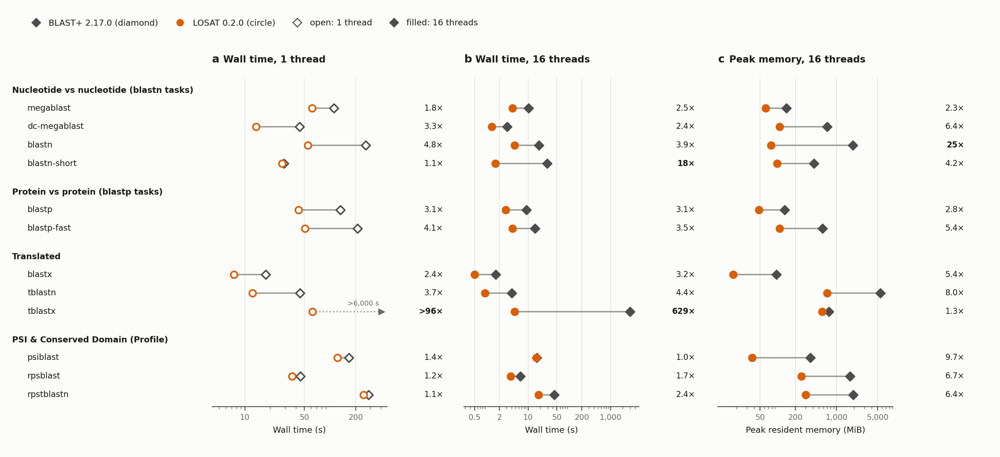
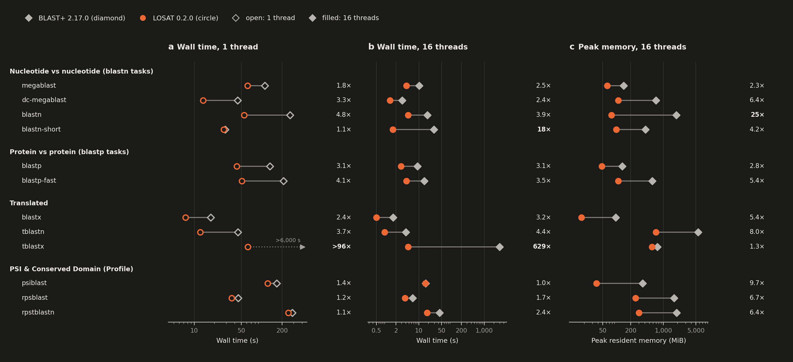
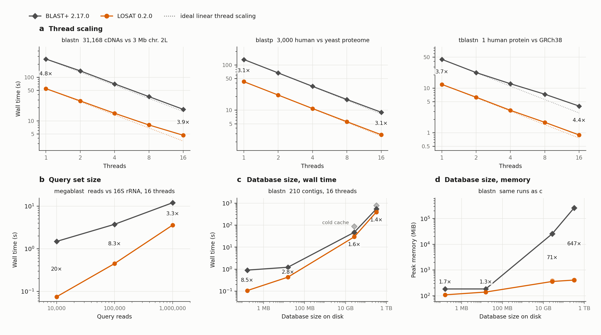
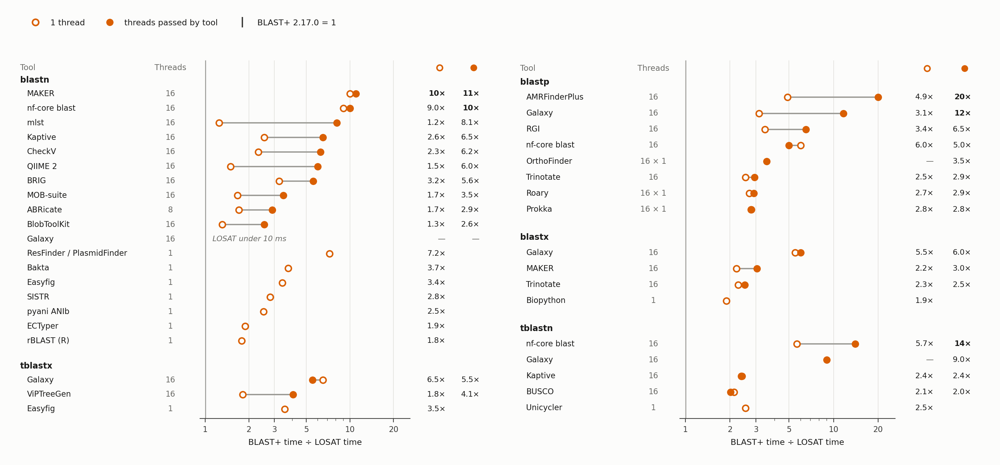
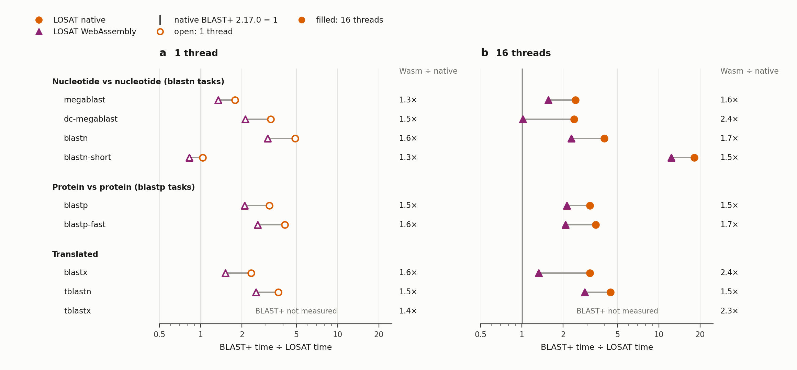

# Threads, speed and memory

## Summary (v0.2.0)

LOSAT v0.2.0 matches NCBI BLAST+ `2.17.0` output bytes across the release test suite while reducing wall time and peak resident memory (`RSS`) across nucleotide, protein, translated, PSI-BLAST, and CDD profile searches—with no C or C++ runtime dependencies.

| Highlight | Measured result (`losat` v0.2.0 vs NCBI BLAST+ `2.17.0`) |
| --- | --- |
| Standard searches (`16` threads) | `1.7×`–`18.3×` faster across `megablast`, `blastn`, `dc-megablast`, `blastn-short`, `blastp`, `blastp-fast`, `blastx`, `tblastn`, `rpsblast`, `rpstblastn` |
| Pairwise genome `tblastx` | `4.72 s` vs `2,970.75 s` at `16` threads (**`629×`** faster, byte-identical); `62.35 s` vs `>6,000 s` timeout at `1` thread |
| Large database memory (`core_nt`, `319.4 GB`) | **`407 MiB`** peak RSS vs **`263,594 MiB`** (**`647×`** less RAM); `391.74 s` warm vs `542.14 s` (`1.4×` faster) |
| Large prokaryotic DB (`ref_prok_rep_genomes`, `26.8 GB`) | **`358 MiB`** peak RSS vs **`25,580 MiB`** (**`71×`** less RAM); `29.37 s` vs `47.28 s` (`1.6×` faster) |
| Profile / CDD utilities (`1` thread) | `psiblast` **`14.2×`** less RAM (`28 MiB` vs `401 MiB`); `makeblastdb` `3.6×`–`3.9×` faster; `rpsbproc` **`2.0×`** faster (`5.3×` less RAM) |
| Downstream pipelines | Up to **`20×`** faster (`AMRFinderPlus`), **`14×`** (`nf-core/blast`), **`12×`** (`Galaxy`), **`11×`** (`MAKER`) |

## Threads

Every search program accepts `-num_threads N` (default `1`). LOSAT uses all requested threads for both kinds of search:

- **`-db`**: the database is searched in parallel across volumes and chunks, as in NCBI BLAST+.
- **`-subject`**: LOSAT also searches FASTA subjects using `N` threads (whereas NCBI BLAST+ runs `-subject` single-threaded and prints `'num_threads' is currently ignored when 'subject' is specified.`).

The output does not depend on thread count: the same command writes the exact same bytes at `1`, `2`, `4`, `8`, or `16` threads, matching single-threaded NCBI BLAST+ `2.17.0` on the release test suite.

`-mt_mode` is accepted for CLI compatibility and does not alter output bytes:
- `blastn`, `blastp`, `blastx`, `tblastn`: `0` (auto), `1` (split by queries), `2` (split by database).
- `rpsblast`, `rpstblastn`: `0` (split by database volumes), `1` (split by queries).
- `tblastx`, `psiblast`: no `-mt_mode`, matching NCBI BLAST+ `2.17.0`.

LOSAT does not clamp `-num_threads` to the host CPU count and prints no warning; choosing a value up to your physical core count works best.

## Memory

Memory footprint scales gently with query batch size and thread count rather than loading large database pages into process resident memory. On NCBI's `319.4 GB` `core_nt` database at `16` threads, LOSAT peaks at **`407 MiB` RSS** compared with **`263.6 GiB` RSS** for NCBI BLAST+ `2.17.0` (`647×` reduction).

If you run a very large query set on a tightly constrained machine:
- reduce `-num_threads` (which lowers per-worker scratch memory); or
- split a huge FASTA query file into smaller batches.

When memory allocation fails, LOSAT stops immediately; see [Differences from NCBI BLAST+](differences.md) for exit code details compared with NCBI's exit code `4`.

## Utilities and downstream tools

On single-threaded database builds and domain annotation (`Dual Xeon Gold 6338`):
- `makeblastdb` builds `16s_all` (`28,036` nucl seqs) in `0.193 s` (`9.0 MiB`) vs `0.691 s` (`52.0 MiB`, **`3.6×`**) and UniProtKB/Swiss-Prot (`575,748` prot seqs) in `2.197 s` (`16.0 MiB`) vs `8.537 s` (`58.4 MiB`, **`3.9×`**).
- `rpsbproc` annotates `4,300` *E. coli* query proteins (`-t both -m rep -f`) against CDD v3.22 in `1.309 s` (`62.0 MiB`) vs NCBI `rpsbproc 0.5.1`'s `2.610 s` (`331.0 MiB`, **`2.0×`** faster, `5.3×` less RAM, identical output bytes).

Running published pipelines on their official command lines and test datasets with LOSAT shims yields `1.8×`–`20×` speedups across BLAST stages with byte-identical outputs:

## WebAssembly

Both serial (`wasm32-wasip1`) and threaded (`wasm32-wasip1-threads`) WebAssembly builds produce identical output bytes to native runs (aside from the 15th printed digit of `psiblast` ASN.1 `informationContent` under WASI `libm`; see [Platforms and WebAssembly](platforms.md)). Under Node.js (`7f7db49c` paired runs), WASI execution adds only `1.3×`–`1.6×` overhead at `1` thread and `1.5×`–`2.4×` at `16` threads—keeping threaded Wasm runs `1.0×`–`12.3×` faster than native BLAST+ `2.17.0` on measured pairs:

For all 12 workload definitions (Table 1), per-round medians, hardware details, and reproduction scripts, see the full [v0.2.0 Benchmark Report](https://github.com/satoshikawato/LOSAT/blob/main/benchmarks/v0.2.0/README.md).
